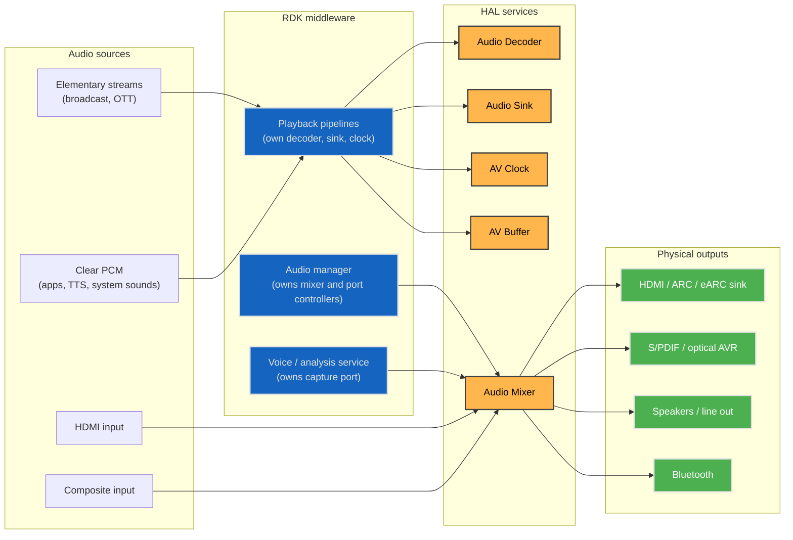
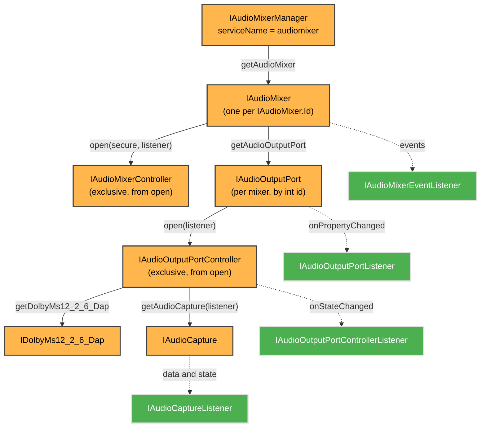
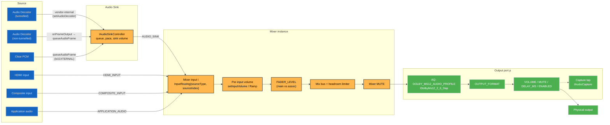
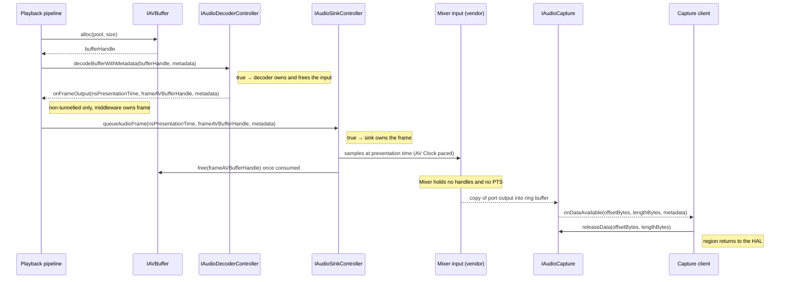
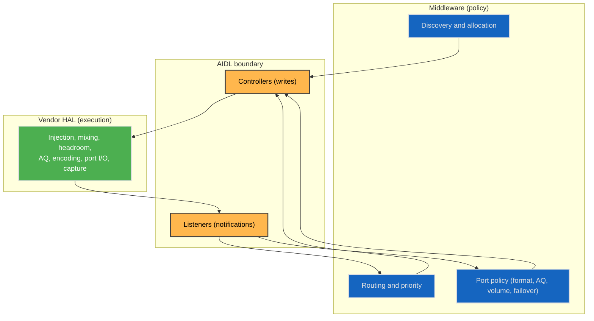
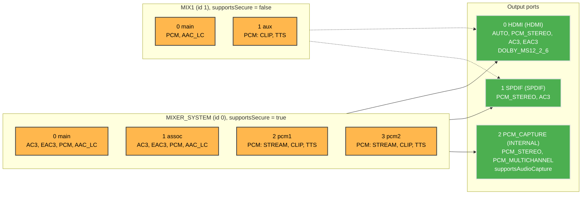

# Audio System Architecture

!!! info "References"
    |||
    |-|-|
    |**AudioMixer Interface**|[audiomixer/current](https://github.com/rdkcentral/rdk-halif-aidl/tree/develop/audiomixer/current/com/rdk/hal/audiomixer)|
    |**Platform profile**|[hfp-audiomixer.yaml](https://github.com/rdkcentral/rdk-halif-aidl/blob/develop/audiomixer/current/hfp-audiomixer.yaml)|
    |**Interface surface**|[AudioMixer HAL](audio_mixer.md)|
    |**Use cases**|[AudioMixer Use Cases](use_cases.md)|

## Summary

The RDK audio path is built from five HAL services. Audio Decoder decodes, Audio Sink paces PCM against an AV Clock, AV Buffer holds the data, and Audio Mixer combines up to N inputs per mixer instance and drives that instance's output ports. Middleware owns every policy decision: which resource serves which stream, which source feeds which mixer input, the balance between inputs, the format and AQ settings of each port, and what happens when a port disappears. The HAL executes those decisions and reports state through listeners.

The mixer exposes no buffers and no timestamps. Data reaches it through a routed source (an Audio Sink, an HDMI or Composite input, or application audio). It leaves through output ports, or through a shared-memory ring buffer for capture. Timing is owned upstream by Audio Sink and AV Clock.

Multi-playback is expressed as several `IAudioMixer` instances, each opened by one client with a fixed secure mode, plus per-input routing and volume within an instance. The HAL defines no priority or pre-emption model, so contention is resolved by the middleware audio manager. Platform differences are declared in `hfp-audiomixer.yaml` and surfaced through `getCapabilities()`, never through divergent APIs.

Interface additions that multi-playback needs are tracked in [#982 Task: audiomixer behaviour and additions for multi-playback](https://github.com/rdkcentral/rdk-halif-aidl/issues/982).

## Context

## Components

| Component | Responsibility |
|---|---|
| `IAudioMixerManager` | Lists the mounted mixers (`getAudioMixerIds()`), stable for the life of the process. |
| `IAudioMixer` | Read side of one mixer: capabilities, properties, current routing and codecs, output port enumeration, listener registration. |
| `IAudioMixerController` | Write side of one mixer: routing, per-input volume, mixer properties, start/stop/flush/discontinuity/end-of-stream. |
| `IAudioOutputPort` | Read side of one output port: capabilities, state, properties, listener registration. |
| `IAudioOutputPortController` | Write side of one port: port properties, and the only way to reach DAP and capture for that port. |
| `IDolbyMs12_2_6_Dap` | MS12 2.6 DAP runtime commands for the port it was obtained from. |
| `IAudioCapture` | Streams a copy of the port's output through a shared-memory ring buffer. |

The interface-by-interface surface, the mixer state machine and the capture lifecycle are in [AudioMixer HAL](audio_mixer.md).

## Assumptions and Constraints

- **One writer per mixer.** `IAudioMixer.open()` throws `EX_ILLEGAL_STATE` unless the mixer is `CLOSED`, so a single client (the audio manager) holds each `IAudioMixerController`. Any number of observers may attach with `registerEventListener()`.
- **One writer per port.** `IAudioOutputPort.open()` throws `EX_ILLEGAL_STATE` while another client holds the controller. DAP and capture are reachable only through that controller, so the port owner also owns that port's AQ settings and capture.
- **Secure mode is fixed per session.** It is chosen in `IAudioMixer.open(secure, …)`. Changing it means `stop()`, `close()` and `open()` again. The AIDL does not say whether a mixer opened with `secure = true` accepts non-secure sources.
- **Mixer-to-port topology is fixed.** Each mixer reports its own ports through `getAudioOutputPortIds()`, and no call connects a mixer to a different port. "Rerouting" an output means changing port properties (`ENABLED`, `MUTE`, `VOLUME`) on ports that the mixer already drives.
- **Only `MixingMode.NORMAL` is specified.** The other `MixingMode` values have no defined semantics, so priority between inputs is expressed with per-input volume (`setInputVolumeRamp()`), not with `MIXING_MODE`.
- **Crash cleanup is implicit.** If a controller's client dies, the HAL performs `stop()` and `close()` on a mixer, and `close()` on a port.

## End-to-End Data Flow

### Source to mixer input

A mixer input is selected by array position in `IAudioMixerController.setInputRouting(InputRouting[])`: `routing[i]` configures input `i`, and input `i` is described by `Capabilities.inputs[i]` (`MixerInput.supportedCodecs`, `supportedContentTypes`, `name`). `AudioSourceType.NONE` disconnects an input. An input already mapped to a different source must be disconnected before it is remapped, otherwise the call returns `false`.

| Path | Source side | Mixer routing |
|---|---|---|
| Tunnelled decode | `IAudioDecoder.open(codec, secure, …)` with `getCurrentOperationalMode() == TUNNELLED`; the sink is bound with `IAudioSinkController.setAudioDecoder(decoderId)` and decoded audio moves decoder → sink inside the vendor layer. | `{AUDIO_SINK, sinkIndex}` |
| Non-tunnelled decode | Decoder returns PCM handles in `onFrameOutput()`; middleware queues them with `IAudioSinkController.queueAudioFrame()`. | `{AUDIO_SINK, sinkIndex}` |
| Clear PCM | Middleware fills an AV Buffer and queues it on a sink bound to `IAudioDecoder.Id.EXTERNAL`. | `{AUDIO_SINK, sinkIndex}` |
| HDMI input | No decoder or sink. | `{HDMI_INPUT, hdmiPort}` |
| Composite input | No decoder or sink. | `{COMPOSITE_INPUT, port}` |
| Application audio | No decoder or sink. | `{APPLICATION_AUDIO, index}` |

The AIDL does not define what produces `APPLICATION_AUDIO` or how its `sourceIndex` is allocated. The sink side of each path is specified in [Audio Sink](../audiosink/audio_sink.md) and [Audio Decoder](../audiodecoder/audio_decoder.md).

### Mixing

Per-input volume, `FADER_LEVEL`, the headroom guarantee and mute are specified in [AudioMixer HAL — Mixing, Volume, and Ducking](audio_mixer.md#mixing-volume-and-ducking). `setInputVolumeRamp()` is the only attenuation control that works on every source type, including HDMI and Composite inputs that bypass the Audio Sink.

### Output port to physical output

Every port of a mixer receives that mixer's mix. Per port, middleware sets `OUTPUT_FORMAT` (`PCM_STEREO`, `PCM_MULTICHANNEL`, `AC3`, `EAC3`, `MAT`, `TRUEHD`, `DTS`, `DTS_HD`, `PASSTHROUGH` or `AUTO`), AQ processing, `VOLUME`, `MUTE`, `DELAY_MS` and `ENABLED`, each only if listed in `OutputPortCapabilities.supportedProperties` and `supportedOutputFormats`. Encoding to AC3 or EAC3 is selected through `OUTPUT_FORMAT`; there is no separate transcode property. The AIDL does not define the order in which a port applies AQ, encoding, volume and delay.

`OutputFormat.PASSTHROUGH` carries a compressed bitstream to the port unchanged. The AIDL does not say which mixer input supplies the bitstream when several inputs carry compressed audio, nor how other inputs are treated on that port.

## Timing and Buffer Ownership

| Stage | Owner | Rule |
|---|---|---|
| Compressed input buffer | Middleware until `decodeBufferWithMetadata()` returns `true`, then the decoder | [Audio Decoder](../audiodecoder/audio_decoder.md) |
| Decoded frame (non-tunnelled) | Middleware from `onFrameOutput()` until `queueAudioFrame()` returns `true`, then the sink | [Audio Sink — Audio Buffers](../audiosink/audio_sink.md#audio-buffers) |
| Decoded audio (tunnelled) | Vendor layer throughout; `frameAVBufferHandle` is `-1` | [Audio Decoder](../audiodecoder/audio_decoder.md) |
| Mixer inputs, mix bus, port output | Vendor layer; no handle crosses the AIDL | — |
| Capture ring buffer | HAL owns the ring from `getSharedMemory()` to `releaseSharedMemory()`; each region signalled by `onDataAvailable()` is lent to the client until `releaseData()` with the same tuple | [AudioMixer HAL — Shared-Memory Offset/Length Usage](audio_mixer.md#shared-memoryoffsetlength-usage) |

Presentation timing exists only upstream of the mixer. Audio Sink consumes frames at `nsPresentationTime` against the AV Clock bound with `attachClock()`, and the clock's `ClockMode` (`AUTO`, `PCR`, `AUDIO_MASTER`, `VIDEO_MASTER`) selects the timebase; see [AV Clock](../avclock/av_clock.md). Downstream of the sink the AIDL exposes these timing values:

| Value | Where | Meaning |
|---|---|---|
| `Property.LATENCY_MS` | `IAudioMixer.getProperty()` | Current mixer latency, ms, read-only. |
| `OutputPortProperty.DELAY_MS` | port | Added output delay, ms, range implementation-defined. |
| `OutputPortProperty.METRIC_UNDERFLOWS` / `METRIC_OVERFLOWS` | port | Starvation and overrun counts since the port was enabled. |
| `AudioCaptureData.timestampUs` | capture | Monotonic system clock, µs, per captured frame. |

The AIDL does not say whether AV Clock compensates for `LATENCY_MS` or `DELAY_MS` when aligning audio with video. `IAudioMixerController.signalDiscontinuity()` tells the mixer that input PTS or format has broken (source switch, seek); `flush(reset)` discards buffered mixer data; `signalEndOfStream()` drains all inputs and returns the mixer to `READY`.

## Middleware / HAL Responsibility Split

| Responsibility | Owner | Mechanism |
|---|---|---|
| Resource discovery | Middleware | `IAudioMixerManager.getAudioMixerIds()`, `IAudioMixer.getAudioOutputPortIds()`, `getCapabilities()` on mixer and port |
| Mixer selection and secure mode | Middleware | `IAudioMixer.open(secure, listener)` |
| Source → mixer input | Middleware | `IAudioMixerController.setInputRouting()` |
| Source priority, ducking | Middleware | `setInputVolume()`, `setInputVolumeRamp()` |
| Main / associated balance | Middleware | `setProperty(FADER_LEVEL, …)` |
| Per-stream volume (sink-fed sources) | Middleware | `IAudioSinkController.setVolume()`, `setVolumeRamp()` |
| Output format per port | Middleware | `IAudioOutputPortController.setProperty(OUTPUT_FORMAT, …)` |
| AQ profile and DAP settings per port | Middleware | `setProperty(DOLBY_MS12_AUDIO_PROFILE, …)`, `IDolbyMs12_2_6_Dap` |
| Master volume, mute, delay, enable per port | Middleware | `setProperty(VOLUME / MUTE / DELAY_MS / ENABLED, …)` |
| Failover when a port disconnects | Middleware | Reacts to `onPropertyChanged(CONNECTION_STATE, …)` |
| Stream injection and pacing | HAL | Audio Sink and AV Clock |
| Mixing and clipping prevention | HAL | Vendor implementation |
| AQ processing, encoding, port output | HAL | Vendor implementation |
| Capture | HAL produces, client consumes | `IAudioCapture`, `IAudioCaptureListener` |
| Client-crash cleanup | HAL | Implicit `stop()` / `close()` on binder death |

Notifications from HAL to middleware:

| Event | Listener | Fires when |
|---|---|---|
| `onStateChanged(oldState, newState)` | `IAudioMixerEventListener` | Mixer lifecycle transition |
| `onInputCodecChanged(inputIndex, codec, contentType)` | `IAudioMixerEventListener` | Codec or content type on an input changes |
| `onError(errorCode, message)` | `IAudioMixerEventListener` | Mixer runtime error |
| `onPropertyChanged(property, newValue)` | `IAudioOutputPortListener` | Any port property changes, including `CONNECTION_STATE`, `OUTPUT_FORMAT`, `SUPPORTED_AUDIO_FORMATS`, `DOLBY_ATMOS_SUPPORT` |
| `onStateChanged(oldState, newState)` | `IAudioOutputPortControllerListener` | Port open / close transition |
| `onStarted()`, `onStopped()`, `onDataAvailable()`, `onError(AudioCaptureError, message)` | `IAudioCaptureListener` | Capture session events |

No event reports a routing change, a resource becoming free, or the end of a mixer drain other than the `READY` state transition. `errorCode` in `IAudioMixerEventListener.onError()` has no defined enumeration.

## Multi-Playback and Multi-View

### Reference topology

The reference profile in `hfp-audiomixer.yaml` declares two mixers and three ports:

The profile declares `outputPorts` once, not per mixer. The AIDL does not say whether two mixers that report the same port id share one `IAudioOutputPort` (and so one controller), nor how two mixers' outputs combine on one physical port; the dashed links show that assumption is unresolved.

### Scenarios

| Scenario | Mixers | Inputs used | Use case |
|---|---|---|---|
| Single OTT stream | `MIXER_SYSTEM`, non-secure | main | [UC-AM-01 Stream playback](use_cases.md#uc-am-01-stream-playback) |
| Broadcast with audio description | `MIXER_SYSTEM`, secure | main + assoc, `FADER_LEVEL` | [UC-AM-02 Broadcast routing with audio description](use_cases.md#uc-am-02-broadcast-routing-with-audio-description) |
| Stream plus system tone or TTS | `MIXER_SYSTEM` | main + pcm1, ducking | [UC-AM-05 Multi-source mix](use_cases.md#uc-am-05-multi-source-mix) |
| HDMI input to outputs | `MIXER_SYSTEM` | main from `HDMI_INPUT` | [UC-AM-07 HDMI input routing](use_cases.md#uc-am-07-hdmi-input-routing) |
| Multi-view audio follow | `MIXER_SYSTEM` | main swapped between two sinks, or main + pcm1 | [UC-AM-08 Multi-view audio switch](use_cases.md#uc-am-08-multi-view-audio-switch) |
| Secure broadcast plus non-secure app | `MIXER_SYSTEM` secure and `MIX1` non-secure | one per mixer | [UC-AM-09 Concurrent mixers and contention](use_cases.md#uc-am-09-concurrent-mixers-and-contention) |
| Capture during playback | `MIXER_SYSTEM` | port 2 capture | [UC-AM-03 Capture of the output mix](use_cases.md#uc-am-03-capture-of-the-output-mix) |

### Coordinating mixer instances

Each mixer is an independent session with its own controller, secure mode, routing, properties and ports. Secure and non-secure content run concurrently by opening one mixer of each kind (`MIXER_SYSTEM` with `secure = true`, `MIX1` with `secure = false` in the reference profile). The AIDL does not say whether one source (for example sink 0) may be routed to inputs on two mixers at once.

### Multi-view

Multi-view runs one decoder → sink chain per view against a shared AV Clock and routes the chain whose audio is wanted. Because an unrouted sink keeps consuming at clock rate ([Audio Sink — Audio Mixer Input Routing](../audiosink/audio_sink.md#audio-mixer-input-routing)), switching the audible view is a routing change: disconnect the old sink with `NONE`, then route the new one. Hearing two views at once uses two inputs of one mixer, balanced with `setInputVolume()`.

### Contention, priority and pre-emption

| Request | HAL response |
|---|---|
| Second `IAudioMixer.open()` on a mixer already open | `EX_ILLEGAL_STATE` |
| `open(secure = true)` on a mixer with `supportsSecure = false` | `null` |
| Second `IAudioOutputPort.open()` on a held port | `EX_ILLEGAL_STATE` |
| `setInputRouting()` naming the same source twice | `false` |
| `setInputRouting()` remapping an input that already has a different source | `false` |
| `getAudioMixer()` on a defined `IAudioMixer.Id` that is not mounted | `null` |

The HAL arbitrates nothing beyond these rejections. Which stream wins, when a stream is pre-empted, and how much a background input is attenuated are middleware decisions, carried out with routing and per-input volume.

## Platform Consistency

`hfp-audiomixer.yaml` declares each platform's mixers and ports. Runtime queries must return what the profile declares:

| HFP key | Runtime query |
|---|---|
| `resources[].id` | `IAudioMixerManager.getAudioMixerIds()` |
| `resources[].supportsSecure` | `Capabilities.supportsSecure` |
| `resources[].supportedProperties` | `Capabilities.supportedProperties` |
| `resources[].inputs[]` (order, `name`, codecs, content types) | `Capabilities.inputs[]` |
| `outputPorts[].id` | `IAudioMixer.getAudioOutputPortIds()` |
| `outputPorts[].portName`, `portType` | `OutputPortCapabilities.portName`, `portType` |
| `outputPorts[].supportedProperties`, `supportedOutputFormats` | `OutputPortCapabilities.supportedProperties`, `supportedOutputFormats` |
| `outputPorts[].supportedAQProcessors[].id` | `OutputPortCapabilities.supportedAQProcessors` |
| `outputPorts[].supportedAQProcessors[].setFunctions.*.supports*` | `IDolbyMs12_2_6_Dap.getCapabilities()` |
| `outputPorts[].dolbyMs12AudioProfiles` | `OutputPortCapabilities.dolbyMs12AudioProfiles` |
| `outputPorts[].supportsAudioCapture` | `OutputPortCapabilities.supportsAudioCapture` |

Three profile keys have no runtime query: `resources[].supportedSourceTypes`, `outputPorts[].supportedChannelLayouts` and the `range` / `default` values under `setFunctions`. Conformance tests read these from the profile.

Rules that hold on every SoC:

- Middleware branches on `OutputPortType`, never on `portName`.
- An operation on a property, format, AQ processor or DAP function the profile does not declare fails the way the AIDL specifies (`false`, `EX_ILLEGAL_ARGUMENT` or `EX_UNSUPPORTED_OPERATION`); it is never silently ignored.
- Vendor differences are expressed in the profile, or in `OutputPortProperty.VENDOR_EXTENSION`, never in a different call sequence.
- Each scenario in [AudioMixer Use Cases](use_cases.md) is a conformance scenario, run against the platform's own profile.
