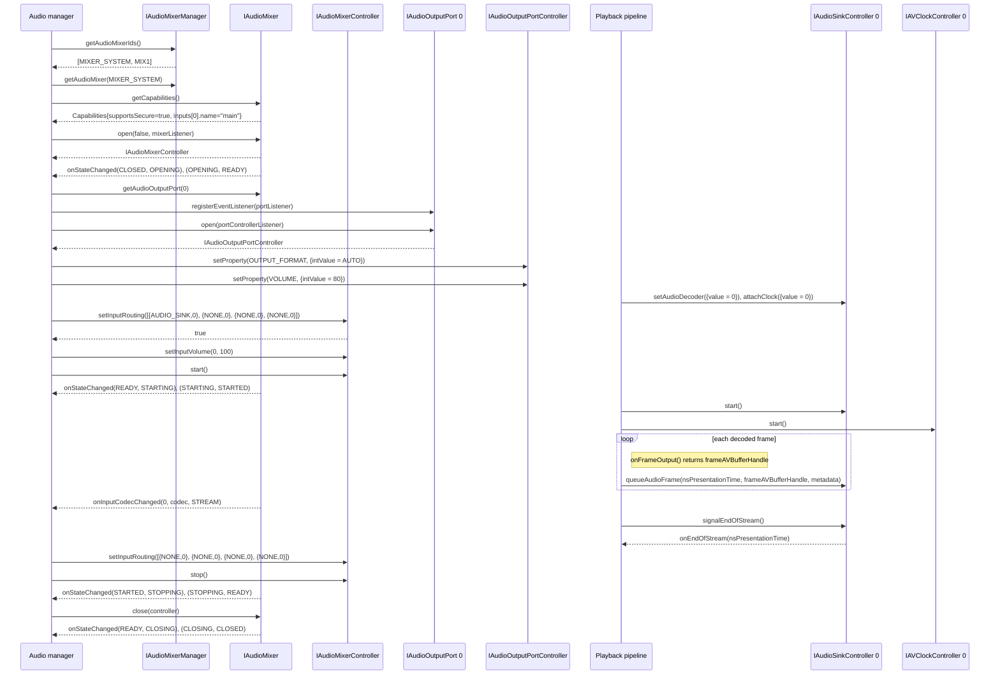
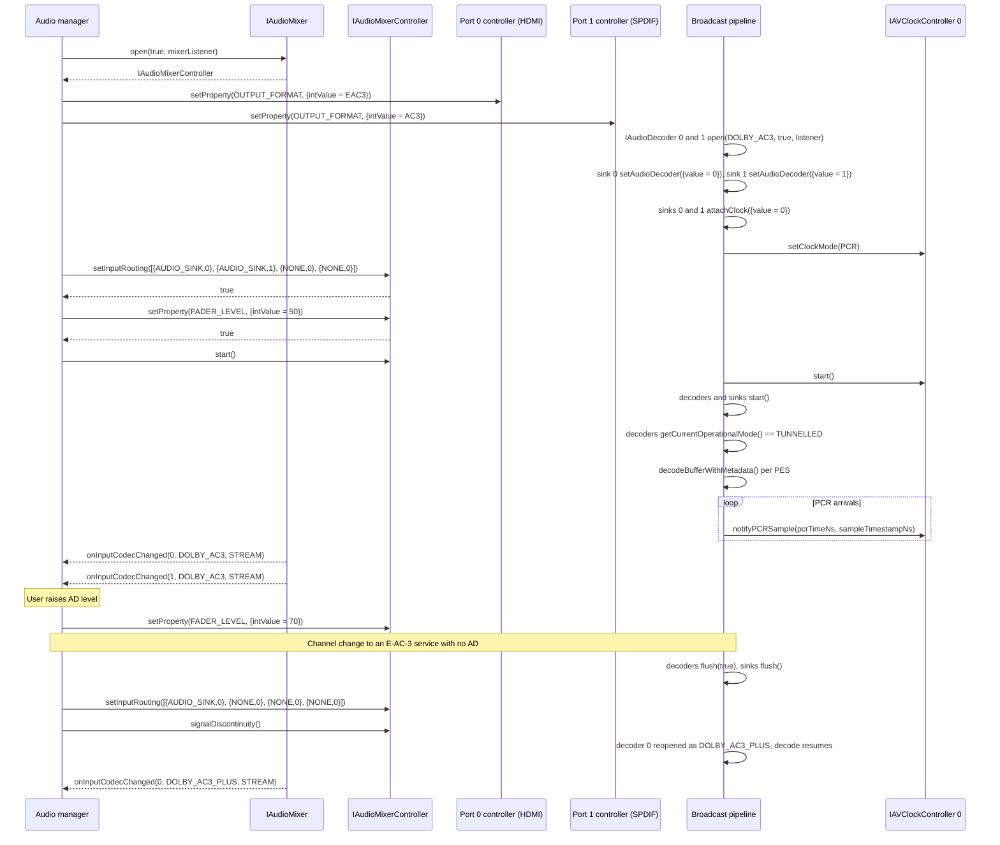
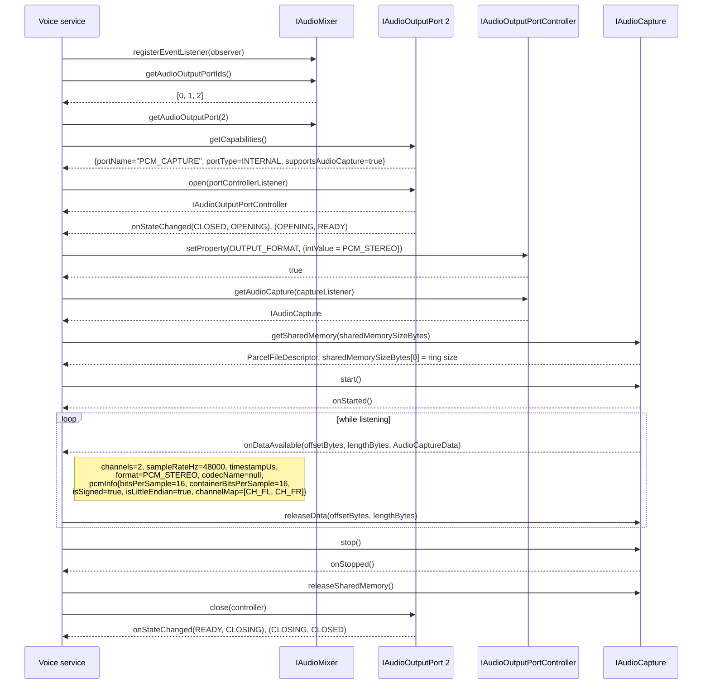
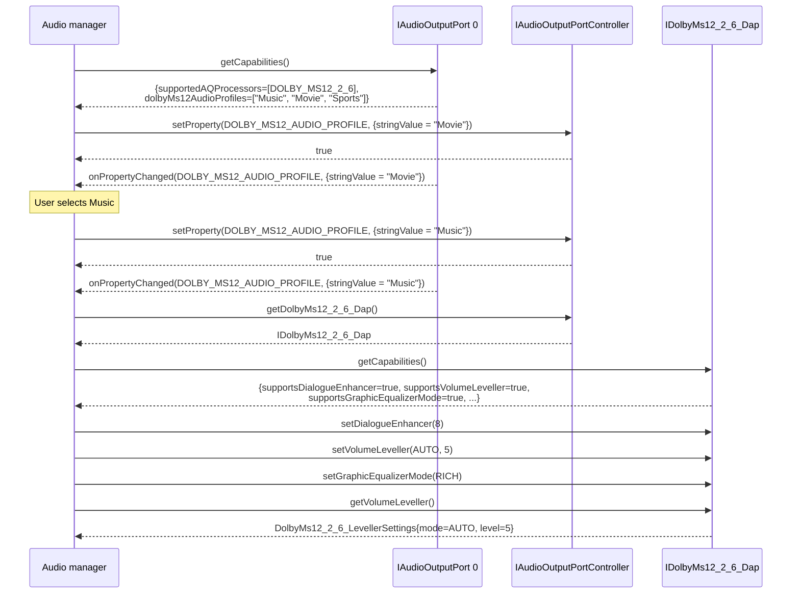
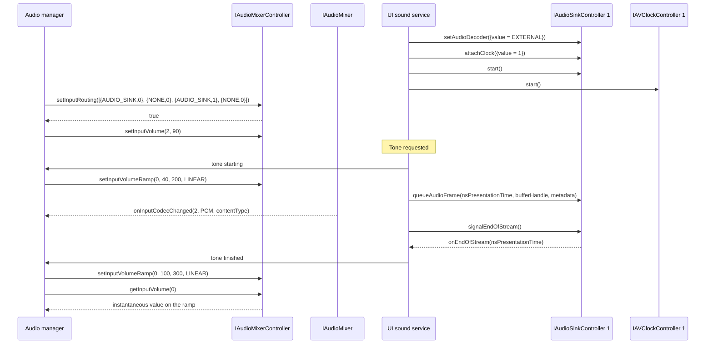
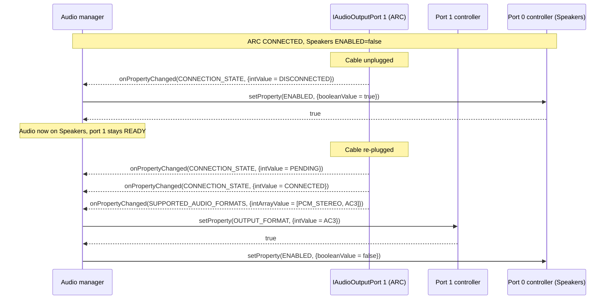
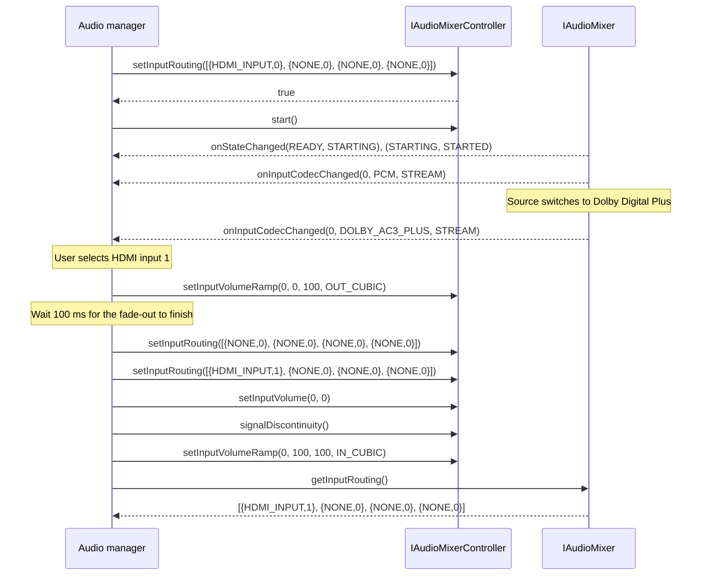
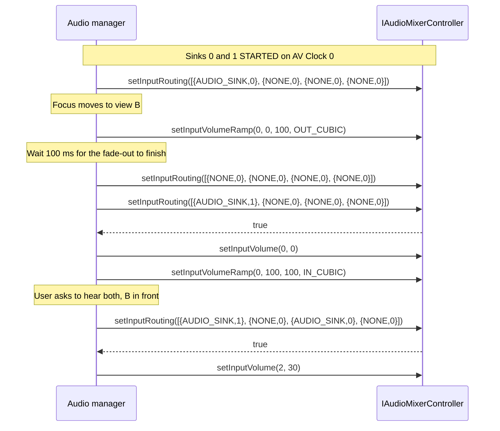
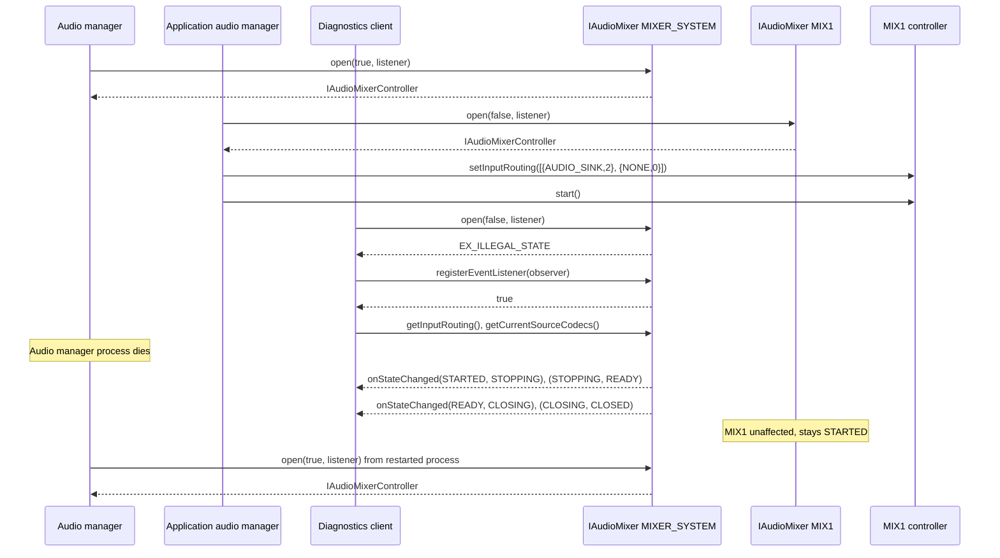

# AudioMixer Use Cases

Each use case is a conformance scenario. Test plans refer to it by its `UC-AM-nn` heading. The architecture behind them is in [Audio System Architecture](audio_system_architecture.md), and the interface surface is in [AudioMixer HAL](audio_mixer.md).

## Conventions

- **Platform.** Values come from the reference `hfp-audiomixer.yaml`: `MIXER_SYSTEM` (secure-capable, inputs `0 main`, `1 assoc`, `2 pcm1`, `3 pcm2`), `MIX1` (non-secure, inputs `0 main`, `1 aux`), ports `0 HDMI`, `1 SPDIF`, `2 PCM_CAPTURE`. A use case that needs other ports states its profile fragment.
- **Routing.** `{AUDIO_SINK, 0}` is `InputRouting{sourceType = AUDIO_SINK, sourceIndex = 0}`. The examples pass one entry per mixer input. The AIDL does not say whether repeated `{NONE, 0}` entries count as duplicate sources, or what a shorter array does to the inputs it omits.
- **Property values.** `{intValue = 80}` is a `PropertyValue` whose `value` union holds `intValue = 80`; likewise `booleanValue`, `stringValue`, `intArrayValue`.
- **Resource ids.** `{value = 0}` is an `IAudioSink.Id`, `IAudioDecoder.Id` or `IAVClock.Id` parcelable with `value = 0`.
- **Actors.** The *audio manager* is the middleware component that holds the mixer and port controllers. A *playback pipeline* holds the Audio Decoder, Audio Sink and AV Clock controllers for one stream.
- **State events.** "open events" means `onStateChanged(CLOSED, OPENING)` then `onStateChanged(OPENING, READY)`; "start events" `(READY, STARTING)` then `(STARTING, STARTED)`; "stop events" `(STARTED, STOPPING)` then `(STOPPING, READY)`; "close events" `(READY, CLOSING)` then `(CLOSING, CLOSED)`.

## UC-AM-01 Stream playback

**Scenario.** One non-secure OTT stream (AAC-LC) decoded by a HAL Audio Decoder in non-tunnelled mode, mixed on `MIXER_SYSTEM` input 0 and played on HDMI.

**Actors.**

1. Audio manager: `IAudioMixerManager` → `IAudioMixer(MIXER_SYSTEM)` → `open()`; `IAudioOutputPort(0)` → `open()`.
2. Playback pipeline: `IAudioDecoder` 0, `IAudioSink` 0, `IAVClock` 0.
3. Audio manager routes sink 0 and starts the mixer before the pipeline starts.

**Expected events.**

| When | Listener | Event |
|---|---|---|
| `IAudioMixer.open()` | `IAudioMixerEventListener` | open events |
| `IAudioOutputPort.open()` | `IAudioOutputPortControllerListener` | open events |
| `setProperty(OUTPUT_FORMAT, …)` changes the value | `IAudioOutputPortListener` | `onPropertyChanged(OUTPUT_FORMAT, …)` |
| `start()` | `IAudioMixerEventListener` | start events |
| First audio on input 0 | `IAudioMixerEventListener` | `onInputCodecChanged(0, codec, STREAM)` |
| `stop()`, `close()` | `IAudioMixerEventListener` | stop events, close events |

The AIDL does not say whether `onInputCodecChanged()` reports `PCM` or the stream's source codec for a sink-fed input. It does not say whether `getProperty(OUTPUT_FORMAT)` returns the configured `AUTO` or the resolved format.

**Failure modes.**

| Trigger | Expected |
|---|---|
| `open()` on a mixer that another client holds | `EX_ILLEGAL_STATE` |
| `open(…, null)` | `EX_NULL_POINTER` |
| `start()` while `STARTED` | `EX_ILLEGAL_STATE` |
| `close()` while `STARTED` | `EX_ILLEGAL_STATE` |
| `setInputVolume(4, 50)` on a 4-input mixer, or `setInputVolume(0, 101)` | `EX_ILLEGAL_ARGUMENT` |
| `setInputVolume(1, 50)` with input 1 unrouted | `false` |
| `getAudioMixer()` with an integer outside `IAudioMixer.Id` | `EX_ILLEGAL_ARGUMENT` |
| Audio manager process dies while `STARTED` | HAL calls `stop()` and `close()`; an observer registered with `registerEventListener()` sees stop and close events; a new `open()` succeeds |

## UC-AM-02 Broadcast routing with audio description

**Scenario.** A secure broadcast service with main audio and an audio-description (AD) track, both Dolby AC-3, decoded in tunnelled mode, mixed on `MIXER_SYSTEM` inputs `main` and `assoc`, balanced with `FADER_LEVEL`. HDMI carries E-AC-3 and S/PDIF carries AC-3. The user then changes channel.

**Actors.**

1. Audio manager: opens `MIXER_SYSTEM` with `secure = true`; opens ports 0 and 1.
2. Broadcast pipeline: Audio Decoders 0 (main) and 1 (AD), Audio Sinks 0 and 1, AV Clock 0 in `PCR` mode shared by both sinks.
3. Routing is set before `start()`; the pipeline starts after the mixer.

**Expected events.**

| When | Listener | Event |
|---|---|---|
| `open(true, …)` | `IAudioMixerEventListener` | open events |
| `start()` | `IAudioMixerEventListener` | start events |
| Main and AD audio arrive | `IAudioMixerEventListener` | `onInputCodecChanged(0, DOLBY_AC3, STREAM)`, `onInputCodecChanged(1, DOLBY_AC3, STREAM)` |
| New service decodes | `IAudioMixerEventListener` | `onInputCodecChanged(0, DOLBY_AC3_PLUS, STREAM)` |
| `signalDiscontinuity()` | — | No state change; the mixer stays `STARTED` |

**Failure modes.**

| Trigger | Expected |
|---|---|
| `MIX1.open(true, …)` (`supportsSecure = false`) | `null` |
| `setProperty(FADER_LEVEL, {intValue = 101})` | `false`, level unchanged |
| `setProperty(FADER_LEVEL, {booleanValue = true})` | `EX_ILLEGAL_ARGUMENT` |
| `setProperty(FADER_LEVEL, …)` on `MIX1` (not in `supportedProperties`) | `false` |
| `setInputRouting([{AUDIO_SINK,0}, {AUDIO_SINK,0}, …])` | `false` |
| `signalDiscontinuity()` while `READY` | `EX_ILLEGAL_STATE` |
| `setProperty(OUTPUT_FORMAT, {intValue = MAT})` on SPDIF (not in `supportedOutputFormats`) | `false` |
| AD stream removed mid-programme; input 1 set to `NONE` | Main continues uninterrupted on input 0 |

## UC-AM-03 Capture of the output mix

**Scenario.** A voice service captures the stereo mix from the dedicated capture port while UC-AM-01 is playing, as the echo-cancellation reference for hot-word detection. The microphone path is outside the Audio Mixer HAL.

**Actors.**

1. Audio manager: holds `MIXER_SYSTEM` in `STARTED` (UC-AM-01).
2. Voice service: `IAudioMixer(MIXER_SYSTEM)` (read side, observer) → `IAudioOutputPort(2)` → `open()` → `getAudioCapture()`.

**Expected events.**

| When | Listener | Event |
|---|---|---|
| `IAudioOutputPort.open()` | `IAudioOutputPortControllerListener` | open events |
| `start()` | `IAudioCaptureListener` | `onStarted()`, then repeated `onDataAvailable()` |
| Each captured frame | `IAudioCaptureListener` | `onDataAvailable(offsetBytes, lengthBytes, metadata)` with `metadata.format = PCM_STEREO` and `pcmInfo.channelMap = [CH_FL, CH_FR]` |
| `stop()` | `IAudioCaptureListener` | `onStopped()`; no further `onDataAvailable()` |
| `close()` | `IAudioOutputPortControllerListener` | close events |

**Failure modes.**

| Trigger | Expected |
|---|---|
| `getAudioCapture()` on port 0 (`supportsAudioCapture = false`) | `EX_UNSUPPORTED_OPERATION` |
| `getAudioCapture(null)` | `EX_NULL_POINTER` |
| `IAudioOutputPort.open()` on port 2 while another client holds it | `EX_ILLEGAL_STATE` |
| `start()` before `getSharedMemory()` | `EX_ILLEGAL_STATE` |
| `getSharedMemory()` or `releaseSharedMemory()` while started | `EX_ILLEGAL_STATE` |
| `releaseData()` with an offset or length that does not match a callback | `EX_ILLEGAL_ARGUMENT` |
| Client stops calling `releaseData()` until the ring fills | `onError(ERROR_OVERFLOW, message)`; new data is dropped |
| `setProperty(OUTPUT_FORMAT, {intValue = AC3})` on port 2 | `false` |
| `onDataAvailable()` region wraps past `sharedMemorySizeBytes` | Client reads two segments as in [Shared-Memory Offset/Length Usage](audio_mixer.md#shared-memoryoffsetlength-usage) |

The AIDL does not say what capture delivers while the mixer is not `STARTED`, which of the profile's `supportedChannelLayouts` a `PCM_MULTICHANNEL` capture uses, or what happens to an `IAudioCapture` when its port controller is closed.

## UC-AM-04 AQ processor reconfiguration at runtime

**Scenario.** While UC-AM-01 plays on HDMI, the user changes the sound mode from Movie to Music and then adjusts dialogue enhancement, volume levelling and graphic EQ through Dolby MS12 2.6 DAP.

**Actors.**

1. Audio manager: holds the port 0 controller from UC-AM-01; obtains `IDolbyMs12_2_6_Dap` from it.

**Expected events.**

| When | Listener | Event |
|---|---|---|
| Profile write changes the value | `IAudioOutputPortListener` | `onPropertyChanged(DOLBY_MS12_AUDIO_PROFILE, {stringValue = …})` |
| DAP setters | — | None; read back with the matching getter |
| Throughout | `IAudioMixerEventListener` | No state change; the mixer stays `STARTED` |

**Failure modes.**

| Trigger | Expected |
|---|---|
| `setProperty(DOLBY_MS12_AUDIO_PROFILE, {stringValue = "Cinema"})` (not in `dolbyMs12AudioProfiles`) | `false`, profile unchanged |
| `setProperty(DOLBY_MS12_AUDIO_PROFILE, {intValue = 1})` | `EX_ILLEGAL_ARGUMENT` |
| `getDolbyMs12_2_6_Dap()` on port 1 (`supportedAQProcessors = [UNDEFINED]`) | `EX_UNSUPPORTED_OPERATION` |
| `setDialogueEnhancer(13)`, `setSurroundVirtualizer(MANUAL, 97)`, `setPostGain(500.0)` | `EX_ILLEGAL_ARGUMENT` |
| A setter whose `supports*` capability is `false` | `EX_UNSUPPORTED_OPERATION` |
| `setAtmosLock(true)`, then port `close()` and `open()` | `getAtmosLock()` still returns `true` |

`OutputPortCapabilities.supportedAQProcessors` names a default processor (the first entry) but no property or method selects another, so swapping processors (for example `DOLBY_MS12_2_6` to `DTS_ULTRA`) at runtime is not expressible, and `DTS_ULTRA` has no runtime command interface ([#448 Task: audiomixer - add DTS AQ Processor Settings](https://github.com/rdkcentral/rdk-halif-aidl/issues/448)). How processors are selected, and whether each keeps a typed interface like `IDolbyMs12_2_6_Dap` or all share one generic parameter model, is decided by [#840 Trade study: typed per-processor AQ interfaces vs a generic AQ parameter model](https://github.com/rdkcentral/rdk-halif-aidl/issues/840); this use case shows the typed MS12 interface the AIDL has today. The AIDL does not say whether a profile change resets DAP settings, or whether an `IDolbyMs12_2_6_Dap` stays usable after its port controller is closed.

## UC-AM-05 Multi-source mix

**Scenario.** A system tone plays over the UC-AM-01 stream. The tone is clear PCM on its own sink, routed to `pcm1`, and the main input is ducked for its duration.

**Actors.**

1. Audio manager: holds `MIXER_SYSTEM` in `STARTED` with sink 0 on input 0.
2. UI sound service: `IAudioSink` 1 bound to `IAudioDecoder.Id.EXTERNAL`, `IAVClock` 1 in `AUTO`.
3. The tone sink is routed at setup, so triggering a tone needs no routing change.

**Expected events.**

| When | Listener | Event |
|---|---|---|
| Tone audio reaches input 2 | `IAudioMixerEventListener` | `onInputCodecChanged(2, PCM, contentType)` |
| Tone queue drained | `IAudioSinkControllerListener` (sink 1) | `onEndOfStream(nsPresentationTime)` |
| Throughout | `IAudioMixerEventListener` | No state change |

The AIDL does not define how an Audio Sink `ContentType` (`SONIFICATION`, `SPEECH`, …) maps to the mixer `ContentType` (`CLIP`, `TTS`, `STREAM`) that `onInputCodecChanged()` reports. Mixing and ducking semantics are in [AudioMixer HAL — Mixing, Volume, and Ducking](audio_mixer.md#mixing-volume-and-ducking).

**Failure modes.**

| Trigger | Expected |
|---|---|
| `setInputVolumeRamp(0, 40, 0, LINEAR)` | `EX_ILLEGAL_ARGUMENT` |
| `setInputVolumeRamp(…)` while the mixer is `READY` | `EX_ILLEGAL_STATE` |
| `setInputVolumeRamp(3, 40, 200, LINEAR)` with input 3 unrouted | `false` |
| Second ramp on input 0 before the first completes | First ramp stops at its instantaneous volume; the second starts from there |
| Inputs 0 and 2 both at 100 with full-scale content | Output on capture port 2 stays within full scale |
| `setInputVolume(2, 0)` | Input 0 keeps its level (no auto-scale-up) |
| `setInputRouting([{AUDIO_SINK,1}, {NONE,0}, {AUDIO_SINK,1}, {NONE,0}])` | `false` |

## UC-AM-06 Output reroute on port disconnect

**Scenario.** A TV plays through an ARC soundbar with the built-in speakers disabled. The ARC cable is unplugged, so the speakers take over; when it is re-plugged, ARC is restored with the new sink's formats.

The profile fragment this use case assumes:

| Port | `portType` | `supportedProperties` | `supportedOutputFormats` |
|---|---|---|---|
| 0 `Speakers` | `SPEAKERS` | `VOLUME`, `MUTE`, `ENABLED` | `PCM_STEREO` |
| 1 `ARC` | `ARC` | `VOLUME`, `MUTE`, `ENABLED`, `OUTPUT_FORMAT`, `CONNECTION_STATE`, `SUPPORTED_AUDIO_FORMATS`, `METRIC_UNDERFLOWS`, `METRIC_OVERFLOWS` | `AUTO`, `PCM_STEREO`, `AC3`, `EAC3` |

**Actors.**

1. Audio manager: holds `MIXER_SYSTEM` in `STARTED`, both port controllers, and an `IAudioOutputPortListener` on port 1.

**Expected events.**

| When | Listener | Event |
|---|---|---|
| Unplug | `IAudioOutputPortListener` | `onPropertyChanged(CONNECTION_STATE, {intValue = DISCONNECTED})` |
| Re-plug | `IAudioOutputPortListener` | `CONNECTION_STATE` `PENDING` then `CONNECTED`; `SUPPORTED_AUDIO_FORMATS` if the set changed |
| New sink lacks the configured format | `IAudioOutputPortListener` | `onPropertyChanged(OUTPUT_FORMAT, …)` after fallback to `AUTO` |
| Throughout | `IAudioMixerEventListener`, `IAudioOutputPortControllerListener` | None; neither mixer nor port changes state |

**Failure modes.**

| Trigger | Expected |
|---|---|
| Unplug | Audio to port 1 is dropped; port 1 stays `READY` and its controller stays valid |
| `setProperty(VOLUME, …)` on port 1 while disconnected | `true`; applied on reconnect |
| `CONNECTION_STATE` becomes `FAULT` (e.g. HDCP failure) | Audio manager applies the same failover as `DISCONNECTED` |
| `setProperty(ENABLED, …)` on a port without `ENABLED` in `supportedProperties` | `false`; audio manager falls back to `MUTE` |
| Port 1 `ENABLED` set `false` then `true` | `METRIC_UNDERFLOWS` / `METRIC_OVERFLOWS` hold while disabled and reset on re-enable |
| Unplug and re-plug within one handshake | Events arrive in order; the final `CONNECTION_STATE` matches `getProperty(CONNECTION_STATE)` |

No port sleep state exists; `ENABLED = false` is the nearest equivalent.

## UC-AM-07 HDMI input routing

**Scenario.** Audio from HDMI input 0 is mixed on `MIXER_SYSTEM` input 0 and played on HDMI and S/PDIF; the user then switches to HDMI input 1.

**Actors.**

1. Audio manager: holds `MIXER_SYSTEM` and the port controllers. HDMI input selection belongs to the [HDMI Input](../hdmiinput/hdmi_input.md) HAL.

**Expected events.**

| When | Listener | Event |
|---|---|---|
| Source format changes | `IAudioMixerEventListener` | `onInputCodecChanged(0, codec, STREAM)` |
| Input switch | `IAudioMixerEventListener` | `onInputCodecChanged(0, …)` if the new source's codec differs; no state change |

**Failure modes.**

| Trigger | Expected |
|---|---|
| `setInputRouting([{HDMI_INPUT,1}, …])` while input 0 is mapped to `{HDMI_INPUT,0}` | `false` |
| `setInputRouting([{HDMI_INPUT,0}, {HDMI_INPUT,0}, …])` | `false` |
| `setInputVolumeRamp()` on the HDMI-fed input | `true`; ducking works without an Audio Sink |
| `getInputRouting()` length | Equals `Capabilities.inputs.length` |

The AIDL does not report loss of an HDMI input source to the mixer client, does not define behaviour when the source codec is not in `MixerInput.supportedCodecs`, and has no runtime query for `supportedSourceTypes`.

## UC-AM-08 Multi-view audio switch

**Scenario.** Two views play at once, each with its own decoder → sink chain on a shared AV Clock. Only view A is heard; the user moves focus to view B, then asks to hear both.

**Actors.**

1. Playback pipelines A and B: sinks 0 and 1, both attached to AV Clock 0 and `STARTED`.
2. Audio manager: holds `MIXER_SYSTEM` in `STARTED`.

**Expected events.**

| When | Listener | Event |
|---|---|---|
| Routing changes | `IAudioMixerEventListener` | `onInputCodecChanged()` on an input whose codec or content type changes; no state change |
| Sink unrouted | `IAudioSinkControllerListener` | None; the sink keeps consuming at clock rate |

**Failure modes.**

| Trigger | Expected |
|---|---|
| `setInputRouting([{AUDIO_SINK,1}, …])` while input 0 is mapped to sink 0 | `false` |
| Both sinks routed and B unrouted again | A continues without a gap; B's queue keeps draining |
| View A's sink routed to `pcm1` (input 2) | Accepted only when its audio is PCM, as `pcm1` lists `supportedCodecs = [PCM]` |

The AIDL does not say whether an input's volume persists across a routing change, so the switch fades out, waits for the ramp duration before clearing the route (the AIDL has no ramp-complete event), sets the new route's volume to 0 and fades in.

## UC-AM-09 Concurrent mixers and contention

**Scenario.** Secure broadcast plays on `MIXER_SYSTEM` while an application plays non-secure audio on `MIX1`. A second client tries to take `MIXER_SYSTEM`, then the audio manager crashes.

**Actors.**

1. Audio manager: opens `MIXER_SYSTEM` with `secure = true` (UC-AM-02).
2. Application audio manager: opens `MIX1` with `secure = false`, sink 2 on input 0.
3. Diagnostics client: observer only.

**Expected events.**

| When | Listener | Event |
|---|---|---|
| Each `open()` | That mixer's `IAudioMixerEventListener` | open events |
| Audio manager crash | Observer on `MIXER_SYSTEM` | stop events, close events |
| Audio manager crash | `MIX1` listeners | None |

**Failure modes.**

| Trigger | Expected |
|---|---|
| `open()` on a mixer that is not `CLOSED` | `EX_ILLEGAL_STATE` |
| `registerEventListener()` twice with the same listener | `false` |
| `unregisterEventListener()` with an unregistered listener | `false` |
| `close()` with a controller from another mixer | `false` |
| Port controller holder dies | Port returns to `CLOSED`; another client's `open()` succeeds |

The AIDL does not say whether ports reported by both mixers are one shared `IAudioOutputPort`, how both mixes combine on one physical port, or whether one source may feed inputs on two mixers.
