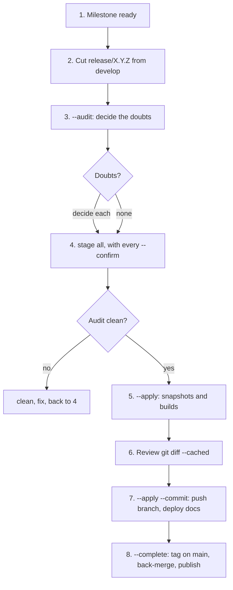

# Release Runbook

The steps to cut release `X.Y.Z` with `scripts/release.sh`, in order. The rules the tool applies (change classes, version bumps, the structural audit) are in the [HAL Delivery & Versioning SOP](versioning-sop.md).



Run every command from the repository root, in a clean worktree. Each step names the command and what to check before moving on.

## 1. Milestone ready

- The milestone `X.Y.Z` has no open issues or PRs.
- Every PR merged into `develop` since the last tag carries milestone `X.Y.Z`. GitHub knows which PRs merged, however they were merged, so ask it rather than reading commit subjects:

```bash
set -eo pipefail     # a failed lookup stops here instead of printing nothing
since=$(git log -1 --format=%cI <last-tag>)
gh pr list -R rdkcentral/rdk-halif-aidl --base develop --state merged --limit 500 \
  --search "merged:>${since}" --json number,title,milestone \
  -q '.[] | select(.milestone.title != "X.Y.Z") | "#\(.number) \(.milestone.title // "none") \(.title)"'
```

It prints nothing when every PR is on `X.Y.Z`; set the milestone on each PR it lists.

- Set the milestone's due date to the release date.

## 2. Cut the release branch first

```bash
git fetch origin
git switch -c release/X.Y.Z origin/develop
```

Create the branch before anything else. `stage` takes the release version from the branch name; it has no `--release-version` option. Run on `develop`, it assumes the next minor (for example 0.24.0 after 0.23.0) and writes a whole release for that version. A point release such as 0.23.1 is only possible from `release/0.23.1`.

## 3. Read the plan

```bash
./scripts/release.sh --audit
```

Read-only; it writes nothing to the repository. On a clean clone it first stages the AIDL toolchain and Binder SDK (`./build_binder.sh`), which takes several minutes, so that every component gets the compiler's verdict. It prints the structural audit for every component, then the **Doubts** table: components where the PR labels and the compiler disagree.

The tool releases each doubted component at the compiler's class unless you confirm a higher one. The compiler sees only the interface surface, so decide from what the change does to existing implementations and clients, as the SOP defines in [What "Major" Means](versioning-sop.md#what-major-means):

- **`minor`**: behaviour is added or defined behind an unchanged interface, and existing clients keep working.
- **`major`**: the semantics of an existing call change so that existing clients or HALs can break, even though no signature changed.
- **Neither**: accept the compiler's class.

Write down the class and a one-line reason for each; step 4 needs them.

## 4. Stage everything, with every decision, in one run

```bash
./scripts/release.sh stage all \
  <component> --confirm <minor|major> "<what changed for implementers>" \
  <component> --confirm <minor|major> "<what changed for implementers>"
```

Use the class and reason decided in step 3 for each doubted component; leave out a component whose compiler class stands.

Give every `--confirm` (and every `--version` pin) in this one command. Staging writes each component's snapshot with imports pinned to the versions of the components it depends on. Re-staging one component later, by `drop` and `stage`, leaves its dependants importing the old version, and their snapshot builds then fail with `Unresolved versioned-import target`.

Check that the output ends with `✅ Audit clean`. A row marked ⚠️ blocks the release: run `clean` (below), fix the cause, and repeat this step.

Staging writes the snapshot directories, each `metadata.yaml`, `versions_released.yaml`, `mkdocs.yml`, `RAG_STATUS_REPORT.md`, a `CHANGELOG.md` section and `docs/releases/X.Y.Z.md`.

## 5. Apply

```bash
./scripts/release.sh --apply --release-version X.Y.Z
```

Regenerates the bindings, builds every snapshot and the documentation site, and stages the result on `release/X.Y.Z`. Nothing is committed. Each failed build names its log under `out/release-snapshot-<component>.log`.

## 6. Review

```bash
git diff --cached --stat
```

Check the versions in each `metadata.yaml`, that `RAG_STATUS_REPORT.md` shows the same versions, and that the `CHANGELOG.md` section lists every merged PR.

Then write the release notes in `docs/releases/X.Y.Z.md` and `git add` it. The tool fills in the component bumps; write the three sections it leaves as comments, following the previous release's notes:

- **Headline**: one paragraph on what the release changes.
- **Highlights**: the interface changes as a table (component, change, PR), then behaviour, specification and tooling changes.
- **Upgrade Guide**: numbered steps for HAL and client implementers.

`CHANGELOG.md` lists every merged change; the release notes are what readers act on, and `--complete` publishes them as the GitHub release.

## 7. Commit and push the release branch

```bash
./scripts/release.sh --commit --release-version X.Y.Z
```

Commits the staged release artefacts, pushes `release/X.Y.Z` and deploys the versioned documentation. Always pass `--release-version`: without it, `--commit` takes the next minor after the last tag, not the branch name, and would commit and deploy the wrong version. The hint printed at the end of `--apply` omits it.

Then check the committed report against the committed snapshots:

```bash
./scripts/release.sh --check-metadata     # prints that both are up to date
```

It compares with the snapshots in `HEAD`, so it only passes once the release is committed; do not run it, or its `--refresh-metadata` advice, before this step. If it fails here, run `./scripts/release.sh --refresh-metadata`, commit the result to `release/X.Y.Z` and push it before step 8.

## 8. Complete

```bash
./scripts/release.sh --complete --release-version X.Y.Z
```

Runs `git flow release finish X.Y.Z` (merges to `main`, tags `X.Y.Z`, merges back to `develop`), pushes `main`, `develop` and the tag, publishes the documentation, and creates the GitHub release from `docs/releases/X.Y.Z.md`. A re-run after a partial failure resumes from the first incomplete step. Pass `--release-version` here too: once `git flow release finish` has run, the release branch is gone and the tool can no longer read the version from it.

A failed `gh release create` is only a warning, so confirm the release exists:

```bash
gh release view X.Y.Z -R rdkcentral/rdk-halif-aidl
```

If it reports `release not found`, create it from the notes:

```bash
gh release create X.Y.Z -R rdkcentral/rdk-halif-aidl --target main \
  --title X.Y.Z --notes-file docs/releases/X.Y.Z.md
```

## Starting again

```bash
./scripts/release.sh clean
git rm -f --ignore-unmatch docs/releases/X.Y.Z.md
git status --short     # prints nothing
```

`clean` reverts every release artefact and forgets the pins and confirmations. It leaves `docs/releases/X.Y.Z.md` when staging added it to the index, so remove that by hand.
