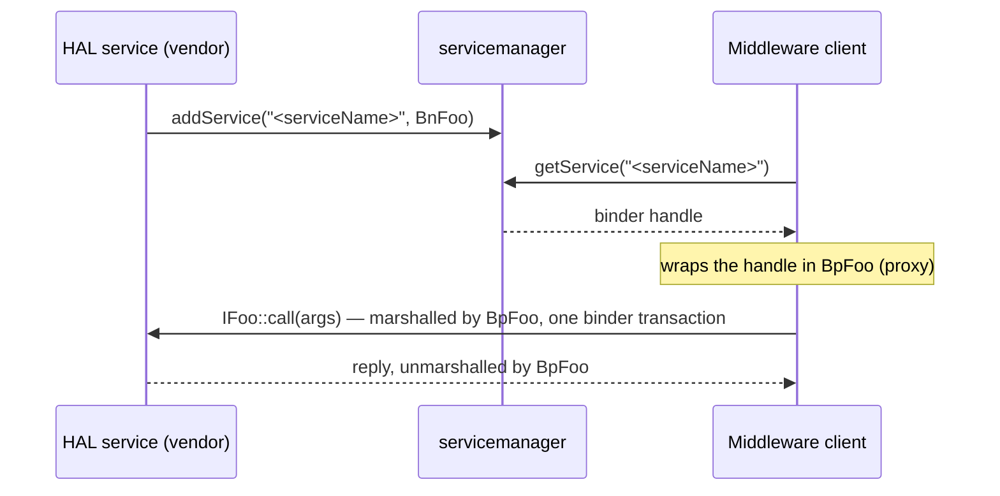

# AIDL and Binder Overview in RDK HAL Architecture

## Revision History

| Version | Date       | Author           | Changes                                    |
| ------- | ---------- | ---------------- | ------------------------------------------ |
| 1.2     | 2026-11-18 | Gerald Weatherup | Corrected to the current layout, versioning and toolchain; call detail moved to Binder Call Path |
| 1.1     | 2025-06-17 | Gerald Weatherup | Updated to include more detail |
| 1.0     | 2024-08-13 | Lucien Kennedy-Lamb| Initial version, AIDL + RDK Binder Context |

Every RDK HAL is an AIDL interface, served by a vendor process and called by middleware over Binder IPC.
This page is the entry point: what the pieces are, how a component is laid out, and how it is versioned.
What one call costs, and which threads run it, is in [Binder Call Path](binder_call_path.md).

---

## How a HAL is found and called



The HAL registers under the service name its AIDL interface declares. The client holds only the proxy;
it never links against vendor code.

---

## RDK HAL and Binder Design Goals

The 2023 RDK HAL study set these goals for the next-generation HAL:

* **Clean Separation:** Middleware and vendor code are modular and clearly separated.
* **Process Isolation:** Each HAL runs in its own process, so a HAL crash is contained.
* **Late Binding:** Middleware and vendor components are linked only at runtime, not build-time.
* **Versioning:** AIDL interfaces support backward and forward compatibility.
* **Testability:** Vendor HALs can be tested in isolation, without the full stack.
* **Debuggability:** Calls can be traced and inspected at the transaction level.

---

## Binder in RDK HALs

Binder is the kernel IPC mechanism from Android, built into the RDK kernel (`CONFIG_ANDROID_BINDER_IPC`).
The user-space side, `libbinder`, the `servicemanager` and the AIDL generator, comes from
[linux_binder_idl](https://github.com/rdkcentral/linux_binder_idl): AOSP's sources with the patches that
make them build and run on Linux.

* **Process and memory isolation:** a HAL crash is contained in its process; the client sees the binder die.
* **Late binding:** HAL and middleware components are delivered and updated independently.
* **Security:** RDK runs AppArmor. The `servicemanager` registers without requesting callers' security
  contexts, so binder works under AppArmor or with no LSM.
* **Debugging:** the kernel's binder tracepoints record every transaction.

---

## AIDL: Interface Definition and Contract

AIDL (Android Interface Definition Language) defines each HAL's interface.

* **Contract definition:** a precise, language-neutral description of the API.
* **Code generation:** the generator emits the proxy and stub C++ classes, so no marshalling is hand-written.
  What the generated code guarantees is in linux_binder_idl's
  [CODEGEN.md](https://github.com/rdkcentral/linux_binder_idl/blob/develop/CODEGEN.md).
* **Stable AIDL:** interfaces evolve with runtime version negotiation (see [Versioning](#versioning)).

For an interface `IFoo`, the generator emits:

| Generated | Role |
| --- | --- |
| `IFoo.h` | The interface, with its `VERSION` and `HASH` identity |
| `BpFoo` | Proxy: client side, marshals each call into a transaction |
| `BnFoo` | Stub: server side, unmarshals and dispatches to the implementation |

---

## HAL Development Flow

1. Define or change the interface in `.aidl` under the component's `current/`.
2. Run `./build_interfaces.sh <component>` from the repository root. It stages the binder SDK, generates
   the C++ bindings and builds the interface library. `./scripts/validate_aidl.sh <component>` checks the
   AIDL in seconds without a build.
3. Implement the service in the vendor HAL by deriving from `BnFoo`, and register it with the `servicemanager`.
4. Middleware gets the service by name and calls it through `BpFoo`.

Generated code under `current/` is build output and is never committed.

---

## Component Directory Structure

Each HAL component is a self-contained module. Its working version lives in `current/`; each released
version is a frozen snapshot beside it.

### Example: `audiosink`

```text
audiosink/
├── metadata.yaml               # component version, RAG status, reviewers
├── 0.1.0.0/  0.2.0.0/  0.3.0.0/   # released snapshots
└── current/
    ├── CMakeLists.txt          # builds the interface library from the staged SDK
    ├── interface.yaml          # AIDL module: sources, imports, stability
    ├── hfp-audiosink.yaml      # HAL Feature Profile
    ├── mkdocs.yml
    ├── docs/
    │   └── audio_sink.md       # the HAL specification
    └── com/rdk/hal/audiosink/
        ├── IAudioSinkManager.aidl
        ├── IAudioSink.aidl
        ├── IAudioSinkController.aidl
        ├── IAudioSinkControllerListener.aidl
        ├── IAudioSinkEventListener.aidl
        └── ... (parcelables and enums)
```

* `current/` is the authoritative working copy of the AIDL and its HAL Feature Profile.
* `interface.yaml` declares the module: its sources, the components it imports, and its stability.
* `hfp-audiosink.yaml` is the [HAL Feature Profile](../key_concepts/hal/hal_feature_profiles.md): what a
  platform's implementation of this HAL supports.
* `CMakeLists.txt` builds the component's interface library standalone, against the staged binder SDK.

---

## Versioning

* `current/` carries no version while it is developed.
* At a release, `release.sh` validates each changed component, snapshots `current/` to a versioned
  directory, and sets the component's version in `metadata.yaml`. Before the 1.0 baseline, versions are
  `0.<generation>.<minor>.<patch>`, so `audiosink/0.3.0.0` is the third generation.
* A PR never edits the version: its change-class label decides the bump.

The rules are in the [HAL Delivery & Versioning SOP](../governance/versioning-sop.md), and what a client can
rely on across versions is in the [Versioning Guide](../standards/versioning-guide.md).

---

## Resources

### RDK HAL & AIDL

* [RDK HAL AIDL Repository](https://github.com/rdkcentral/rdk-halif-aidl)
* [linux_binder_idl](https://github.com/rdkcentral/linux_binder_idl): the binder SDK and AIDL generator
* [Binder Call Path](binder_call_path.md): layers, threads, copies and priority of one call

### Android AIDL Documentation

* [AIDL Overview](https://developer.android.com/develop/background-work/services/aidl)
* [AIDL Language Reference](https://source.android.com/docs/core/architecture/aidl/aidl-language)
* [Stable AIDL](https://source.android.com/docs/core/architecture/aidl/stable-aidl)

### Binder Internals

* [Binder Kernel Driver (v5.15)](https://git.kernel.org/pub/scm/linux/kernel/git/stable/linux.git/tree/drivers/android?h=v5.15.164)
* [Binder Tracing Tools](https://github.com/foundryzero/binder-trace)
* [Binder Explorer](https://github.com/opersys/binder-explorer-web)
