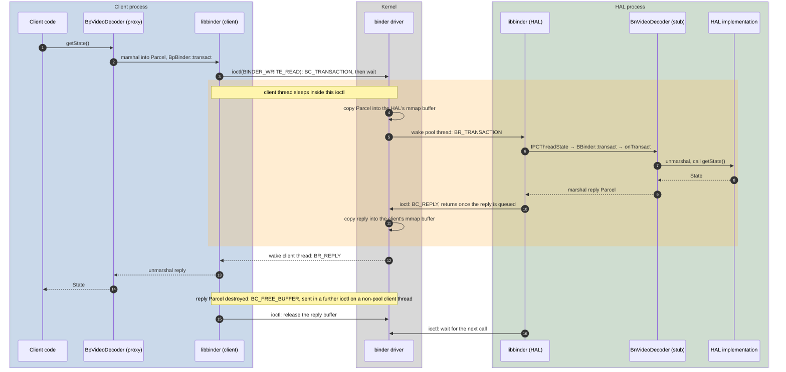
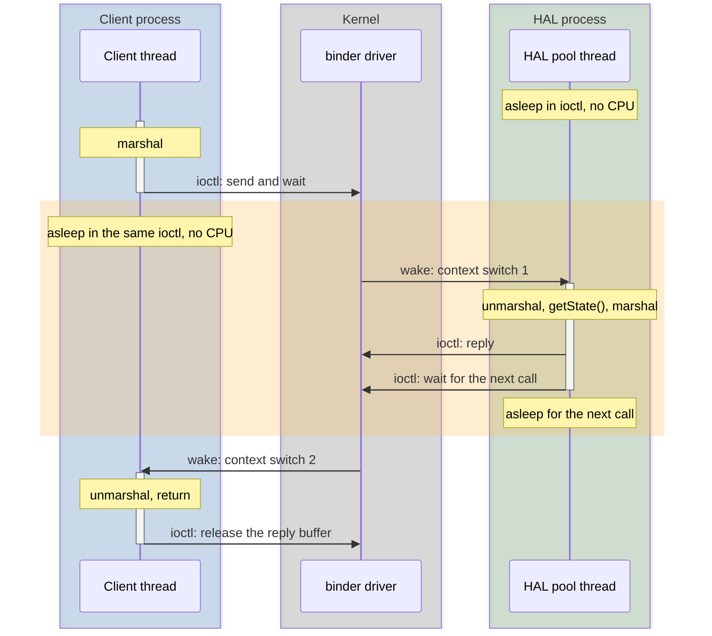
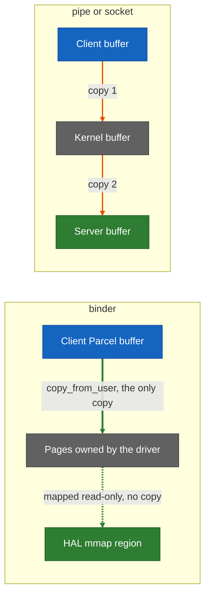
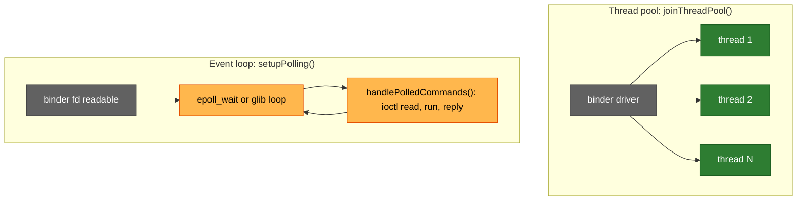
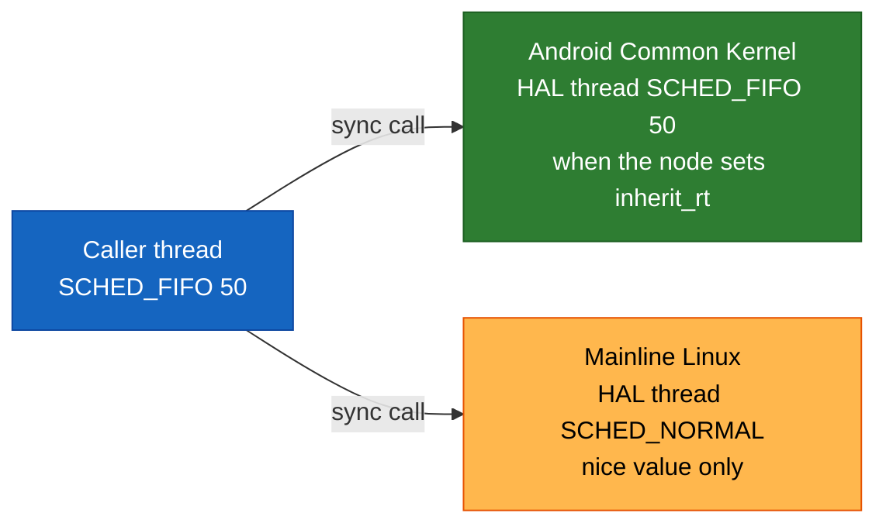
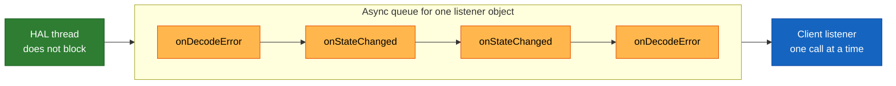

# Binder Call Path

What one HAL call costs when it crosses binder, traced from the client's generated proxy through the kernel driver to the HAL's implementation and back.

Each synchronous call passes through libbinder twice per side. The client makes one blocking `ioctl`, plus a second to release the reply buffer when its thread is not a binder pool thread; the HAL's pool thread makes two, one to send the reply and one to wait for the next call. The kernel copies once in each direction, and an ideal hand-off takes two context switches. There is no third process and no dispatcher thread.

## Layers a call passes through

| Cost per round trip | Count |
| --- | --- |
| Passes through libbinder | 4: client out, HAL in, HAL out, client in |
| Syscalls | 4 on a non-pool client thread: one client `ioctl` that sends and waits for the reply, one client `ioctl` that releases the reply buffer; two on the HAL, one to send the reply and one to wait for the next call. A client that defers or batches the release makes 3. |
| Kernel copies | 2: request into the HAL, reply into the client |
| Context switches | 2 in an ideal hand-off: client to HAL, HAL to client. Scheduling can add more. |

When client and HAL share a process, libbinder finds a local `BBinder` and makes a direct C++ call, with no kernel involvement.

## Which thread runs the call

The calling thread does not move to the HAL. It sleeps, and a thread from the HAL's binder pool runs the method in the HAL's address space. If every pool thread is busy, the call queues until one is free; the driver can send `BR_SPAWN_LOOPER` to ask the HAL for another thread, up to its maximum.

On a multi-core SoC the HAL thread may wake on another core. The client's core still switches away when the client blocks, and the wake-up crosses cores. Whether either thread's cache is still warm depends on what the scheduler ran in between.

## One copy in each direction

Each process maps a receive area through the driver: about 1 MB less two pages in libbinder, shared by every transaction in flight to that process. A reply that does not fit fails with `FAILED_TRANSACTION`. Oneway calls may use only half of it.

## Pool threads or an event loop

| | Thread pool | Event loop |
| --- | --- | --- |
| Syscalls per incoming call | 2: wait, reply | 3 or more: poll, read, reply |
| Concurrency | Calls run in parallel | One thread; calls run one at a time |
| Typical user | HAL services | A daemon that already has a main loop |

A client must also run a pool or poll its binder fd, or its listener callbacks are never delivered. To see which a running process does, run `strace -f -e trace=ioctl,epoll_wait,poll -p <pid>`: pool threads show only `ioctl`.

## Priority of the HAL thread

| | Mainline Linux driver | Android Common Kernel driver |
| --- | --- | --- |
| Sync call: nice value | Inherited, never below the node's minimum priority | Inherited |
| Sync call: real-time policy | Not inherited | Inherited when the node sets `inherit_rt` (`setInheritRt()`) |
| Oneway call | Runs at the node's minimum priority | Same |

This table comes from reading the driver sources, and is unverified on an RDK target. Android's own [performance testing](https://source.android.com/docs/core/tests/vts/performance) page, written for Android 8.0, lists priority inheritance for hwbinder only, so kernel release matters as well as kernel lineage. Whether an RDK vendor kernel carries the Android Common Kernel changes shows in its `drivers/android/binder.c`: look for `inherit_rt` or `binder_do_set_priority`.

The priority is applied when a pool thread picks up the call. A call queued behind other work, and a mutex the HAL thread waits on, are not boosted.

## Oneway calls queue per listener

The kernel delivers one oneway call at a time to a given binder object, and the next waits until the client has finished the current one. Order is preserved, but a slow listener delays every callback on that object. When the async half of the client's buffer is full, the HAL's next oneway send fails.

## Reference figures

Published measurements, for comparison only. Figures for RDK targets are produced by [#956](https://github.com/rdkcentral/rdk-halif-aidl/issues/956).

| Source | Platform | Payload | Average round trip |
| --- | --- | --- | --- |
| [Treble paper](https://arxiv.org/pdf/2410.02809), Table 3 | Pixel, Android 8, hwbinder | 4 B | 66.7 µs |
| | | 4 KB | 80.7 µs |
| | | 64 KB | 277 µs |
| [AOSP performance testing](https://source.android.com/docs/core/tests/vts/performance) | Android 8 sample run | 8 B | about 70 µs |

- **Fixed cost:** the time is near-constant up to one 4 KB page, so it is dominated by context switches and libbinder, not by the copy.
- **Contention:** in the same paper, 10 client–server pairs exchanging 512 B average 371 µs, with a 90th percentile of 826 µs.
- **Deadline:** AOSP tests against a 2.5 ms deadline per call.
- **Shared memory for comparison:** reading 64 B through Android's shared-memory queue took 217 ns. Per-frame and per-sample data belongs there, not on binder.

## Measuring a target

AOSP's tests in `frameworks/native/libs/binder/tests` are the starting point:

- `binderThroughputTest`: round trips by payload size and thread count.
- `schd-dbg`: latency against a deadline, and a check that priority inheritance and the sync flag work on the running kernel.
