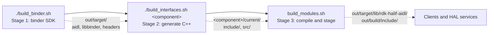

# HAL Interface Generation

Each HAL component's AIDL generates C++ bindings and builds into one interface library. Three scripts at the
repository root do it, in three stages.



## Stage 1: the binder SDK

```bash
./build_binder.sh
```

Run it once per checkout. It clones [linux_binder_idl](https://github.com/rdkcentral/linux_binder_idl) at the
version pinned in `binder_sdk.version` into `build-tools/`, builds it, and stages the SDK under `out/target/`:
the `aidl` compiler, `libbinder` and the other runtime libraries, and their headers.
`BINDER_VERSION=<ref> ./build_binder.sh` builds another version for a one-off build.

Stages 2 and 3 stop with a pointer to this command until it has run.

## Stage 2: generate and build a component

```bash
./scripts/validate_aidl.sh audiodecoder   # check the AIDL in seconds, no build
./build_interfaces.sh audiodecoder        # generate the C++ and build the library
./build_interfaces.sh all                 # every component
./build_interfaces.sh audiodecoder --version 0.3.0.0   # a released snapshot
```

The generated C++ goes into the component's own tree:

```text
audiodecoder/current/
├── com/rdk/hal/audiodecoder/*.aidl     # the interface, committed
├── include/com/rdk/hal/audiodecoder/   # generated headers: IFoo.h, BpFoo.h, BnFoo.h
└── src/                                # generated sources
```

Generated `include/` and `src/` under `current/` are build output: gitignored and never committed. A released
snapshot, such as `audiodecoder/0.3.0.0/`, carries its generated C++ committed.

## Stage 3: compile and stage

`build_interfaces.sh` hands the compile to `build_modules.sh`, which builds each component's interface library
against the SDK and stages:

| Output | Location |
| --- | --- |
| Interface libraries, `lib<component>-v<version>-cpp.so` | `out/target/lib/rdk-halif-aidl/` |
| Generated headers, by component | `out/build/include/` |

`./build_modules.sh <component>` runs Stage 3 on its own; it generates any sources that are missing.

## Cleaning

| Command | Removes |
| --- | --- |
| `./build_interfaces.sh clean` | `out/` |
| `./build_interfaces.sh cleanall` | `out/` and `build-tools/` |

## Cross-compilation and Yocto

These scripts are for host development and refuse to run in a cross or OpenEmbedded environment. A production
build stages the binder SDK from the `linux-binder` recipe and builds each component's `CMakeLists.txt`
directly; [Third-Party Build Integration](../standards/build_integration.md) describes it.
