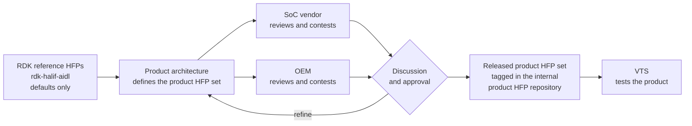

# HAL Feature Profile (HFP)

The **HAL Feature Profile (HFP)** is a structured, YAML-based declaration of the HAL feature set a product supports. Each product has its own HFP set, negotiated between product architecture, the SoC vendor and the OEM. It serves as both a **machine-readable contract** and **validation reference** between the platform and RDK middleware.

---

## Document Version Information

| Version | Date        | Author       | Comment         |
| ------- | ----------- | ------------ | --------------- |
| 1.3     | 19 Oct 2026 | G. Weatherup | Product HFP lifecycle and file header |
| 1.2     | 23 Jun 2025 | G. Weatherup | Improved format |
| 1.1     | 24 Mar 2025 | G. Weatherup | Added clarity   |
| 1.0     | 17 Feb 2025 | G. Weatherup | First revision  |

---

## Purpose and Runtime Role

The HAL Feature Profile (HFP) defines the platform's supported HAL interfaces and capabilities in a structured, machine-readable format. It plays a foundational role in platform validation, runtime capability discovery, and certification.

### Key Functions

* **Test Driver Configuration**
  Guides the Vendor Test Suite (VTS) in dynamically tailoring test coverage. Declared resources, capabilities, and constraints drive targeted validation based on the actual platform configuration.

* **Interface Capability Declaration**
  Serves as a machine-readable contract between the platform vendor and RDK middleware. Enables runtime introspection of supported features using methods such as `getCapabilities()` and `getPlatformCapabilities()`.

* **Operational Semantics and Return Values**
  Clarifies expected runtime behaviours, especially where AIDL definitions return abstract or variable feature sets. For example, codec support or event types may be enumerated here even if not explicitly codified in the interface.

* **Compliance and Certification**
  Acts as the authoritative reference for determining mandatory versus optional feature support. Used by QA and certification pipelines to assert conformance with product requirements.

Maintaining the HFP in sync with the actual HAL implementation and runtime behaviour is essential for reliable system integration, middleware compatibility, and accurate feature negotiation.

---

## Product HFP Lifecycle



Each product has its own HFP set: one HFP per HAL component the product uses. The HFPs reflect the product. They record the agreement between what the product requires and what the SoC vendor and the OEM can provide.

1. **Reference.** The HFPs in this repository (`<component>/current/hfp-<component>.yaml`) hold the RDK defaults. They are independent of any product.
2. **Definition.** Product architecture creates the product HFP set from the reference HFPs, stating how the product is to operate.
3. **Negotiation.** The set is given to the SoC vendor and the OEM, who may contest any entry: a codec that cannot be decoded, a limit that cannot be met, a mode of operation that is not used. Every change is agreed through discussion and approval.
4. **Release.** The agreed set is kept in a common internal product HFP repository. A release is a git tag on that repository, and the merged pull request that precedes it is the approval record. The build stamps the tag and commit hash into the packaged set, so every VTS result names the HFP release it ran against.
5. **Re-release.** When a negotiation reopens for an OEM or a SoC vendor, the change goes through a new pull request and a new tag.

### Layers

| Layer | Supplies |
|---|---|
| RDK reference | The defaults in this repository. |
| Product | The product HFP set, defined by product architecture. |
| SoC vendor | HFPs for SoC-provided components, such as the audio and video pipeline. A SoC vendor may supply its own HFPs as the starting point. |
| OEM | HFPs for OEM vendor-layer components, such as deviceinfo, firmware update and sensors. The OEM may layer on top of or modify the SoC vendor's entries to meet the product requirements. |

Not every HFP has a SoC vendor layer: OEM components are agreed between product architecture and the OEM.

### Middleware view

The middleware binary is identical on every platform, and it does not read the HFP. It discovers every capability at runtime through the AIDL interfaces: codecs, limits, resources and modes of operation. The HFP records what those runtime answers must be on the product, and VTS asserts them.

### Installed File Locations

```text
vendor/<vendor_name>/<platform>/config/hal_feature_profile.yaml
```

Component-level fragments may be stored in:

```text
vendor/<vendor_name>/<platform>/config/components/<component>.yaml
```

These may be merged via include directives, YAML anchors, or pre-processing scripts.

---

## HFP File Layout

Every HFP file, reference or product, is laid out in this order:

1. **Licence block.**
2. **HFP header**: the component, the identity of the product the HFP was agreed for, its version and source of truth, the layers it derives from, and a link to the [Product HFP Lifecycle](#product-hfp-lifecycle).
3. **Component notes**: semantics of the fields that the AIDL does not state. Optional.
4. **YAML body**: the root key is the component name, and its first entry is `interfaceVersion`.

The release, date and approval of an HFP come from git: the release tag, its date and the merged pull request. They are never typed into the file by hand. The release tooling writes them into the header when it releases the file:

| Line | Unreleased | Released |
|---|---|---|
| `Version` | `current (unreleased)` | the version and the release tag |
| `Source` | the file on the development branch | the file at the release tag |
| `Latest` | omitted | the file on the development branch |

A copy that is passed on outside the repository therefore names the release it came from and where the latest copy lives. A file cannot carry its own commit hash, so the layers it derives from are recorded as git URLs pinned to a tag or commit hash.

### Product HFP header

```yaml
# HAL Feature Profile (HFP): videodecoder
#
# Product:   <product name>
# Platform:  <platform / board>
# Supplier:  SoC vendor: <vendor>, SoC: <part>
# Version:   <product HFP release>, release <tag>
# Source:    https://<internal-git>/<product-hfp-repo>/blob/<tag>/hfp-videodecoder.yaml
# Latest:    https://<internal-git>/<product-hfp-repo>/blob/main/hfp-videodecoder.yaml
#
# Derived from:
#   Reference:  https://github.com/rdkcentral/rdk-halif-aidl/blob/<tag>/videodecoder/current/hfp-videodecoder.yaml
#   SoC vendor: https://<internal-git>/<soc-hfp-repo>/blob/<hash>/hfp-videodecoder.yaml
#   OEM:        https://<internal-git>/<oem-hfp-repo>/blob/<hash>/hfp-videodecoder.yaml
#
# Lifecycle: https://github.com/rdkcentral/rdk-halif-aidl/blob/develop/docs/key_concepts/hal/hal_feature_profiles.md#product-hfp-lifecycle
```

`Supplier` names the one party that supplies the component: the SoC vendor and its SoC part, or the OEM (`Supplier:  OEM: <oem>`). `Derived from` lists only the layers that apply. An OEM component with no SoC vendor layer omits the `SoC vendor` line.

### Reference HFP header

The HFPs in this repository use the same header with no `Derived from` list:

```yaml
# HAL Feature Profile (HFP): videodecoder
#
# Product:   RDK-E reference defaults (not a shipping product)
# Platform:  RDK
# Supplier:  SoC vendor (expected; confirmed per product)
# Version:   current (unreleased)
# Source:    https://github.com/rdkcentral/rdk-halif-aidl/blob/develop/videodecoder/current/hfp-videodecoder.yaml
```

`Supplier` states which kind of party is expected to supply the component, `SoC vendor` or `OEM`. Each product confirms it. When a component version is released, `release.sh` pins `Version` and `Source` in the frozen copy to the release tag and adds `Latest`.

---

## File Structure

The HFP consists of:

* A **top-level metadata block** (`hal`) with platform and schema version
* A **list of HAL components**, either embedded or included
* **Per-component declarations** that define interface versions, resources, and feature sets

### Parent File Example

```yaml
hal:
  profile: "TV"
  platform: "Sky Glass"
  schema_version: "1.2.0"

  components:
    - include: "audio_decoder.yaml"
    - include: "videodecoder.yaml"
    - include: "panel.yaml"
```

---

## Component Schema

Each HAL component follows a consistent and extensible structure:

```yaml
<component_name>:                  # e.g., videodecoder, audiosink
  interfaceVersion: current        # AIDL interface version

  - id: 0                          # Resource ID (multi-instance support)
    <field1>: <value>              # E.g., supportsSecure: true
    <field2>:                      # Optional list field
      - VALUE_A
      - VALUE_B

  platformCapabilities:            # Optional key-value metadata
    systemMixerSampleRateHz: 48000

  events:                          # Event callbacks supported by listener
    - onStarted
    - onError
```

### Example: `videodecoder.yaml`

```yaml
videodecoder:
  interfaceVersion: current

  - id: 0
    supportedCodecs:
      - H264
      - HEVC
    supportsSecure: true

  - id: 1
    supportedCodecs:
      - MPEG2
      - AV1
    supportsSecure: false

  platformCapabilities:
    maxResolution: "4K"
    maxFramerate: 60

  events:
    - onDecoderError
    - onFrameReady
```

---

## Mandatory and Optional HALs and Features

The HFP must explicitly list all supported HAL components. Each HAL or resource block can be marked as `mandatory: true` or `optional: true`.

Fields that are not supported may be omitted, but explicit negation is recommended for clarity:

```yaml
drm:
  interfaceVersion: current
  mandatory: true
  supportedSchemes:
    - { name: "PlayReady", mandatory: true }
    - { name: "Widevine", optional: true }
```

---

## Tooling and Automation

Tooling for HFP consumption and validation should support:

* **YAML Schema Validation**: Ensure integrity of the file structure
* **Test Vector Generation**: Generate test coverage based on capability matrix
* **Gap Detection**: Report missing mandatory components or undeclared features
* **Compliance Reporting**: Output summaries for QA, integrators, or certification

---

## Versioning and Schema Evolution

The `schema_version` field under the `hal` root must follow [semantic versioning](https://semver.org):

* **MAJOR** – Breaking changes to the schema or logic
* **MINOR** – Backwards-compatible enhancements or field additions
* **PATCH** – Minor metadata updates or clarifications

This ensures that both platform teams and automation tooling can safely track and adopt schema changes over time.
