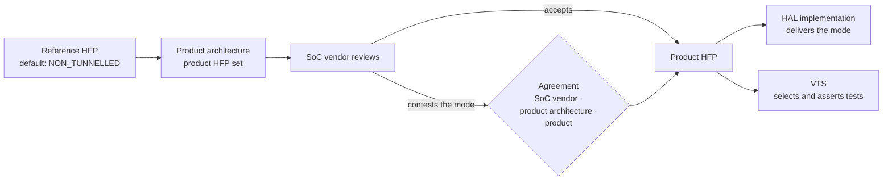
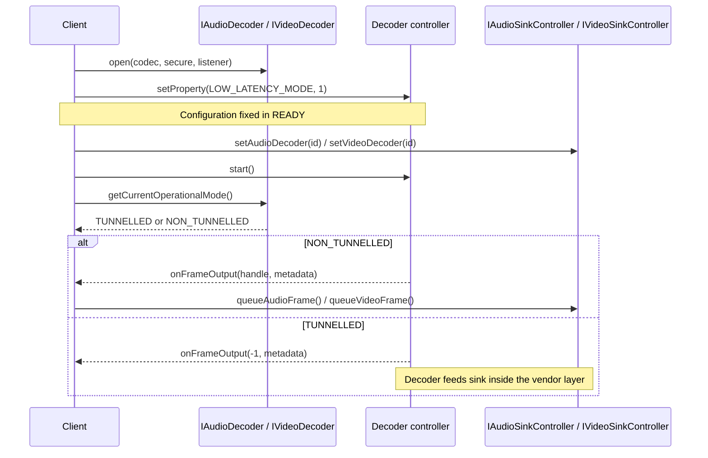

# HAL Pipeline Operational Mode

A decoder pipeline runs in one of two operational modes. **The default operational mode is `NON_TUNNELLED`**: every audio and video decoder pipeline operates in `NON_TUNNELLED` mode unless the product's HAL Feature Profile (HFP) specifies otherwise.

---

## Document Version Information

| Version | Date        | Author       | Comment        |
| ------- | ----------- | ------------ | -------------- |
| 1.0     | 19 Oct 2026 | G. Weatherup | First revision |

---

## References

!!! info References
    |||
    |-|-|
    |**Interface Definition**|[audiodecoder/current](https://github.com/rdkcentral/rdk-halif-aidl/tree/develop/audiodecoder/current), [videodecoder/current](https://github.com/rdkcentral/rdk-halif-aidl/tree/develop/videodecoder/current), [audiosink/current](https://github.com/rdkcentral/rdk-halif-aidl/tree/develop/audiosink/current), [videosink/current](https://github.com/rdkcentral/rdk-halif-aidl/tree/develop/videosink/current)|
    |**Reference HFPs**|[hfp-audiodecoder.yaml](https://github.com/rdkcentral/rdk-halif-aidl/blob/develop/audiodecoder/current/hfp-audiodecoder.yaml), [hfp-videodecoder.yaml](https://github.com/rdkcentral/rdk-halif-aidl/blob/develop/videodecoder/current/hfp-videodecoder.yaml)|
    |**Tracking**|[#28](https://github.com/rdkcentral/rdk-halif-aidl/issues/28), [#759](https://github.com/rdkcentral/rdk-halif-aidl/issues/759)|

---

## Related Pages

!!! tip "Related Pages"
    - [HAL Feature Profiles](hal_feature_profiles.md)
    - [HAL Session State Management](hal_session_state_management.md)

---

## Operational Modes

| Mode | Decoded output | Sink input |
|---|---|---|
| `NON_TUNNELLED` | Returned to the client through `onFrameOutput()` with a valid frame buffer handle. | The client queues each frame with `queueAudioFrame()` / `queueVideoFrame()`. |
| `TUNNELLED` | Consumed inside the vendor layer. `onFrameOutput()` carries frame buffer handle `-1`. | Fed by the decoder inside the vendor layer. `queueAudioFrame()` / `queueVideoFrame()` throw `EX_UNSUPPORTED_OPERATION`. |

A product HFP with no `operationalMode` entry is a fully non-tunnelled product. Every reference HFP and every test runs against that default unchanged.

### Secure and Tunnelled are Independent

The secure path and the operational mode are separate properties of a session. Secure, requested by the client through `open(codec, secure)` and read back as `SECURE_AUDIO` / `SECURE_VIDEO`, governs where the data lives: in protected memory from decryption onwards. The operational mode governs where the decoded output goes. Tunnelled output is not secure unless the session was opened secure.

| | `NON_TUNNELLED` | `TUNNELLED` |
|---|---|---|
| **Clear** | Frame buffer handles are returned to the client and queued to the sink. | Decoded output passes to the sink inside the vendor layer. |
| **Secure** | Frame buffer handles are returned in secure buffers. The client queues them to the sink without reading them, so the sink must support the secure path. | Decoded output passes securely to the sink inside the vendor layer. |

All four combinations are valid. A product whose SoC decodes secure content only on its tunnelled path declares that with a `secure` override in the HFP; most products do not need one.

---

## How the Mode is Agreed



The operational mode is negotiated like every other HFP entry, through the [Product HFP Lifecycle](hal_feature_profiles.md#product-hfp-lifecycle). A SoC vendor that does not operate a decoder in `NON_TUNNELLED` mode contests the default and overrides it to `TUNNELLED`: for the whole component, one decoder resource, one codec, or one configuration such as low latency. Each override selects a different set of VTS tests for the sessions it covers.

The client does not select the mode. No interface method or property sets it. The middleware discovers it at runtime and operates correctly in either mode.

---

## Declaring the Mode in the HFP

`operationalMode` may appear at three levels of a decoder component's HFP. Each level holds an optional `default` and an optional ordered `when` list.

| Level | Scope | Location |
|---|---|---|
| Global | every resource of the component | component root, beside `interfaceVersion` |
| Resource | one decoder instance | resource object, e.g. `IVideoDecoder: - 0:` |
| Codec | one codec on one decoder instance | codec entry, e.g. `supportedCodecs: - H264_AVC:` |

Each `when` entry matches the session configuration fixed before `start()`:

| Key | Type | Matches |
|---|---|---|
| `properties` | map of `Property` name → integer value | values set with `setProperty()` in `READY` |
| `secure` | boolean | the `secure` argument passed to `open()` |
| `mode` | `TUNNELLED` \| `NON_TUNNELLED` | the mode that applies when the entry matches |

An entry matches when every key it lists matches the session. Keys it omits are not compared.

### Resolution

The mode for a session is the first result from this order, most specific first:

1. the first matching `when` entry at codec level
2. the codec-level `default`
3. the first matching `when` entry at resource level
4. the resource-level `default`
5. the first matching `when` entry at global level
6. the global `default`
7. `NON_TUNNELLED`

Audio and video decoders are separate components with separate HFPs. A global default applies only within its own component.

### Examples

No entry: every pipeline of the component is non-tunnelled.

```yaml
audiodecoder:
  interfaceVersion: current
```

Every video decoder operates tunnelled:

```yaml
videodecoder:
  interfaceVersion: current
  operationalMode:
    default: TUNNELLED
```

Video decoder `0` operates tunnelled only when low latency is enabled, for the lowest-latency path to the display. Every other session keeps the default:

```yaml
videodecoder:
  interfaceVersion: current
  IVideoDecoder:
    - 0:
        operationalMode:
          when:
            - properties: { LOW_LATENCY_MODE: 1 }
              mode: TUNNELLED
```

One codec on one decoder operates tunnelled:

```yaml
videodecoder:
  interfaceVersion: current
  IVideoDecoder:
    - 1:
        supportedCodecs:
          - AV1:
              operationalMode:
                default: TUNNELLED
```

Secure sessions operate tunnelled, for a SoC whose secure decode path is tunnelled only. Clear sessions keep the default:

```yaml
videodecoder:
  interfaceVersion: current
  operationalMode:
    when:
      - secure: true
        mode: TUNNELLED
```

---

## Runtime Contract



The mode is decided by the time `start()` succeeds and is constant until `stop()`. It depends only on the codec, the `secure` argument and the properties set in `READY`, never on stream content. The client reads it with `getCurrentOperationalMode()` after every `start()`; the same codec can run in different modes in different sessions.

A sink has no mode of its own. Its mode is the `getCurrentOperationalMode()` of the decoder associated through `setAudioDecoder()` / `setVideoDecoder()`.

### Worked Example

Three products share one video decoder resource `0`. Product A has no `operationalMode` entry; product B declares `default: TUNNELLED`; product C declares a `LOW_LATENCY_MODE: 1` override to `TUNNELLED` on resource `0`. The client code is identical on all three:

```cpp
using namespace com::rdk::hal::videodecoder;

sp<IVideoDecoderController> ctl;
decoder->open(Codec::H264_AVC, /*secure=*/false, listener, &ctl);

bool ok;
ctl->setProperty(Property::LOW_LATENCY_MODE,                  // optional, in READY
                 PropertyValue::make<PropertyValue::intValue>(1), &ok);
sink->setVideoDecoder(decoderId, &ok);

OperationalMode mode;
decoder->getCurrentOperationalMode(&mode);                    // EX_ILLEGAL_STATE: not STARTED
ctl->start();
decoder->getCurrentOperationalMode(&mode);                    // EX_NONE

if (mode == OperationalMode::NON_TUNNELLED) {
    // forward each onFrameOutput() handle to sink->queueVideoFrame()
} else {
    // the vendor layer feeds the sink; observe metadata and end-of-stream only
}
```

| Call | A | B | C, low latency off | C, low latency on |
|---|---|---|---|---|
| `getCurrentOperationalMode()` before `start()` | `EX_ILLEGAL_STATE` | `EX_ILLEGAL_STATE` | `EX_ILLEGAL_STATE` | `EX_ILLEGAL_STATE` |
| `getCurrentOperationalMode()` after `start()` | `NON_TUNNELLED` | `TUNNELLED` | `NON_TUNNELLED` | `TUNNELLED` |
| `onFrameOutput()` frame buffer handle | valid handle | `-1` | valid handle | `-1` |
| `queueVideoFrame()` | `true`, or `false` when the queue is full | `EX_UNSUPPORTED_OPERATION` | `true` / `false` | `EX_UNSUPPORTED_OPERATION` |
| `getProperty(SECURE_VIDEO)` | `0` | `0` | `0` | `0` |
| End of stream | `onEndOfStream()` on decoder, then sink | same | same | same |

The same codec on the same decoder runs in different modes in product C, so the client reads the mode after every `start()` and never caches it per codec.

---

## Implementation Requirements

| #                 | Requirement | Comments |
| ----------------- | ----------- | -------- |
| **HAL.OPMODE.1** | A decoder pipeline shall operate in `NON_TUNNELLED` mode unless the product HFP resolves the session to `TUNNELLED`. | Resolution order above. |
| **HAL.OPMODE.2** | The operational mode of a session shall equal the mode the product HFP resolves for its codec, `secure` argument and `READY`-state properties. | |
| **HAL.OPMODE.3** | The operational mode shall be decided by the time `start()` succeeds and shall not change until `stop()`. | |
| **HAL.OPMODE.4** | `getCurrentOperationalMode()` shall return the session's operational mode in the `STARTED` state, and throw `EX_ILLEGAL_STATE` in any other state. | |
| **HAL.OPMODE.5** | In `TUNNELLED` mode, `onFrameOutput()` shall pass frame buffer handle `-1`, and the associated sink's `queueAudioFrame()` / `queueVideoFrame()` shall throw `EX_UNSUPPORTED_OPERATION`. | |
| **HAL.OPMODE.6** | In `TUNNELLED` mode, the vendor layer shall propagate end-of-stream from decoder to sink, so the client observes the same `onEndOfStream()` sequence as in `NON_TUNNELLED` mode. | |
| **HAL.OPMODE.7** | An `operationalMode` entry in a product HFP shall be agreed through the [Product HFP Lifecycle](hal_feature_profiles.md#product-hfp-lifecycle). | |

---

## Validation

For every codec in each decoder resource, VTS resolves the expected mode for the default configuration and for each `when` entry, then:

1. `open()` with the entry's `secure` value, sets the entry's properties in `READY`, and calls `start()`.
2. Asserts `getCurrentOperationalMode()` equals the resolved mode.
3. In `NON_TUNNELLED` mode, asserts decoded frame buffers are returned and accepted by the sink.
4. In `TUNNELLED` mode, asserts frame buffer handle `-1`, `EX_UNSUPPORTED_OPERATION` from the sink's queue method, and end-of-stream delivery at the sink.
