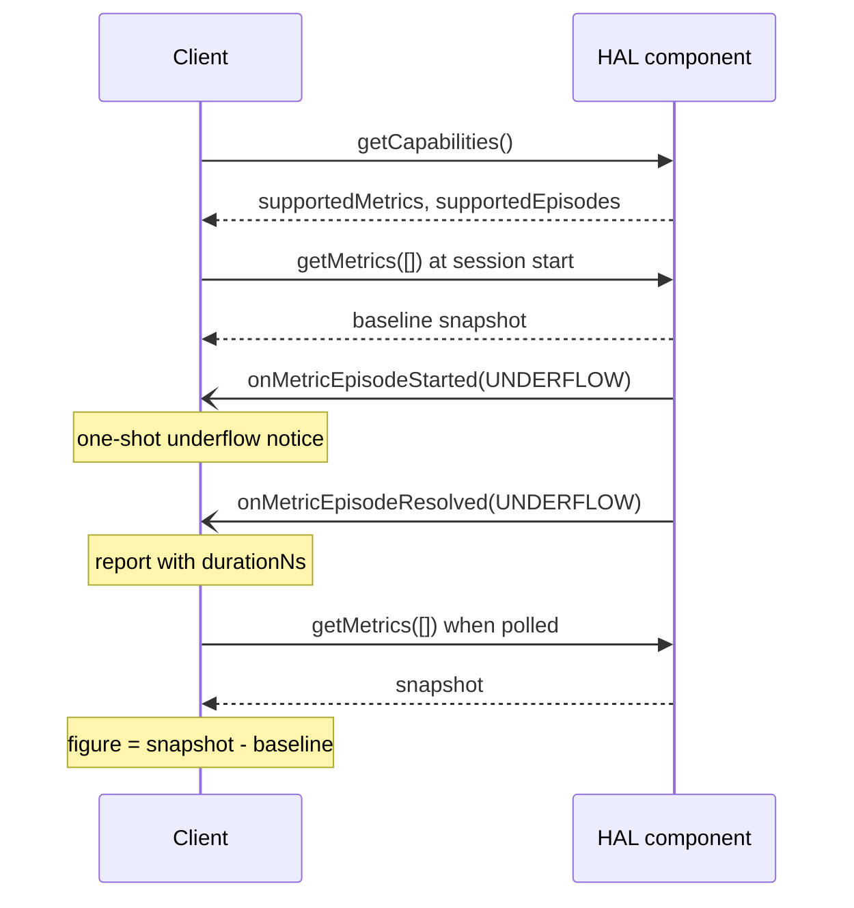

# HAL Metrics: Client Use

How a client above the HAL (a player, a media service or an application adapter) turns the metrics of the [HAL Metrics Pattern](hal_metrics_pattern.md) into the figures its consumers report. Each recipe uses only what the components serve: `getCapabilities()`, `getMetrics()`, and the `onMetricEpisodeStarted()` and `onMetricEpisodeResolved()` events.

## Rules every recipe relies on

| Fact | Consequence for the client |
|---|---|
| Counters start at zero when the service initialises, only rise, and are kept per resource instance across sessions. | A session figure is always a difference from a baseline the client took. The client never resets the HAL. |
| One `getMetrics()` call latches every value it returns at one `timestampNs`. | Ask for every figure that is compared or divided in the same call. |
| Two components latch in two calls. | A figure combining decoder and sink values is approximate by the gap between their `timestampNs`. |
| A counter lower than in the client's earlier snapshot means the service restarted. | Take the later snapshot as the new baseline and treat the interval as lost. |
| `timestampNs` and episode times are `CLOCK_MONOTONIC_RAW`. | To stamp a report with wall-clock time, read `CLOCK_REALTIME` and `CLOCK_MONOTONIC_RAW` together and apply their offset. |
| Episodes are raised once when they start and once when they end; nothing is raised per frame. | Per-occurrence detail is the episode's `count`, the first and last `presentationTimeNs`, and the counters. |
| Each episode event carries `metrics`, a snapshot latched at the event. | The state at the event needs no second read. |
| Mandatory members are served by every product; optional ones only where `getCapabilities()` lists them. | Check `supportedMetrics` and `supportedEpisodes` once per resource instance before relying on an optional figure. |

## Basic figures

| To get | Do |
|---|---|
| A figure for a session or an interval | Read a snapshot at its start and at its end, with one `getMetrics()` call each, and subtract. |
| A rate | Divide the difference of a counter by the difference of the two `timestampNs`. |
| A ratio of two counters | Ask for both in the same `getMetrics()` call, then divide the differences. |
| The state at an event | Read `metrics` in the episode event. |
| A mean episode length | Divide the difference of an `_DURATION_NS` counter by the difference of its `_EPISODES` counter. |

## Polled playback quality

A consumer that polls for totals of presented, dropped and damaged video frames, such as a media element's playback-quality query, is served from the video sink and the video decoder.

| Consumer field | Source | Calculation |
|---|---|---|
| Total frames | Video sink `FRAMES_RENDERED`, `FRAMES_DROPPED` | Δ`FRAMES_RENDERED` + Δ`FRAMES_DROPPED`, both from one sink snapshot. |
| Dropped frames | Video sink `FRAMES_DROPPED` | Δ`FRAMES_DROPPED`. Add the video decoder's Δ`FRAMES_DROPPED` where the consumer counts frames lost before decode as dropped. |
| Corrupted frames | Video decoder `FRAMES_CORRUPTED` | Δ`FRAMES_CORRUPTED` from a second read. A corrupted frame is also counted as rendered or dropped, so it is never added to the total. |

The baseline is taken where the consumer's own count restarts, for example when a new media load begins.

## Read-and-reset diagnostics

A consumer whose diagnostic call returns the change since its previous call keeps the snapshot from that call. On each call it reports current minus previous and stores the current snapshot as the next baseline. The HAL counters are untouched, so several such consumers can run side by side.

## Per-event quality reports

A consumer that receives one report per quality event is fed from the episode events.

| Report | Episode | Fields |
|---|---|---|
| Video or audio frames dropped | Decoder or sink `FRAME_DROP`, resolved | `count` frames; `presentationTimeNs` of the first dropped frame from the started event and of the last from the resolved event. |
| Decode errors | Decoder `DECODE_ERROR`, resolved | `count` errors. Each error's code arrives separately through `onDecodeError()`. |
| Video frames repeated | Video sink `FRAME_REPEAT`, resolved | `count` repeated presentations. |
| Audio gap | Audio sink `GAP`, resolved | `count` frame periods of silence, `durationNs`. |

A consumer that needs one report per frame reports the episode as one report carrying `count`, stamped with the first presentation time. Where it needs a report as soon as the first frame is lost, it reports on the started event and the remainder on the resolved event.

Publish from the resolved event alone; it carries everything the report needs. Every started event is followed by a resolved event: an episode still open at `flush()` or `stop()` ends there.

## Underflow notice

A consumer that wants one notice when playback starves takes it from `onMetricEpisodeStarted(UNDERFLOW)` on the sink of the affected stream. Underflow is measured where the audience experiences it: the queue is empty when a frame is due. It is not raised before the first frame, after a flush, while paused or after end of stream, so the client does not filter those cases. The resolved event gives the stall length in `durationNs` for a consumer that measures rebuffering.

## Pairing decoder and sink figures

Losses before the sink are counted by the decoder and losses at the sink by the sink; no frame is counted by both. A whole-pipeline drop count is the sum of the two differences, read in two calls. Read both as close together as the client can and treat the sum as approximate.
