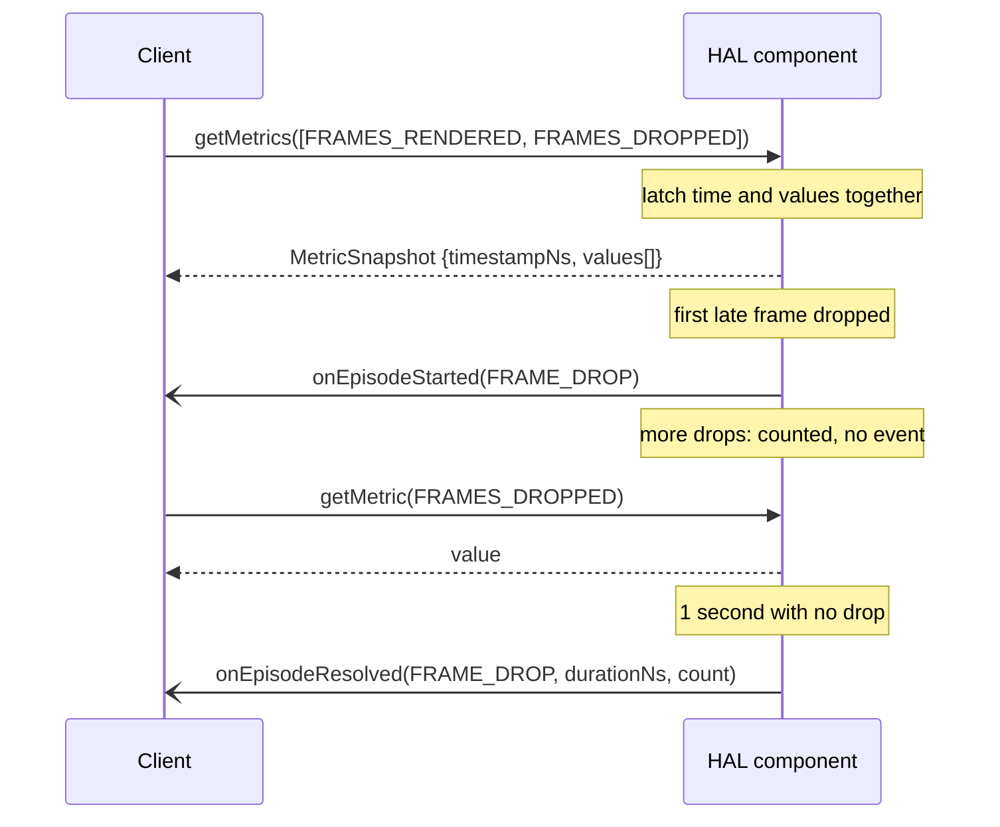

# HAL Metrics Pattern

A HAL component that produces a figure worth measuring serves it itself, from its own interface, with its own types. This page is the pattern to copy when adding metrics to a component, by hand or with an AI assistant. The worked example is [Video Sink](../videosink/video_sink.md#metrics).



## Rules

| # | Rule |
|---|---|
| M1 | The component that produces a figure serves it. No shared metrics module, no shared metric types and no generated identifiers: every type below lives in the component's own `metrics` sub-package, `com.rdk.hal.<component>.metrics`. |
| M2 | Metrics are a `Metric` enum, `@VintfStability`, `@Backing(type = "int")`, numbered from 0 and append-only. A member is never renumbered or reused. |
| M3 | A value is a `long` in the unit its member documents. Time is in nanoseconds and the member name ends `_NS`. |
| M4 | A metric is a counter or a gauge. A counter starts at zero when the service initialises and only rises; no call resets it. Each resource instance keeps its own figures, across every session opened on it. A gauge is the level at the instant of the read. |
| M5 | `getMetrics(in Metric[] metrics)` returns a `MetricSnapshot`. The service latches `timestampNs` (`CLOCK_MONOTONIC_RAW`, nanoseconds) and every value at one instant, at the start of the read, before copying any out. An empty array asks for every supported metric. |
| M6 | Each `MetricValue` carries its `Metric` id. A metric that is not supported, or has no value at present, has no entry in the snapshot; there is no sentinel value and no status field. |
| M7 | `getMetric(in Metric metric)` returns one value. It throws `EX_UNSUPPORTED_OPERATION` for a metric the product does not support and `EX_ILLEGAL_STATE` for one that has no value at present. |
| M8 | Both accessors are callable in any state. |
| M9 | The metrics a product serves are listed once, as `supportedMetrics` under the component in its HAL Feature Profile, and apply to every resource instance. |
| M10 | Events are episodes only. An episode is something with a start and an end; it is a member of the component's `Episode` enum (`@VintfStability`, `@Backing(type = "int")`, numbered from 0, append-only) and is reported once when it starts, by `onEpisodeStarted()`, and once when it ends, by `onEpisodeResolved()`. Nothing is raised per frame or per occurrence: those figures are read with `getMetrics()`. A new episode is a new enum member, never a new callback. |
| M11 | `EpisodeStarted` carries the `Episode` id, `timestampNs` (the `CLOCK_MONOTONIC_RAW` time the service detected the event), `presentationTimeNs` (`-1` where the frame carried none) and `metrics`, a `MetricSnapshot` of every supported metric latched at `timestampNs`, so an event is a complete record and needs no second read. `EpisodeResolved` carries the same and adds `durationNs` and `count`. Each `Episode` member documents what its duration and count measure; a member with nothing to count reports 0. |
| M12 | An episode whose occurrences are separate in time, such as dropped frames or decode errors, starts at the first occurrence when none is open and ends when 1 second has passed without another. Its duration runs from the first occurrence to the last. An episode still open at `flush()` or `stop()` ends there. |
| M13 | A figure is counted where it is experienced. Where a decoder and a sink could both report something, the component whose figure describes what the audience saw or heard serves it, and the other does not duplicate it. |
| M14 | Deliberate behaviour is excluded: frames discarded by a flush, a seek, a reconfiguration, a stop, end of stream or pacing are not drops, and repeats made by frame rate conversion are not freezes. |
| M15 | Metrics from two components are two reads, latched separately. Document any pairing a client is likely to make as approximate. |

## Using the figures

| To get | Do |
|---|---|
| A figure for a session or an interval | Read a snapshot at its start and at its end, with one `getMetrics()` call each, and subtract. |
| A rate | Divide the difference of a counter by the difference of the two `timestampNs`. |
| A ratio of two counters | Ask for both in the same `getMetrics()` call, so both are latched together, then divide the differences. |
| The state at an event | Read `metrics` in the episode event; it is latched at the event's `timestampNs`. |
| A baseline after a service restart | A counter lower than in an earlier snapshot means the service restarted and counts from zero; take the later snapshot as the new baseline. |

## Files

| File | Content |
|---|---|
| `metrics/Metric.aidl` | The enum. |
| `metrics/MetricValue.aidl` | `{ Metric id; long value; }` |
| `metrics/MetricSnapshot.aidl` | `{ long timestampNs; MetricValue[] values; }` |
| `metrics/Episode.aidl` | The enum of episodes. Omitted, with the two files below, by a component that has none. |
| `metrics/EpisodeStarted.aidl` | `{ Episode id; long timestampNs; long presentationTimeNs; MetricSnapshot metrics; }` |
| `metrics/EpisodeResolved.aidl` | `{ Episode id; long timestampNs; long presentationTimeNs; long durationNs; long count; MetricSnapshot metrics; }` |
| `I<Component>.aidl` | `getMetrics()` and `getMetric()`, appended after the existing methods. |
| `I<Component>EventListener.aidl` | `onEpisodeStarted()` and `onEpisodeResolved()`, appended after the existing methods. |
| `hfp-<component>.yaml` | `supportedMetrics`. |
| `docs/<component>.md` | A `Metrics` section, the requirement rows and the new files in the interface table. |

## Metric documentation

Every `Metric` member carries the same six paragraphs, in this order. A reader must be able to implement the metric, and use it, from the member's comment alone.

| Paragraph | Says |
|---|---|
| `@brief` | The figure in one line. |
| `Measures:` | What is counted, and the point in the component where it is counted. |
| `Excludes:` | What is deliberately left out, and which metric counts it instead. |
| `Used for:` | The question the figure answers. |
| `How to use:` | The calculation: what to difference, what to divide by, which episode reports it. |
| `Unit:` / `Kind:` | The unit, and counter or gauge. |

```aidl
    /**
     * @brief Frames discarded because they arrived too late.
     *
     * Measures: frames queued to the sink and discarded without being
     * presented because their presentation time had passed, counted at the
     * sink.
     *
     * Excludes: frames discarded on purpose by flush(), a seek, a stream
     * reconfiguration, stop() or end of stream, frames removed by frame rate
     * conversion or pacing, and frames the decoder never output
     * (com.rdk.hal.videodecoder.metrics.Metric::FRAMES_DROPPED).
     *
     * Used for: measuring stutter the viewer saw.
     *
     * How to use: rate = delta FRAMES_DROPPED / (delta FRAMES_RENDERED + delta
     * FRAMES_DROPPED), from one getMetrics() call per snapshot. A run of drops
     * is reported as an Episode::FRAME_DROP episode.
     *
     * Unit: frames. Kind: counter.
     */
    FRAMES_DROPPED = 1,
```

## Submission checklist

- [ ] Every type is in the component's own `metrics` sub-package; nothing is imported from another component for metrics.
- [ ] `Metric` is `@VintfStability`, `@Backing(type = "int")`, numbered from 0, with new members appended.
- [ ] Every member has the six paragraphs of [metric-documentation](#metric-documentation).
- [ ] Every member names its unit; every time value is in nanoseconds and its name ends `_NS`.
- [ ] No member has a sentinel value, and `MetricValue` has no status field.
- [ ] `getMetrics()` and `getMetric()` are the last methods of the main interface, with the exceptions of rule M7.
- [ ] Every event is a member of `Episode`, raised once at its start and once at its end; nothing is raised per occurrence.
- [ ] Every `Episode` member documents when it starts, when it ends and what `durationNs`, `count` and `presentationTimeNs` hold.
- [ ] Both episode parcelables carry `metrics`, latched at the event's `timestampNs`.
- [ ] `interface.yaml` lists `com/rdk/hal/<component>/metrics/*.aidl` under `srcs`.
- [ ] `onEpisodeStarted()` and `onEpisodeResolved()` are appended to the event listener; no existing method or callback is changed or removed.
- [ ] `supportedMetrics` in `hfp-<component>.yaml` lists members of the enum by name.
- [ ] The component document has a `Metrics` section, a requirement for the accessors and one for the episodes.
- [ ] Any property or callback the metrics replace is marked `@deprecated` under the [HAL API Deprecation Governance](../key_concepts/hal/hal_api_deprecation_governance.md) process.
- [ ] `./build_interfaces.sh <component>` passes, and the PR carries the `Minor Change` label.
