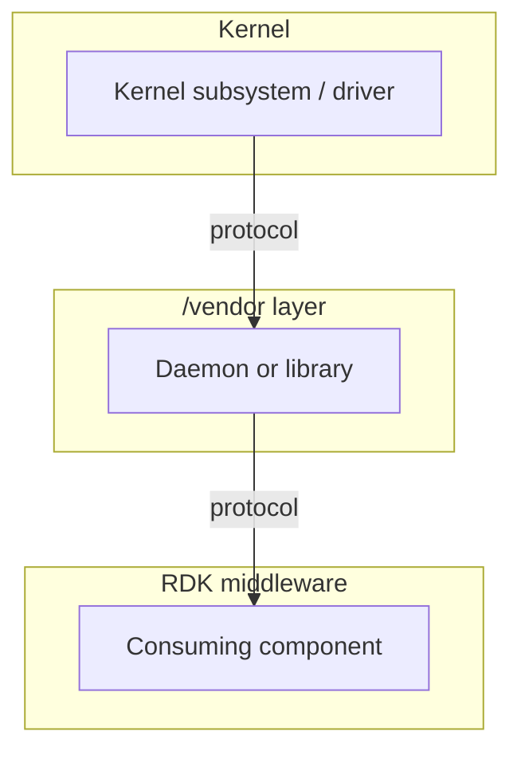
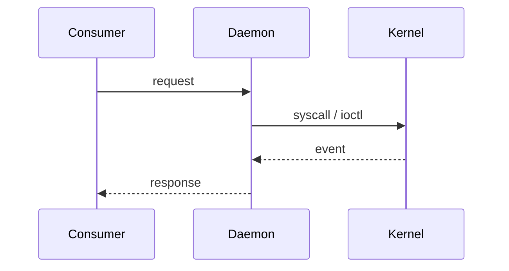

# VSI Specification Template

> **Using this template**: copy into `vsi/<component>/current/docs/<component>.md`, delete every blockquote like this one, and delete any section that genuinely does not apply — do not leave it with "N/A". Requirement IDs, the upstream baseline table, the dependency table and at least one diagram are mandatory in every VSI specification.
>
> A Vendor System Interface is not a HALIF interface. If the component you are specifying is an AIDL service, use [Interface Template](interface_template.md) instead. A VSI component specifies an existing Linux subsystem, daemon or library that the vendor supplies, and the contract a vendor must meet when supplying it.

## Document History

|Date|Author|Comments|
|----|------|--------|
|YYYY-MM-DD|Name|Initial specification|

!!! warning "Draft Document"
    This document is currently in **draft form** and under active discussion. Specifications, examples, and recommendations may change based on review feedback and implementation experience.

## References

!!! info References
    |||
    |-|-|
    |**Upstream Project**| Name and canonical URL |
    |**Upstream Baseline**| Version this specification is written against |
    |**Responsibility**| SOC or OEM — must match `type` in this component's `metadata.yaml` |
    |**Consumed By**| HALIF interfaces that depend on this component, or None |
    |**Validation**| [L4 System Interface Testing](../external_content/ut-core-wiki/3.3.-Standards:-L4-‐-System-Interface-Testing.md) |
    |**Reference Implementation**| TBD |

## Related Pages

!!! tip "Related Pages"
    - [Third-Party Build Integration](build_integration.md)
    - [Module Boot Sequence](../vsi/boot_sequence/current/module_boot_sequence.md)

## Purpose

> One or two paragraphs. What this component is responsible for on an RDK platform, and what it is explicitly not responsible for. Name the adjacent components that own the excluded behaviour.

## Upstream Baseline and Variance Policy

> The single most important table in the document. A vendor reads this to know what they must ship.

|Item|Value|
|----|-----|
|Upstream project|e.g. `wpa_supplicant` / BlueZ / `libevdev`|
|Baseline version|Minimum version, and the version this document is written against|
|Source|Upstream URL or Yocto layer and recipe|
|Licence|SPDX identifier|

**Variance policy**

> State what an integrator may change and what is fixed. Be specific — "vendor may patch" is not a policy. For each of the following, say permitted, permitted with declaration, or prohibited:
>
> - Substituting a different upstream project for the same role.
> - Running a newer or older major version than the baseline.
> - Carrying downstream patches that change observable behaviour.
> - Disabling upstream features or build options this specification relies on.

## System Context

> Mandatory diagram. Mermaid, so it can be diffed. Show this component, the kernel interfaces beneath it, the RDK components above it, and every process boundary crossed. Prose below the diagram explains only what the diagram cannot show.

## Usage on the RDK Stack

> Mandatory diagram. A Mermaid sequence diagram of the primary flow through this component — the one a reader must understand to integrate it. Add a second only if a materially different flow exists (e.g. provisioning versus steady state). Do not attempt to cover every flow.

## Protocol and API Surface

> The contract proper. Enumerate only what RDK actually relies on — this defines the vendor's compatibility obligation, so anything listed here cannot be changed without breaking RDK, and anything omitted is fair game for the vendor to alter.
>
> State the protocol and its version: D-Bus interface name and version, netlink family and generic-netlink version, evdev/ioctl ABI, sysfs paths, or the library soname and ABI level. Then the operations.

|Protocol|Version|Transport|
|--------|-------|---------|
|e.g. D-Bus `fi.w1.wpa_supplicant1`|v1|System bus|

**Operations relied upon**

|Operation|Direction|Parameters|Returns|Errors|
|---------|---------|----------|-------|------|
|Method, signal, ioctl or event name|Client → Service, or Service → Client|Name, type, units, range, mandatory/optional|Value and type|Named error conditions and when each occurs|

> Prose only for semantics the table cannot carry: ordering guarantees, lifetime and ownership of handles or file descriptors, idempotency, concurrency limits, timing. "Returns an error" is not a specification.

**Protocol assumptions**

> Anything assumed but not enforced by the protocol itself: bus name ownership, socket paths and permissions, device node naming and `udev` rules, event ordering, reconnection behaviour after a daemon restart, behaviour when the kernel module is absent.

## Performance and Resource Budget

> Numbers with units, and the source of each. An acceptance criterion that cannot be measured is not a criterion. Where a figure is fixed by physics or by the upstream protocol, say so and give the value; where it is an RDK choice, it needs agreeing rather than assuming.

|Metric|Budget|Measured at|Source|
|------|------|-----------|-------|
|Latency of the primary operation|Value and unit|Observation point|Protocol-imposed, or RDK requirement|
|Throughput or event rate|Value and unit|Observation point||
|Memory ceiling (RSS)|Value and unit|Steady state||
|CPU ceiling|Percentage of one core|Steady state and peak||
|Startup time to ready|Value and unit|From unit start to readiness signal||

> State what degrades first when a budget is exceeded, and what a consumer observes.

## Security and Threat Surface

> Every VSI component sits between untrusted input and the platform. Fill this in even when the conclusion is that the surface is small — that statement is the useful output.

- **Assets**: what an attacker gains by compromising this component — credentials, pairing keys, user input, media paths, kernel access.
- **Attack surface**: every externally reachable entry point — radio, network, removable media, device nodes, sockets, bus names — and who can reach each.
- **Privilege boundaries**: the user and capabilities the component runs with, and the justification for anything beyond an unprivileged user.
- **Secrets**: what is stored, where, with what permissions, and what removes it on factory reset.
- **Isolation**: AppArmor profile, namespace or cgroup confinement applied.
- **Known upstream CVE classes** for this component, and the update path when one lands.

## Dependencies

> Every third-party library and daemon required at build or run time, with the version constraint. A version-free dependency list cannot be audited and will not survive licence scanning.

|Dependency|Version constraint|Build or Runtime|Licence (SPDX)|Purpose|
|----------|------------------|----------------|--------------|-------|
|e.g. `libnl`|≥ 3.5.0|Both|LGPL-2.1-only|Netlink transport|

## Licensing and Open-Source Obligations

> Fill this in even when every dependency is permissive — the statement that there are no copyleft obligations is itself the useful output.

- Licence of the component and of each dependency above, as SPDX identifiers.
- Copyleft obligations triggered (LGPL dynamic-linking constraints, GPL source-offer duties) and how the layered file system satisfies them.
- Any dependency whose licence prohibits the intended distribution model, or requires a commercial alternative.
- Attribution entries required in the platform `NOTICE`.
- Confirmation that the dependency set has passed the repository's licence scanning.

## Certification and Regulatory

> Some VSI components carry gating external obligations that no amount of RDK testing substitutes for. Where none apply, say so in one line and delete the table.

|Obligation|Body|Applies to|Who holds it|
|----------|----|----------|------------|
|e.g. Bluetooth qualification|Bluetooth SIG|Products shipping a BT radio|OEM|
|e.g. Regulatory domain configuration|Regional regulator|Wi-Fi transmit behaviour|OEM|

> State what the obligation gates — shipping, branding, or radio operation — and what evidence RDK needs to see.

## Responsibilities

> Aligned with the `type` field in `metadata.yaml`. A reader must be able to tell, per row, who is accountable.

|Item|SOC|OEM|RDK|
|----|---|---|---|
|Kernel driver and configuration|✓|||
|Daemon packaging and configuration||✓||
|Consuming interface and policy|||✓|

## Implementation Requirements

> Normative, ID'd, and individually testable. `VSI.<COMPONENT>.n`, numbers never reused. Each requirement uses "shall", states one obligation, and can be failed by a specific observation. Requirements are what validation and review comments reference — prose bullets are not acceptable here.

|#|Requirement|Comments|
|-|-----------|--------|
|**VSI.\<COMPONENT\>.1**|The vendor shall …|Rationale, or the observation that demonstrates compliance|

## Configuration Surface

> Every file, kernel symbol and tunable an integrator must set, and the value RDK requires. This is the second thing a vendor reads.

|Item|Type|Required value|Owner|
|----|----|--------------|-----|
|`/etc/<component>/<file>.conf`|Config file|Setting and value|OEM|
|`CONFIG_<SYMBOL>`|Kernel config|`y` / `m`|SOC|
|`/sys/class/<path>`|sysfs|Expected presence and permissions|SOC|

## Interfaces to be Defined

> Where this component meets RDK code. Either name the AIDL interfaces that consume it and state what crosses that boundary, or state explicitly that it has no HALIF consumer and is used directly. Where a new interface is required but not yet defined, record it here with its tracking issue — this is the section that turns a VSI specification into HALIF work.

|Interface|Status|Consumer|Tracking|
|---------|------|--------|--------|
|e.g. `IGraphicsFbProvider`|Defined / Required / Not required|Component that calls it|Issue link|

## Build and Packaging

> Defer the mechanics to [Third-Party Build Integration](build_integration.md); state here only what is specific to this component.

- Layer and mount point the component is delivered into, and its module directory.
- Recipes or build files the vendor supplies, and the build options this specification requires.
- Libraries exposed to other layers, and those that must remain private.
- Dynamic linking: `RPATH` or `ld.so.conf.d` entry, and the soname policy for anything exported.

## Third-Party Integration

> Written for a vendor engineer integrating this component for the first time, who will not read the rest of the document first.

1. What to supply, and where it is installed.
2. Build steps specific to this component.
3. Configuration that must be applied, referencing the Configuration Surface table.
4. How to demonstrate the integration works, referencing Validation.
5. What to declare back to RDK — versions shipped, variances taken, licences.

## Startup and Lifecycle

> Reference [Module Boot Sequence](../vsi/boot_sequence/current/module_boot_sequence.md) rather than restating it.

- systemd unit name, type, and the target it is ordered against.
- Dependencies that must be running first, and what depends on this component.
- Readiness signalling, and what a consumer observes before readiness.
- Restart policy, and consumer-visible behaviour across a restart.

## Diagnostics and Debug

> What an integrator uses to find out why it is not working, on a real device. Missing, this section costs every vendor the same few days.

- Log sources: journald unit or identifier, and how to raise verbosity without a rebuild.
- Inspection commands: the upstream tools that show live state, with the command as it is actually run.
- Healthy baseline: what correct output looks like, so an integrator can tell a fault from normal operation.
- Common failure modes, and the observation that distinguishes each.
- Anything needing a debug build or a kernel option not enabled in production.

## Validation

> How conformance is demonstrated. Each requirement above should be reachable from something here.

|Requirement|Method|Test asset|
|-----------|------|----------|
|`VSI.<COMPONENT>.1`|L4 system interface test / manual procedure / inspection|Test name or location|

## Product Customization

> What a product may legitimately vary — device counts, supported modes, tunables — and how a consumer discovers the variation at runtime rather than assuming it.

## Open Issues

> Only unresolved items, each with an owner and a tracking issue. An item without both belongs in the tracker, not here. Delete this section when empty.

|Issue|Owner|Tracking|
|-----|-----|--------|
