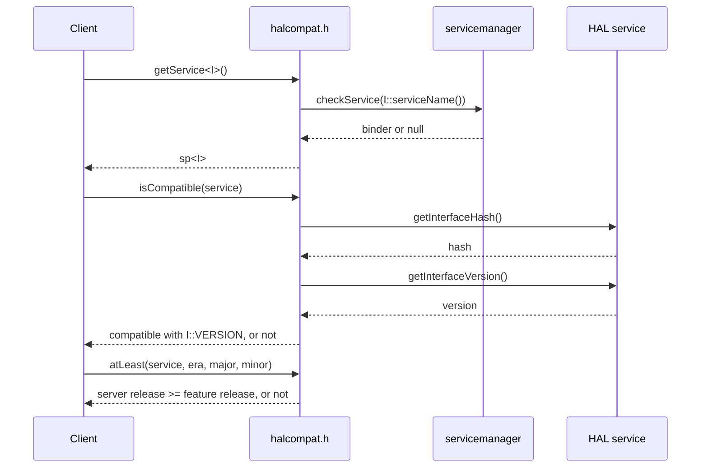

# HAL Compatibility Helper

`halcompat.h` is the header-only client adapter for RDK HAL AIDL services. A
client resolves a service and decides compatibility through it, and never calls
`getInterfaceVersion()` or `getInterfaceHash()` itself. The compatibility rules
it applies are defined in the
[AIDL Versioning Guide](../standards/versioning-guide.md#client-compatibility-checks);
the adapter pattern it implements is the
[Client Usage of Stable AIDL](../whitepapers/client_usage_of_stable_aidl.md)
whitepaper.



## Files

| Path | Role |
|---|---|
| `halcompat/current/halcompat.h` | In-development header. Staged by `./build_modules.sh all` at `out/build/include/halcompat/current/include/halcompat.h`. |
| `halcompat/<version>/include/halcompat.h` | Released copy, cut by `scripts/release.sh` with the rest of the cohort. Staged at `out/build/include/halcompat/<version>/include/halcompat.h`. |

No library is built. A client adds the `include/` directory above to its include
path and links the binder libraries it already uses (`libbinder`, `libutils`).

## API

All functions live in `namespace com::rdk::hal::halcompat` and take the
generated interface type `I` as their template parameter.

| Function | Returns | Behaviour |
|---|---|---|
| `getService<I>()` | `android::sp<I>` | Resolves `I::serviceName()` through `checkService()`. Null when the service is not registered; it does not wait. |
| `isCompatible(service, allowUnfrozen = false)` | `bool` | `false` for a null service or a failed hash RPC. A `"notfrozen"` hash returns `allowUnfrozen`. Otherwise applies the era predicate to the server's `getInterfaceVersion()` against the client's compiled `I::VERSION`. |
| `atLeast(service, era, major, minor = 0, bugfix = 0, allowUnfrozen = false)` | `bool` | `true` when the server's release is the named release or newer within the client's compatible range. Gates name additive releases: a cross-major gate in era 0 is never reached because `isCompatible()` fails first. |

```cpp
#include <halcompat.h>
#include <com/rdk/hal/bootreason/IBootReason.h>

using com::rdk::hal::bootreason::IBootReason;
namespace hc = com::rdk::hal::halcompat;

auto service = hc::getService<IBootReason>();
if (!hc::isCompatible(service)) {
    return;                              // absent, unfrozen, or incompatible
}
if (hc::atLeast(service, 0, 2, 1)) {     // release 0.2.1.0 added newMethod()
    service->newMethod();
}
```
