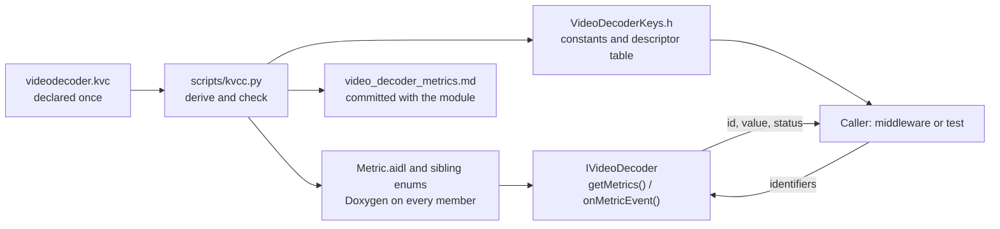

# Key Value Contracts

Every metric a HAL serves is declared once, in its module's Key Value Contract (KVC). `scripts/kvcc.py` generates the module's AIDL, its metrics documentation and its C constants from that declaration, and applies the same checks to every module. A metric's name, unit, meaning and identifier therefore cannot drift between modules, between code and documentation, or between SoCs.

## The problem

Metric definitions span many modules: video and audio decoders, sinks, the AV clock, DRM. Each repeats the same patterns — counters, units, `last_*` error fields, reason codes. Written by hand, they drift:

- One module declares milliseconds and another microseconds; one resets a counter on flush and another does not; one reports `-1` for "cannot measure" and another `0`.
- AIDL carries a name and a type. The unit, the kind, the reset behaviour, the allowed values and the definition a test asserts against live only in comments, where nothing checks them.
- The documentation is a third copy, maintained separately from the code it describes.

## What a contract declares

One file per module, `<module>/kvc/current/<module>.kvc`. Each key states:

| Field | Example | Purpose |
|---|---|---|
| `name` | `frames_decoded` | Composed with the domain and component into `av.video_decoder.frames_decoded` |
| `unit` | `frames` | Part of the key's identity |
| `kind` | `counter` | How it is read: `counter`, `current`, `high_water` or `config`; part of its identity |
| `description` | "Compressed frames the decoder has decoded…" | The definition a vendor implements and a test asserts; mandatory |
| `values` | `bitstream_error = 1`, … | The closed set of values a classification key carries |

Events — occurrences pushed at the instant they happen — are declared the same way, with the attributes that describe each occurrence. [`videodecoder.kvc`](https://github.com/rdkcentral/rdk-halif-aidl/blob/develop/videodecoder/kvc/current/videodecoder.kvc) is a complete example: seven keys and one event.

## How it works

1. **The identifier is derived, never allocated.** It is the first 8 bytes of SHA-256 over `<domain>.<component>.<name>|<unit>|<kind>`. There is no registry, and the module name in the path keeps one module's keys from colliding with another's. A product that serves a key in the wrong unit serves a different identifier, so the consumer sees a mismatch rather than a figure a thousand times wrong.
2. **The generator is the only author.** `kvcc.py` writes the AIDL enums, with each key's unit, kind and definition as its Doxygen comment, and the module's metrics page. Nobody edits either by hand.
3. **One check covers every module.** `kvcc.py` fails where two keys collide or a key has no definition; `kvcc.py --check` fails where committed AIDL or documentation has drifted from its declaration.
4. **Absence is a status, not a number.** Every value carries `SUPPORTED`, `NOT_SUPPORTED` or `NOT_AVAILABLE`; a product never reports `0` or `-1` for a figure it cannot measure.

A new key is one entry in the `.kvc`, a regeneration, and an additive member of the module's `Metric` enum.

## Options considered

| | Hand-written AIDL and docs | AIDL as the source | KVC as the source |
|---|---|---|---|
| Where unit, kind and meaning live | Comments | Annotations or comment conventions, invented and parsed | Structured fields |
| Checks across modules | Review by eye | A custom AIDL parser | One schema, one generator |
| Documentation matches code | By discipline | Partly generated | Generated from the same declaration |
| Up-front cost | None | A parser for AIDL plus conventions | A YAML schema and `kvcc.py` |

KVC wins because the facts that decide whether a metric is right — unit, kind, meaning, allowed values — are data a tool can check rather than prose a reviewer must read.

## Modules using it

| Module | Element | Keys | Events | Generated page |
|---|---|---|---|---|
| `videodecoder` | `av.video_decoder` | 7 | 1 | [video_decoder_metrics.md](https://github.com/rdkcentral/rdk-halif-aidl/blob/develop/videodecoder/current/docs/video_decoder_metrics.md) |
| `videosink` | `av.video_sink` | 19 | 4 | [video_sink_metrics.md](https://github.com/rdkcentral/rdk-halif-aidl/blob/develop/videosink/current/docs/video_sink_metrics.md) |
| `audiodecoder` | `av.audio_decoder` | 7 | 1 | [audio_decoder_metrics.md](https://github.com/rdkcentral/rdk-halif-aidl/blob/develop/audiodecoder/current/docs/audio_decoder_metrics.md) |
| `audiosink` | `av.audio_sink` | 9 | 4 | [audio_sink_metrics.md](https://github.com/rdkcentral/rdk-halif-aidl/blob/develop/audiosink/current/docs/audio_sink_metrics.md) |
| `avclock` | `av.clock` | 6 | 0 | [av_clock_metrics.md](https://github.com/rdkcentral/rdk-halif-aidl/blob/develop/avclock/current/docs/av_clock_metrics.md) |
| `drm` | `av.drm` | 3 | 0 | [drm_metrics.md](https://github.com/rdkcentral/rdk-halif-aidl/blob/develop/drm/current/docs/drm_metrics.md) |

The requirements every key is served under — single-instant sampling, monotonic counters, staleness bound, absence handling — are HAL.METRICS.1–19 in [metrics.md](metrics.md).
