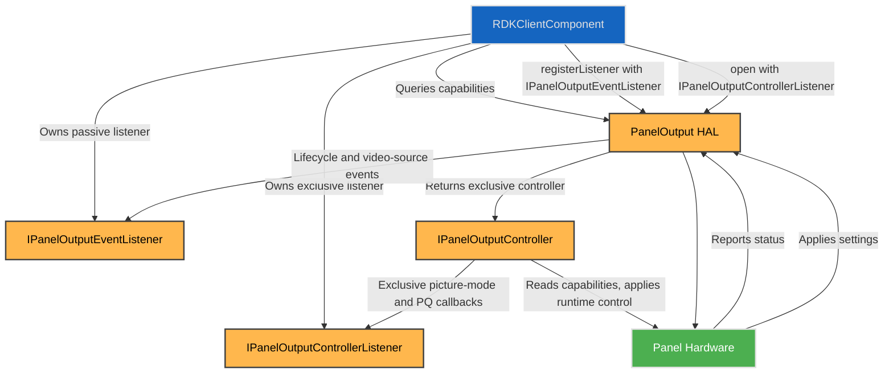
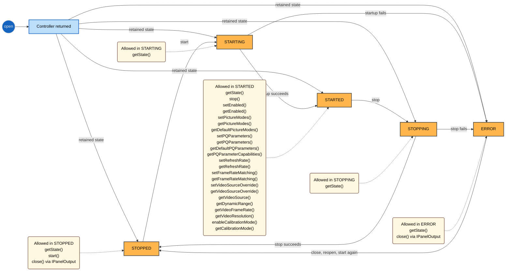

# Panel HAL Interface

## Overview

The Panel HAL provides a standardised interface to control and configure the display panel hardware on RDK platforms. It abstracts platform-specific display functions including resolution, panel type, picture quality parameters, white balance calibration, local dimming, and dynamic runtime controls such as picture modes, refresh rate management, and calibration mode.

This HAL enables higher-level components to dynamically adjust video output parameters and observe runtime panel behaviour through event callbacks.

To declare the static feature set and ensure alignment between implementation and testing, each platform must provide a **HAL Feature Profile (HFP)** YAML file. This machine-readable profile specifies the supported capabilities of the Panel HAL implementation, including available picture modes, PQ parameters, dynamic ranges, supported refresh rates, and supported AV sources. It is essential for test suites, middleware negotiation, and runtime validation.

---

## References

!!! info "References"
    |||
    |-|-|
    |**Interface Definition**|[panel/0.2.0.0](https://github.com/rdkcentral/rdk-halif-aidl/tree/0.23.0/panel/0.2.0.0)|
    |**Interface Version**|`0.2.0.0`|
    |**HAL Feature Profile**|`hfp-panel.yaml` – [Learn more](../key_concepts/hal/hal_feature_profiles.md)|
    |**HAL Interface Type**|[AIDL and Binder](../introduction/aidl_and_binder.md)|
    |**Initialization Unit**|[systemd](../vsi/systemd/current/systemd.md) – **hal-panel.service**|

---

## Related Pages

!!! tip "Related Pages"
    * [HAL Feature Profile](../key_concepts/hal/hal_feature_profiles.md)
    * [HAL Interface Overview](../key_concepts/hal/hal_interfaces.md)

---

## Functional Overview

The Panel HAL manages both static capabilities and dynamic runtime control of the display panel. It exposes:

* Panel hardware capabilities including resolution, physical size, panel type (LCD, OLED, QLED, Mini-LED), supported picture quality (PQ) parameters, refresh rates, picture modes, dynamic ranges, and AV sources.
* Picture quality configuration, including brightness, contrast, saturation, hue, gamma, local dimming, and noise reduction.
* White balance calibration through PQ parameters, with 2-point and multi-point entries scoped by picture mode, dynamic range, AV source, and colour temperature. The white-balance preset lists reuse the same platform-defined colour-temperature strings exposed through `Capabilities.supportedColourTemperatures`.
* Dynamic control over panel enable/disable, picture modes, frame rate matching, and calibration mode.
* Event callbacks for real-time updates on picture mode, PQ parameter, video source, dynamic range, resolution, frame rate, and refresh rate changes.

The corresponding `hfp-panel.yaml` file includes structured declarations for:

* `panelType`, `pixelWidth`, `heightCm`, etc. (from `Capabilities.aidl`, returned via `IPanelOutput.getCapabilities()`)
* `supportedColourTemperatures` (from `Capabilities.aidl`, using platform-defined strings)
* `supportedPQParameters` (from `PQParameter.aidl`)
* `pqParameterCapabilities`, including compact integer bounds with optional step values, Dolby Vision, 2-point WB, multi-point WB, grouped CMS, and preset-value shapes (from `PQParameterCapabilities.aidl`)
* `pictureModeCapabilities`, `supportedDynamicRanges`, and `supportedAVSources` (from `Capabilities.aidl` and `hfp-panel.yaml`)

---

## Implementation Requirements

| #               | Requirement                                                                                                                                    | Comments                                      |
| --------------- | ---------------------------------------------------------------------------------------------------------------------------------------------- | --------------------------------------------- |
| **HAL.PANEL.1** | The service shall expose accurate static capabilities including panel resolution, physical dimensions, and supported PQ parameters.            | Enables adaptive client configurations        |
| **HAL.PANEL.2** | The service shall support setting and querying of picture quality parameters per picture mode, AV source, and dynamic range format, including colour-temperature-scoped white balance entries. | Supports granular PQ control                  |
| **HAL.PANEL.3** | The service shall allow enabling/disabling panel output and backlight independently of lifecycle state, with no side effects.             |                                               |
| **HAL.PANEL.4** | The service shall provide asynchronous event callbacks for picture mode, PQ parameter, video source, dynamic range, frame rate, resolution, and refresh rate changes. | Ensures responsive UI/middleware updates      |
| **HAL.PANEL.5** | The service shall support frame rate matching with panel refresh rate adjustments.                                                             | Enables smooth video playback synchronisation |
| **HAL.PANEL.6** | The service shall support calibration mode and both 2-point and multi-point white balance through the runtime interfaces. | Supports panel tuning and diagnostics         |
| **HAL.PANEL.7** | The service shall expose current capabilities through the service interface and align runtime queries with HFP declarations.                    | Keeps implementation and HFP in sync          |

---

## Interface Definitions

| AIDL File                           | Description                                                  |
| ----------------------------------- | ------------------------------------------------------------ |
| `Capabilities.aidl`                   | Defines panel capabilities, supported picture modes, supported colour temperature strings, and typed panel sources |
| `ColourManagementSettings.aidl`       | Grouped CMS structure used for read-modify-apply colour-management updates |
| `ErrorCode.aidl`                      | Generic panel control result codes used by write-style controller APIs |
| `IPanelOutput.aidl`                   | Singleton entry point for opening and closing the panel      |
| `IPanelOutputController.aidl`         | Exclusive control interface for runtime panel operations     |
| `IPanelOutputControllerListener.aidl` | Exclusive picture-mode and PQ change callbacks               |
| `IPanelOutputEventListener.aidl`      | Passive event listener callbacks for runtime panel and lifecycle changes |
| `DimmingLevel.aidl`                   | Enumeration of local dimming levels |
| `DimmingMode.aidl`                    | Enumeration of local dimming modes |
| `DimmingSettings.aidl`                | Grouped local dimming mode and level settings |
| `PanelSource.aidl`                    | Typed string-based panel source identifier                   |
| `PQParameter.aidl`                    | Enumeration of supported picture quality parameters, including 2-point and multi-point white balance |
| `PQParameterCapabilities.aidl`        | Capabilities per PQ parameter by picture mode and dynamic range, including compact integer ranges, structured WB bounds, grouped CMS bounds, and preset values. For WB, numeric limits live in `rangeBound` while discrete colour temperatures live in `supportedValues`. |
| `PQParameterConfiguration.aidl`       | Bundled selector and value for a PQ parameter instance, including structured WB values |
| `PQParameterSelector.aidl`            | Query selector for PQ parameter, picture mode, dynamic range, and AV source |
| `PQParameterValue.aidl`               | Typed PQ parameter value union used by set/get operations and callbacks |
| `SDRGamma.aidl`                       | Enumeration of supported SDR gamma settings |
| `ToneMappingLevel.aidl`               | Enumeration of HDR tone-mapping levels |
| `ToneMappingMode.aidl`                | Enumeration of HDR tone-mapping modes |
| `ToneMappingSettings.aidl`            | Grouped HDR tone-mapping mode and level settings |
| `PictureModeConfiguration.aidl`       | Picture mode, dynamic range, and AV source config             |
| `State.aidl`                          | Panel controller lifecycle state enumeration                 |
| `TwoPointWB.aidl`                     | Two-point white balance calibration entry keyed by colour temperature with explicit RGB gain/offset fields |
| `WhiteBalanceMultiPointSettings.aidl` | Multi-point white balance calibration entry keyed by colour temperature with per-channel vectors |

---

## Initialization

The Panel HAL service is initialised early in the device boot process, registering itself with the system service manager under the name `"PanelOutput"`. The singleton `IPanelOutput` interface is used to query static capabilities and to open and close the exclusive controller, while `IPanelOutputController` exposes the runtime control operations. The event listener interfaces allow clients to subscribe for asynchronous updates, with `IPanelOutputControllerListener` used by the primary controller client for exclusive control notifications and `IPanelOutputEventListener` used by passive observers for runtime and lifecycle state changes.

---

## Product Customization

* `Capabilities` parcelable exposes physical dimensions, panel type, supported PQ parameters, refresh rates, supported picture modes, supported dynamic ranges, supported typed panel sources, and the supported colour temperature strings.
* Supports multiple picture modes, dynamic ranges, and AV sources, allowing flexible client-specific configurations.
* Platforms may expose multiple simultaneous picture modes or limit to a single active mode depending on hardware capability.

---

## System Context

---

## Resource Management

* Clients acquire the singleton service handle via binder connection to `PanelOutput`, then call `open()` to obtain the exclusive controller.
* Runtime control methods such as `start()`, `stop()`, `setEnabled()`, `setPictureModes()`, and `setPQParameters()` are issued through `IPanelOutputController`.
* 2-point and multi-point white balance are configured through `setPQParameters()` and queried through `getPQParameters()` using `PQParameter.TWO_POINT_WB` and `PQParameter.MULTI_POINT_WB`.
* Passive observers register `IPanelOutputEventListener` to receive video source, dynamic range, frame rate, resolution, refresh-rate, and lifecycle-state notifications.
* If the controller-owning client disconnects or crashes, the HAL releases exclusive ownership but retains the current panel state and latest stored configuration so a later client can reopen the controller and continue from `getState()`.

---

## Operation and Data Flow

* Client queries `IPanelOutput.getCapabilities()` for supported picture modes, PQ parameters, refresh rates, runtime limits, supported colour temperature strings, and typed panel sources.
* Picture mode configurations and PQ parameters are set via `setPictureModes()` and `setPQParameters()` once the controller is in `STARTED`. If `open()` returns a `STOPPED` controller, middleware reaches `STARTED` by calling `start()` first.
* The panel output enable state controls display and backlight through the controller and is orthogonal to controller lifecycle.
* Frame rate matching adjusts panel refresh rate dynamically to match video content.
* PQ parameter queries provide `PQParameterSelector` entries as input and receive `PQParameterConfiguration` entries as output so the returned values remain bundled with the selector context. Aggregate PQ parameters return their full payload in a single `PQParameterConfiguration` value.
* SDR gamma values are exchanged through `PQParameterValue` using the `sdrGamma` variant for `PQParameter.SDR_GAMMA`.
* Colour temperature values are exchanged through `PQParameterValue` using the `stringValue` variant for `PQParameter.COLOR_TEMPERATURE`.
* Dimming values are exchanged through `PQParameterValue`, using `dimmingSettings` for `PQParameter.DIMMING_SETTINGS`.
* Integer-backed PQ parameters may expose a compact `rangeBound.intBounds` representation with `minValue`, `maxValue`, and optional `stepValue` instead of enumerating every valid value.
* White balance values are exchanged through `PQParameterValue`, using aggregate array-backed variants for `PQParameter.TWO_POINT_WB` and `PQParameter.MULTI_POINT_WB` so the full set can be read or written in one shot.
* Tone-mapping values are exchanged through `PQParameterValue`, using `toneMappingSettings` for `PQParameter.TONE_MAPPING_SETTINGS`.
* `PQParameterCapabilities` associates supported dimming levels with each dimming mode through `rangeBound.dimmingSettingsCapabilities.modeLevelCapabilities`.
* `PQParameterCapabilities` associates supported tone-mapping levels with each tone-mapping mode through `rangeBound.toneMappingSettingsCapabilities.modeLevelCapabilities`.
* `TwoPointWB` entries carry one colour-temperature string together with explicit red, green, and blue gain/offset values; `PQParameterValue.twoPointWBSettings` carries the full array of these entries.
* `WhiteBalanceMultiPointSettings` entries carry one colour-temperature string and the per-channel arrays for that temperature; `PQParameterValue.multiPointWBSettings` carries the full array of these entries. `PQParameterCapabilities.supportedMultiPointWBValues` enumerates the same platform-defined colour-temperature strings used by `Capabilities.supportedColourTemperatures`.
* Calibration mode holds the non-calibration PQ pipeline in a neutral state, applies white-balance and calibration-targeted writes live for the active permutation, and defers unrelated PQ writes, including `SDR_GAMMA`, until calibration mode is disabled.
* Grouped CMS values can be exchanged through `PQParameter.COLOUR_MANAGEMENT_SETTINGS` to reduce write traffic while preserving read-modify-apply updates. The payload is one aggregate parcelable containing 18 integer fields: hue, saturation, and luminance for each of red, green, blue, yellow, cyan, and magenta, matching the flattened `ColourManagementSettings` parcelable.

### Calibration Workflow

Calibration mode is scoped to the active picture-mode, source, dynamic-range, and colour-temperature permutation.

1. The client ensures the controller is in `STARTED`, then selects the picture-mode, source, dynamic range, and colour temperature it wants to calibrate.
2. The client calls `enableCalibrationMode(true)`. The HAL snapshots the latest stored values for that active permutation, then forces the non-calibration PQ pipeline into a neutral state.
3. While calibration mode is enabled, `setPQParameters()` applies `TWO_POINT_WB`, `MULTI_POINT_WB`, and `DV_CALIBRATION` writes immediately for the active permutation so a tuning tool can measure the panel output live.
4. While calibration mode is enabled, non-calibration PQ writes, including `SDR_GAMMA`, are accepted and persisted, but they are not applied until calibration mode is disabled.
5. The client repeats measurement and adjustment as needed using the live calibration-targeted writes.
6. The client calls `enableCalibrationMode(false)`. The HAL exits neutral mode for the active permutation and resumes using the latest stored values for that permutation, including the stored `TWO_POINT_WB`, `MULTI_POINT_WB`, and `DV_CALIBRATION` values associated with the active picture mode, source, dynamic range, and colour temperature. Deferred non-calibration writes also become active at that point.

Repeated `enableCalibrationMode(true)` or `enableCalibrationMode(false)` calls are rejected while the controller is already in that state. The existing snapshot is retained and is not refreshed until calibration mode has been exited and entered again.

### Error Handling

The Panel HAL uses Binder exceptions for invalid arguments, null output parameters, and invalid lifecycle state. Boolean returns and `ErrorCode` values are used only after the request itself has been accepted as well-formed.

* `setPQParameters()` returns `ErrorCode.SUCCESS`, `INVALID_ARGUMENT`, `INVALID_STATE`, `NOT_SUPPORTED`, or `HARDWARE_FAILURE` for a valid call.
* `getPQParameters()` and `getDefaultPQParameters()` throw `EX_ILLEGAL_ARGUMENT` for malformed selectors or empty input, throw `EX_ILLEGAL_STATE` if the controller is not `STARTED`, and return `false` only when the selectors are valid but one or more values cannot be resolved. For `COLOUR_MANAGEMENT_SETTINGS`, `TWO_POINT_WB`, `MULTI_POINT_WB`, and `DV_CALIBRATION`, the returned `PQParameterValue` contains the complete aggregate payload for the resolved selector context rather than a single sub-entry.
* `getPictureModes()` and `getDefaultPictureModes()` follow the same pattern: exceptions for malformed input or invalid state, `false` only when valid criteria cannot be resolved.
* `start()` and `stop()` use `EX_ILLEGAL_STATE` for invalid transitions. A `false` return indicates a runtime or hardware failure after a valid transition request. If the panel remains in `ERROR` after `close()` and a fresh `open()`/`start()` attempt, the platform may need a full device reboot or power cycle to clear latched display hardware; treat that as a last-resort recovery action.

### Lifecycle Summary

1. Middleware binds `IPanelOutput` from the service manager.
2. Middleware reads `getCapabilities()` and optionally registers `IPanelOutputEventListener`.
3. Middleware calls `open()` to obtain the exclusive `IPanelOutputController`.
4. When `open()` returns, the panel may already be in any retained lifecycle state: `STOPPED`, `STARTING`, `STARTED`, `STOPPING`, or `ERROR`.
5. Middleware calls `getState()` and chooses the appropriate next action from the returned state rather than assuming a fresh `STOPPED` controller.
6. If the controller is `STOPPED`, middleware may call `start()`, then use `setEnabled()`, `setPictureModes()`, and `setPQParameters()` while `STARTED`.
7. If the controller is already `STARTED`, middleware may continue with `STARTED`-state operations directly.
8. `stop()` is only valid from `STARTED` and transitions `STARTED -> STOPPING -> STOPPED`.
9. `close()` is the normal release path from `STOPPED` and the recovery path from `ERROR`. If a close/open/start cycle does not clear `ERROR`, a platform reboot or power cycle may be required as a last resort.
10. If the controller-owning client dies, the HAL releases ownership but retains the last panel state and stored configuration. A replacement client reopens the controller, calls `getState()`, and continues from there.

### PQ Parameter Capability Mapping

The table below lists the capability shape expected for each `PQParameter` value in `PQParameterCapabilities`. A given parameter uses one primary capability form: either `rangeBound` for bounded or structured ranges, or `supportedValues` for explicit preset lists. If a parameter is unsupported, `isSupported` is `false` and the remaining fields are ignored.

For the preset-list entries, the union members are declared as `@nullable` arrays, so the array field itself may be omitted when no explicit presets are provided. In the Panel HFP examples, the common convention is to keep the field present and use an empty array to mean that the structured range exists but no discrete preset list is advertised.

`stepValue` is only defined on `rangeBound.intBounds` for simple integer-backed parameters. `RangeBound` is a general capability-bounds container and is not limited to a literal min/max pair. There is no generic step-value field for `DolbyVisionCalibrationSettings`, `TwoPointWBCapabilities`, `MultiPointWBCapabilities`, or `ColourManagementSettings`; those types are represented either by their own min/max bounds in `rangeBound` or by explicit preset arrays in `supportedValues`. The colour-temperature field itself is a discrete string and is advertised through `supportedValues.supportedStringValues` for `COLOR_TEMPERATURE` and through `supportedTwoPointWBValues` / `supportedMultiPointWBValues` for the WB parameters. For multi-point WB, the capability bounds are fixed per channel, not per calibration point. When the preset arrays are omitted or empty, clients should treat the structured bounds as the full supported numeric domain for that capability.

| PQParameter | Expected capability fields | Notes |
| --- | --- | --- |
| `BRIGHTNESS` | `rangeBound.intBounds` | Integer-backed control. |
| `CONTRAST` | `rangeBound.intBounds` | Integer-backed control. |
| `SHARPNESS` | `rangeBound.intBounds` | Integer-backed control. |
| `SATURATION` | `rangeBound.intBounds` | Integer-backed control. |
| `HUE` | `rangeBound.intBounds` | Integer-backed control. |
| `MANUAL_BACKLIGHT` | `rangeBound.intBounds` | Integer-backed control. |
| `SDR_GAMMA` | `supportedValues.supportedSdrGammaValues` | Explicit enum preset list. |
| `COLOR_TEMPERATURE` | `supportedValues.supportedStringValues` | String-backed preset list; use the same strings exposed by `Capabilities.supportedColourTemperatures`. `rangeBound` is not used. |
| `DIMMING_SETTINGS` | `rangeBound.dimmingSettingsCapabilities`, optionally `supportedValues.supportedDimmingSettingsValues` | Structured dimming mode/level capability plus optional concrete presets. |
| `LOW_LATENCY_STATE` | `rangeBound.intBounds` | Boolean-like integer control, usually `0` or `1`. |
| `MEMC` | `rangeBound.intBounds` | Integer-backed control. |
| `LOCAL_CONTRAST_LEVEL` | `rangeBound.intBounds` | Integer-backed control. |
| `MPEG_NOISE_REDUCTION` | `rangeBound.intBounds` | Integer-backed control. |
| `NOISE_REDUCTION` | `rangeBound.intBounds` | Integer-backed control. |
| `AI_PQ_ENGINE` | `rangeBound.intBounds` | Boolean-like integer control, usually `0` or `1`. |
| `AMBIENT_LIGHT_SENSOR_CONTROL` | `rangeBound.intBounds` | Boolean-like integer control, usually `0` or `1`. |
| `PRECISION_DETAIL` | `rangeBound.intBounds` | Integer-backed control. |
| `DV_CALIBRATION` | `rangeBound.dvCalibrationBounds`, optionally `supportedValues.supportedDvCalibrationValues` | Structured Dolby Vision calibration bounds plus optional concrete presets. |
| `TWO_POINT_WB` | `rangeBound.twoPointWBCapabilities`, optionally `supportedValues.supportedTwoPointWBValues` | Numeric gain/offset bounds for a WB preset; discrete colour temperatures are listed separately as strings and normally match `Capabilities.supportedColourTemperatures`. |
| `MULTI_POINT_WB` | `rangeBound.multiPointWBCapabilities`, optionally `supportedValues.supportedMultiPointWBValues` | Fixed per-channel bounds for a WB preset; discrete colour temperatures are listed separately as strings and normally match `Capabilities.supportedColourTemperatures`. |
| `DYNAMIC_CONTRAST_LEVEL` | `rangeBound.intBounds` | Integer-backed control. |
| `AISR` | `rangeBound.intBounds` | Integer-backed control. |
| `COLOUR_MANAGEMENT_SETTINGS` | `rangeBound.colourManagementSettingsBounds`, optionally `supportedValues.supportedColourManagementSettingsValues` | Structured grouped CMS bounds plus optional concrete presets. |
| `TONE_MAPPING_SETTINGS` | `rangeBound.toneMappingSettingsCapabilities`, optionally `supportedValues.supportedToneMappingSettingsValues` | Structured tone-mapping mode/level capability plus optional concrete presets. |

For capability consumers, the nested picture-mode scoping is always carried by `pqParamPictureModeCapabilities`, and each picture mode may further scope supported dynamic ranges and AV sources through `pqParamDynamicRangeCapabilities`.

---

## Modes of Operation

* Runtime picture modes configurable by client with dynamic range and typed panel-source scoping.
* 2-point and multi-point white balance entries configurable per picture mode, dynamic range, and AV source, with 2-point white balance carrying one aggregate RGB gain/offset set per colour temperature.
* Frame rate matching mode enabled/disabled by client.
* Calibration mode is available on the controller for PQ pipeline validation workflows, with live white-balance and calibration-targeted updates and deferred application of unrelated PQ writes.

---

## Event Handling

* `IPanelOutputControllerListener` provides exclusive control-linked callbacks:

  * `onPictureModeChanged`
  * `onPQParameterChanged`
* `IPanelOutputEventListener` provides passive runtime observation callbacks:

  * `onVideoSourceChanged`
  * `onDynamicRangeChanged`
  * `onVideoFrameRateChanged`
  * `onVideoResolutionChanged`
  * `onRefreshRateChanged`
  * `onStateChanged`

---

## State Machine / Lifecycle

The diagram below focuses on controller lifecycle state. `IPanelOutput.open()` may return a controller while the panel is already in any retained state, so middleware must call `getState()` first and then choose the appropriate next action. `IPanelOutput.close()` is the release and recovery path from `STOPPED` or `ERROR`.

* Typical states: `STOPPED`, `STARTING`, `STARTED`, `STOPPING`, `ERROR`.
* `open()` does not imply `STOPPED`; it may return a controller while the panel is in any retained lifecycle state, so middleware must call `getState()` first.
* `start()` is only valid from `STOPPED`; on success the controller transitions `STOPPED -> STARTING -> STARTED`.
* `stop()` is only valid from `STARTED`; on success the controller transitions `STARTED -> STOPPING -> STOPPED`.
* `setEnabled()` controls visible output while the controller remains `STARTED`; it does not replace `stop()` and may be used to represent light sleep or standby.
* Picture-mode control, PQ control, refresh-rate control, and calibration-mode control are valid only while `STARTED`.
* `getState()` returns the current lifecycle state and passive observers receive the same transitions through `IPanelOutputEventListener.onStateChanged()`.
* `IPanelOutput.close()` releases the controller from `STOPPED` or `ERROR`.
* If the owning client dies, ownership is released without forcing an automatic stop; the replacement client must reopen and inspect `getState()` before deciding whether to call `start()`, wait for an in-progress transition, continue with the existing runtime state, or recover from `ERROR`.

---

## Data Format / Protocol Support

| Format        | Use Case                | Support Level |
| ------------- | ----------------------- | ------------- |
| Picture Modes | Video display presets   | Mandatory     |
| PQ Parameters | Picture quality control | Mandatory     |
| White Balance | Colour-temperature-scoped 2-point and multi-point calibration values | Mandatory     |

---

## Platform Capabilities

* Supports platform-defined panel-type strings so vendors can expose informative values without revising an enum.
* Supports multiple refresh rates and frame rate matching.
* Supports string-based colour temperature presets that can be applied to both 2-point and multi-point white balance entries, reusing the same platform-defined strings exposed by `Capabilities.supportedColourTemperatures`.
* Supports advanced PQ parameters including AI PQ engine, grouped CMS settings, tone-mapping settings, and noise reduction.
* Supports compact numeric capability definitions with `minValue`, `maxValue`, and optional `stepValue` for regularly spaced integer controls.
* Supports calibration mode on the runtime controller.

---

## HAL Feature Profile Integration

Each platform must include `hfp-panel.yaml` to define the platform-specific implementation of this HAL. It includes:

* Static capabilities such as panel dimensions, panel type, refresh rates, supported AV sources, dynamic ranges, PQ parameters, and picture modes.
* Supported colour temperature string values aligned with the implementation-defined presets exposed by `Capabilities`.
* Lists of supported PQ parameters and picture modes.
* Capabilities of each PQ parameter per picture mode, panel source, and dynamic range, including compact `intBounds` with optional step values, grouped `dimmingSettingsCapabilities`, grouped `toneMappingSettingsCapabilities`, and structured `dvCalibrationBounds`, `twoPointWBCapabilities`, `multiPointWBCapabilities`, and `colourManagementSettingsBounds` shapes. For white balance, discrete colour temperatures are carried by the supported preset lists rather than the bounds parcelables, and multi-point WB uses fixed per-channel bounds rather than per-point bound arrays.
* Preset value lists where the domain is finite, using `supportedSdrGammaValues`, `supportedStringValues`, `supportedIntValues`, `supportedDimmingSettingsValues`, `supportedDvCalibrationValues`, `supportedTwoPointWBValues`, `supportedMultiPointWBValues`, `supportedColourManagementSettingsValues`, and `supportedToneMappingSettingsValues` as appropriate.
* Declared as structured sections aligned with the AIDL interfaces; panel capabilities are returned by `IPanelOutput.getCapabilities()`, while per-parameter capabilities are returned by `IPanelOutputController.getPQParameterCapabilities()`.

These files are machine-readable and used for:

* Platform validation via test automation.
* Runtime feature gating in middleware.
* Reference values for functions like `getCapabilities()`.

> See the [HAL Feature Profile documentation](../key_concepts/hal/hal_feature_profiles.md) for full details and schema format.

