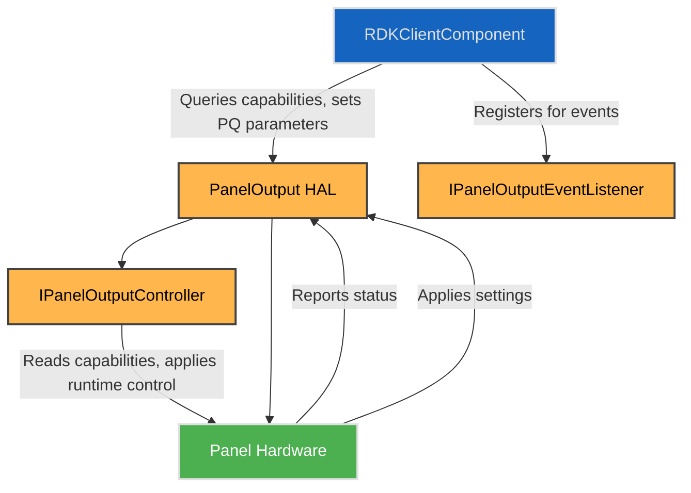

# Panel HAL Interface

## Overview

The Panel HAL provides a standardised interface to control and configure the display panel hardware on RDK platforms. It abstracts platform-specific display functions including resolution, panel type, picture quality parameters, white balance calibration, local dimming, and dynamic runtime controls such as picture modes, refresh rate management, and calibration mode.

This HAL enables higher-level components to dynamically adjust video output parameters and observe runtime panel behaviour through event callbacks.

To declare the static feature set and ensure alignment between implementation and testing, each platform must provide a **HAL Feature Profile (HFP)** YAML file. This machine-readable profile specifies the supported capabilities of the Panel HAL implementation, including available picture modes, PQ parameters, dynamic ranges, supported refresh rates, and supported AV sources. It is essential for test suites, middleware negotiation, and runtime validation.

---

## References

!!! info "References"
    |||
    |-|-|
    |**Interface Definition**|[panel/current](https://github.com/rdkcentral/rdk-halif-aidl/tree/main/panel/current)|
    |**Interface Version**|`current`|
    |**HAL Feature Profile**|[`hfp-panel.yaml`](https://github.com/rdkcentral/rdk-halif-aidl/blob/develop/panel/current/hfp-panel.yaml) – [Learn more](../key_concepts/hal/hal_feature_profiles.md)|
    |**HAL Interface Type**|[AIDL and Binder](../introduction/aidl_and_binder.md)|
    |**Initialization Unit**|[systemd](../vsi/systemd/current/systemd.md) – **hal-panel.service**|

---

## Related Pages

!!! tip "Related Pages"
    * [HAL Feature Profile](../key_concepts/hal/hal_feature_profiles.md)
    * [HAL Interface Overview](../key_concepts/hal/hal_interfaces.md)

---

## Functional Overview

The Panel HAL manages both static capabilities and dynamic runtime control of the display panel. It exposes:

* Panel hardware capabilities including resolution, physical size, panel type (LCD, OLED, QLED, Mini-LED), supported picture quality (PQ) parameters, refresh rates, picture modes, dynamic ranges, and AV sources.
* Picture quality configuration, including brightness, contrast, saturation, hue, gamma, local dimming, and noise reduction.
* White balance calibration through PQ parameters, with 2-point and multi-point entries scoped by picture mode, dynamic range, AV source, and colour temperature.
* Dynamic control over panel enable/disable, picture modes, frame rate matching, and calibration mode.
* Event callbacks for real-time updates on picture mode, PQ parameter, video source, dynamic range, resolution, frame rate, and refresh rate changes.

The corresponding [`hfp-panel.yaml`](https://github.com/rdkcentral/rdk-halif-aidl/tree/develop/panel/current/hfp-panel.yaml) file includes structured declarations for:

* `panelType`, `pixelWidth`, `heightCm`, etc. (from `Capabilities.aidl`, returned via `IPanelOutput.getCapabilities()`)
* `supportedColourTemperatures` (from `Capabilities.aidl`, using platform-defined strings)
* `supportedPQParameters` (from `PQParameter.aidl`)
* `pqParameterCapabilities`, including compact integer bounds with optional step values, Dolby Vision, 2-point WB, multi-point WB, grouped CMS, and preset-value shapes (from `PQParameterCapabilities.aidl`)
* `pictureModeCapabilities`, `supportedDynamicRanges`, and `supportedAVSources` (from `Capabilities.aidl` and `hfp-panel.yaml`)

---

## Implementation Requirements

| #               | Requirement                                                                                                                                    | Comments                                      |
| --------------- | ---------------------------------------------------------------------------------------------------------------------------------------------- | --------------------------------------------- |
| **HAL.PANEL.1** | The service shall expose accurate static capabilities including panel resolution, physical dimensions, and supported PQ parameters.            | Enables adaptive client configurations        |
| **HAL.PANEL.2** | The service shall support setting and querying of picture quality parameters per picture mode, AV source, and dynamic range format, including colour-temperature-scoped white balance entries. | Supports granular PQ control                  |
| **HAL.PANEL.3** | The service shall allow enabling/disabling panel output and backlight with no side effects.                                                    |                                               |
| **HAL.PANEL.4** | The service shall provide asynchronous event callbacks for picture mode, PQ parameter, video source, dynamic range, frame rate, resolution, and refresh rate changes. | Ensures responsive UI/middleware updates      |
| **HAL.PANEL.5** | The service shall support frame rate matching with panel refresh rate adjustments.                                                             | Enables smooth video playback synchronisation |
| **HAL.PANEL.6** | The service shall support calibration mode and both 2-point and multi-point white balance through the runtime interfaces. | Supports panel tuning and diagnostics         |
| **HAL.PANEL.7** | The service shall expose current capabilities through the service interface and align runtime queries with HFP declarations.                    | Keeps implementation and HFP in sync          |

---

## Interface Definitions

| AIDL File                           | Description                                                  |
| ----------------------------------- | ------------------------------------------------------------ |
| `Capabilities.aidl`                   | Defines panel capabilities, supported picture modes, supported colour temperature strings, and typed panel sources |
| `ColourManagementSettings.aidl`       | Grouped CMS structure used for read-modify-apply colour-management updates |
| `ErrorCode.aidl`                      | Generic panel control result codes used by write-style controller APIs |
| `IPanelOutput.aidl`                   | Singleton entry point for opening and closing the panel      |
| `IPanelOutputController.aidl`         | Exclusive control interface for runtime panel operations     |
| `IPanelOutputControllerListener.aidl` | Exclusive picture-mode and PQ change callbacks               |
| `IPanelOutputEventListener.aidl`      | Passive event listener callbacks for runtime panel and lifecycle changes |
| `PanelSource.aidl`                    | Typed string-based panel source identifier                   |
| `PQParameter.aidl`                    | Enumeration of supported picture quality parameters, including 2-point and multi-point white balance |
| `PQParameterCapabilities.aidl`        | Capabilities per PQ parameter by picture mode and dynamic range, including compact integer ranges, structured WB bounds, grouped CMS bounds, and preset values |
| `PQParameterConfiguration.aidl`       | Configuration value of PQ parameter for a mode/source/dynamic range, including structured WB values |
| `PictureModeConfiguration.aidl`       | Picture mode, dynamic range, and AV source config             |
| `State.aidl`                          | Panel controller lifecycle state enumeration                 |
| `TwoPointWB.aidl`                     | Two-point white balance calibration entry keyed by colour temperature and WB colour channel |
| `TwoPointWBColour.aidl`               | Enumeration of supported 2-point white balance colour channels |
| `WhiteBalanceMultiPointSettings.aidl` | Multi-point white balance calibration entry keyed by colour temperature |

---

## Initialization

The Panel HAL service is initialised early in the device boot process, registering itself with the system service manager under the name `"PanelOutput"`. The singleton `IPanelOutput` interface is used to query static capabilities and to open and close the exclusive controller, while `IPanelOutputController` exposes the runtime control operations. The event listener interfaces allow clients to subscribe for asynchronous updates, with `IPanelOutputControllerListener` used by the primary controller client for exclusive control notifications and `IPanelOutputEventListener` used by passive observers for runtime and lifecycle state changes.

---

## Product Customization

* `Capabilities` parcelable exposes physical dimensions, panel type, supported PQ parameters, refresh rates, supported picture modes, supported dynamic ranges, supported typed panel sources, and the supported colour temperature strings.
* Supports multiple picture modes, dynamic ranges, and AV sources, allowing flexible client-specific configurations.
* Platforms may expose multiple simultaneous picture modes or limit to a single active mode depending on hardware capability.

---

## System Context

---

## Resource Management

* Clients acquire the singleton service handle via binder connection to `PanelOutput`, then call `open()` to obtain the exclusive controller.
* Runtime control methods such as `start()`, `stop()`, `setEnabled()`, `setPictureModes()`, and `setPQParameters()` are issued through `IPanelOutputController`.
* 2-point and multi-point white balance are configured through `setPQParameters()` and queried through `getPQParameters()` using `PQParameter.TWO_POINT_WB` and `PQParameter.MULTI_POINT_WB`.
* Passive observers register `IPanelOutputEventListener` to receive video source, dynamic range, frame rate, resolution, refresh-rate, and lifecycle-state notifications.
* Cleanup occurs on client disconnect, with the controller implicitly released by the HAL.

---

## Operation and Data Flow

* Client queries `IPanelOutput.getCapabilities()` for supported picture modes, PQ parameters, refresh rates, runtime limits, supported colour temperature strings, and typed panel sources.
* Picture mode configurations and PQ parameters are set via `setPictureModes()` and `setPQParameters()` after `start()` succeeds.
* The panel output enable state controls display and backlight through the controller.
* Frame rate matching adjusts panel refresh rate dynamically to match video content.
* Colour temperature values are exchanged through `PQParameterConfiguration` using the `stringValue` variant for `PQParameter.COLOR_TEMPERATURE`.
* Integer-backed PQ parameters may expose a compact `rangeBound.intBounds` representation with `minValue`, `maxValue`, and optional `stepValue` instead of enumerating every valid value.
* White balance values are exchanged through `PQParameterConfiguration`, using `TwoPointWB` for `PQParameter.TWO_POINT_WB` and `WhiteBalanceMultiPointSettings` for `PQParameter.MULTI_POINT_WB`.
* `TwoPointWB` entries carry both a colour-temperature string and `TwoPointWBColour` so each gain and offset pair targets a specific colour-temperature preset and RGB channel.
* Calibration mode holds the PQ pipeline in a neutral state, persists requested PQ writes without applying them, and re-applies the saved values when calibration mode is disabled for the active picture-mode, source, dynamic-range, and colour-temperature permutation.
* Grouped CMS values can be exchanged through `PQParameter.COLOUR_MANAGEMENT_SETTINGS` to reduce write traffic while preserving read-modify-apply updates.

---

## Modes of Operation

* Runtime picture modes configurable by client with dynamic range and typed panel-source scoping.
* 2-point and multi-point white balance entries configurable per picture mode, dynamic range, and AV source, with 2-point white balance also scoped by colour temperature and WB colour channel.
* Frame rate matching mode enabled/disabled by client.
* Calibration mode is available on the controller for PQ pipeline validation workflows.

---

## Event Handling

* `IPanelOutputControllerListener` provides exclusive control-linked callbacks:

  * `onPictureModeChanged`
  * `onPQParameterChanged`
* `IPanelOutputEventListener` provides passive runtime observation callbacks:

  * `onVideoSourceChanged`
  * `onDynamicRangeChanged`
  * `onVideoFrameRateChanged`
  * `onVideoResolutionChanged`
  * `onRefreshRateChanged`
  * `onStateChanged`

---

## State Machine / Lifecycle

* Typical states: `STOPPED`, `STARTING`, `STARTED`, `STOPPING`, `ERROR`
* Transitions triggered via `start()` and `stop()` on `IPanelOutputController`
* Picture modes and PQ parameters are set after the controller has been started successfully
* `getState()` returns the current lifecycle state and passive observers receive the same transitions through `IPanelOutputEventListener.onStateChanged()`
* `IPanelOutput.close()` releases the controller from `STOPPED` or `ERROR`

---

## Data Format / Protocol Support

| Format        | Use Case                | Support Level |
| ------------- | ----------------------- | ------------- |
| Picture Modes | Video display presets   | Mandatory     |
| PQ Parameters | Picture quality control | Mandatory     |
| White Balance | Colour-temperature-scoped 2-point and multi-point calibration values | Mandatory     |

---

## Platform Capabilities

* Supports platform-defined panel-type strings so vendors can expose informative values without revising an enum.
* Supports multiple refresh rates and frame rate matching.
* Supports string-based colour temperature presets that can be applied to both 2-point and multi-point white balance entries.
* Supports advanced PQ parameters including AI PQ engine, AISR, grouped CMS settings, tone mapping, and noise reduction.
* Supports compact numeric capability definitions with `minValue`, `maxValue`, and optional `stepValue` for regularly spaced integer controls.
* Supports calibration mode on the runtime controller.

---

## HAL Feature Profile Integration

Each platform must include a [hfp-panel.yaml](https://github.com/rdkcentral/rdk-halif-aidl/tree/develop/panel/current/hfp-panel.yaml) to define the platform-specific implementation of this HAL. It includes:

* Static capabilities such as panel dimensions, panel type, refresh rates, supported AV sources, dynamic ranges, PQ parameters, and picture modes.
* Supported colour temperature string values aligned with the implementation-defined presets exposed by `Capabilities`.
* Lists of supported PQ parameters and picture modes.
* Capabilities of each PQ parameter per picture mode, panel source, and dynamic range, including compact `intBounds` with optional step values, `dimmingLevelCapabilities`, and structured `dvCalibrationBounds`, `twoPointWBBounds`, `multiPointWBBounds`, and `colourManagementSettingsBounds` shapes.
* Preset value lists where the domain is finite, using `supportedStringValues`, `supportedIntValues`, `supportedDvCalibrationValues`, `supportedTwoPointWBValues`, `supportedMultiPointWBValues`, and `supportedColourManagementSettingsValues` as appropriate.
* Declared as structured sections aligned with the AIDL interfaces; panel capabilities are returned by `IPanelOutput.getCapabilities()`, while per-parameter capabilities are returned by `IPanelOutputController.getPQParameterCapabilities()`.

These files are machine-readable and used for:

* Platform validation via test automation.
* Runtime feature gating in middleware.
* Reference values for functions like `getCapabilities()`.

> See the [HAL Feature Profile documentation](../key_concepts/hal/hal_feature_profiles.md) for full details and schema format.

