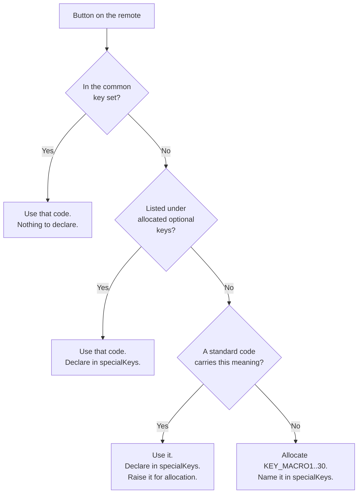

# Common Key Set

## Document History

|Date|Author|Comments|
|----|------|--------|
|2026-09-22|G.Weatherup|Initial definition, version 1|

!!! warning "Draft Document"
    This document is currently in **draft form** and under active discussion. Specifications, examples, and recommendations may change based on review feedback and implementation experience.

## References

!!! info References
    |||
    |-|-|
    |**Defines**| `commonKeySet.version` referenced by `hfp-linuxinput.yaml` |
    |**Parent specification**| [Linux Input](linux_input.md) |
    |**Code namespace**| `linux/input-event-codes.h`, kernel baseline |
    |**Responsibility**| OEM produces; RDK consumes |
    |**Validation**| `VSI.LINUXINPUT.2`, `.20`, `.21`, `.22` |

## Purpose

This document is the authoritative definition of the common key set referenced by `hfp-linuxinput.yaml` as `commonKeySet.version`. It fixes, for every RDK platform, which `KEY_*` code each remote button produces at the evdev device node.

A consumer written against this set works unmodified on any RDK product. A platform that cannot produce a key in it declares the omission with a reason; a platform whose remotes carry a button outside it declares the addition. Neither is silent.

Decimal and hexadecimal values are given because both appear in reference material and the two are routinely confused. The name is normative; the values are the name's definition in the kernel baseline and are stated so a mapping can be checked without a build.

## Choosing a code for a button



A platform never invents a code. `VSI.LINUXINPUT.2` and `.3` prohibit codes outside `linux/input-event-codes.h` and prohibit the vendor-private range, because a code outside the header cannot be carried by Wayland or interpreted by an application.

## Common key set, version 1

Every platform produces every key below, except where an omission is declared in `hfp-linuxinput.yaml` under `omittedKeys` with a reason, per `VSI.LINUXINPUT.20`.

**Power and audio**

|Button|Code|Decimal|Hex|
|------|----|-------|---|
|Power|`KEY_POWER`|116|`0x74`|
|Volume up|`KEY_VOLUMEUP`|115|`0x73`|
|Volume down|`KEY_VOLUMEDOWN`|114|`0x72`|
|Mute|`KEY_MUTE`|113|`0x71`|

**Channel**

|Button|Code|Decimal|Hex|
|------|----|-------|---|
|Channel up|`KEY_CHANNELUP`|402|`0x192`|
|Channel down|`KEY_CHANNELDOWN`|403|`0x193`|

**Navigation**

|Button|Code|Decimal|Hex|
|------|----|-------|---|
|Up|`KEY_UP`|103|`0x67`|
|Down|`KEY_DOWN`|108|`0x6c`|
|Left|`KEY_LEFT`|105|`0x69`|
|Right|`KEY_RIGHT`|106|`0x6a`|
|Select / OK|`KEY_ENTER`|28|`0x1c`|
|Back|`KEY_BACK`|158|`0x9e`|
|Home|`KEY_HOMEPAGE`|172|`0xac`|
|Exit|`KEY_EXIT`|174|`0xae`|
|Page up|`KEY_PAGEUP`|104|`0x68`|
|Page down|`KEY_PAGEDOWN`|109|`0x6d`|

Select is `KEY_ENTER`, not `KEY_OK` (`0x160`). `KEY_ENTER` is the code the browser's Wayland-to-JavaScript mapping resolves to JavaScript `13`; `KEY_OK` has no mapping there, so a platform emitting it produces a select that no web application receives.

**Menus and information**

|Button|Code|Decimal|Hex|
|------|----|-------|---|
|Menu|`KEY_MENU`|139|`0x8b`|
|Options / burger|`KEY_CONTEXT_MENU`|438|`0x1b6`|
|Info|`KEY_INFO`|358|`0x166`|
|Guide|`KEY_EPG`|365|`0x16d`|
|Plus — add or remove a favourite|`KEY_NEW`|181|`0xb5`|
|Voice|`KEY_VOICECOMMAND`|582|`0x246`|

**Media transport**

|Button|Code|Decimal|Hex|
|------|----|-------|---|
|Play / pause|`KEY_PLAYPAUSE`|164|`0xa4`|
|Fast forward|`KEY_FASTFORWARD`|208|`0xd0`|
|Rewind|`KEY_REWIND`|168|`0xa8`|
|Record|`KEY_RECORD`|167|`0xa7`|

A product with no recording function declares `KEY_RECORD` under `omittedKeys`.

Play and pause are one button and one code. A remote with separate transport buttons uses `KEY_PLAY` (207, `0xcf`) and `KEY_PAUSE` (119, `0x77`) and declares both under `specialKeys`; it still produces `KEY_PLAYPAUSE` for the combined button if it has one.

**Numeric**

|Button|Code|Decimal|Hex|
|------|----|-------|---|
|1|`KEY_1`|2|`0x02`|
|2|`KEY_2`|3|`0x03`|
|3|`KEY_3`|4|`0x04`|
|4|`KEY_4`|5|`0x05`|
|5|`KEY_5`|6|`0x06`|
|6|`KEY_6`|7|`0x07`|
|7|`KEY_7`|8|`0x08`|
|8|`KEY_8`|9|`0x09`|
|9|`KEY_9`|10|`0x0a`|
|0|`KEY_0`|11|`0x0b`|

These are the keyboard digit codes, not `KEY_NUMERIC_0`..`KEY_NUMERIC_9` (`0x200`..`0x209`). The keyboard codes are the ones the browser's Wayland-to-JavaScript mapping carries; the numeric-pad codes resolve to nothing above the compositor.

**Colour**

|Button|Code|Decimal|Hex|
|------|----|-------|---|
|Red|`KEY_RED`|398|`0x18e`|
|Green|`KEY_GREEN`|399|`0x18f`|
|Yellow|`KEY_YELLOW`|400|`0x190`|
|Blue|`KEY_BLUE`|401|`0x191`|

These four are the codes most often got wrong, and the failure is silent: a wrong colour code produces a working button that triggers the wrong function. Check a mapping against the values above and not against RDK reference pages, some of which carry the four rotated — `KEY_YELLOW` at `0x18e` and `KEY_RED` at `0x190`. A platform built from a rotated table emits `0x18e` for the button its own documentation calls yellow, and every standard consumer reads that as red.

Where a remote labels these buttons A, B, C and D rather than by colour, the label is a printed legend only. The code follows the function the button is bound to, not the letter.

## Allocated codes for optional buttons

These buttons are not on every remote. The code is fixed here so that two products carrying the same button do not choose differently. A platform carrying one declares it under `specialKeys` in `hfp-linuxinput.yaml`, per `VSI.LINUXINPUT.21`.

|Button|Code|Decimal|Hex|Applies to|
|------|----|-------|---|----------|
|TV input select|`KEY_VIDEO_NEXT`|241|`0xf1`|Products whose remote switches the TV's input source|
|Settings|`KEY_CONFIG`|171|`0xab`|Products with a dedicated settings button|
|Play|`KEY_PLAY`|207|`0xcf`|Remotes with separate transport buttons|
|Pause|`KEY_PAUSE`|119|`0x77`|Remotes with separate transport buttons|

A button that belongs here but is not listed is raised for allocation rather than chosen locally. Until it is allocated, the platform uses the standard code carrying that meaning and declares it under `specialKeys`.

## Reserved ranges

|Range|Reserved for|Rule|
|-----|-----------|----|
|`KEY_PROG1`..`KEY_PROG4` (148, 149, 202, 203)|Branded application launch|Which application each code launches is a product decision, declared by name under `specialKeys`. The codes are not used for anything else.|
|`KEY_MACRO1`..`KEY_MACRO30` (656..685)|Buttons with no standard semantic code|Allocated per `VSI.LINUXINPUT.22` and named under `specialKeys`. Allocation is per product and carries no meaning across products.|
|Vendor-private range|Nothing|Prohibited under `VSI.LINUXINPUT.3`. A code outside `linux/input-event-codes.h` cannot be carried by Wayland.|

A `KEY_MACRO*` allocation is a statement that no standard code fits. Where a standard code does fit, using `KEY_MACRO*` instead makes the button meaningless to every application that did not ship with the product.

## Declaring against this set

A platform states the version it implements, and states only its differences from that version:

```yaml
commonKeySet:
    version: 1

omittedKeys:
  - code: KEY_RECORD
    reason: "No record button on any remote shipped with this product"

specialKeys:
  - code: KEY_CONFIG
    name: "Settings"
    devices: [btRcu]
  - code: KEY_PROG1
    name: "Partner app launch"
    devices: [btRcu]
```

The set is never restated per platform. A platform that enumerates it has created a copy that will drift.

## Versioning

|Change|Effect|
|------|------|
|Adding a key to the common set|New version. Every platform must then produce it or declare the omission.|
|Allocating a code for an optional button|New version. No platform obligation changes.|
|Changing the code for a button already in the set|Not permitted. The button is retired and a new one added, so a consumer can tell the two apart.|

A consumer states the version it was written against. A consumer written against version *n* works on a platform declaring version *n* or later, because later versions only add.
