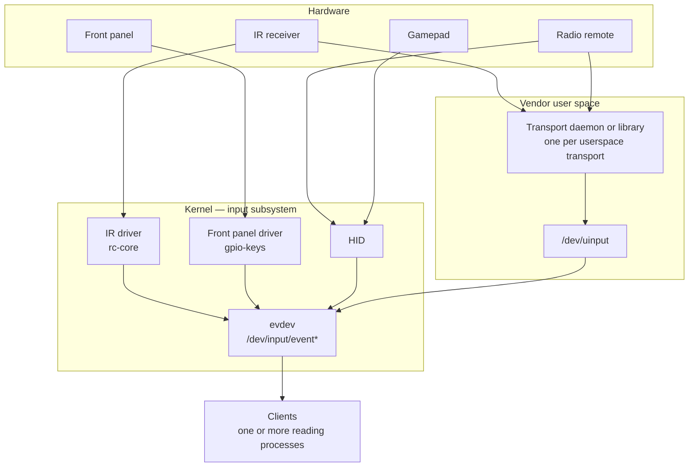
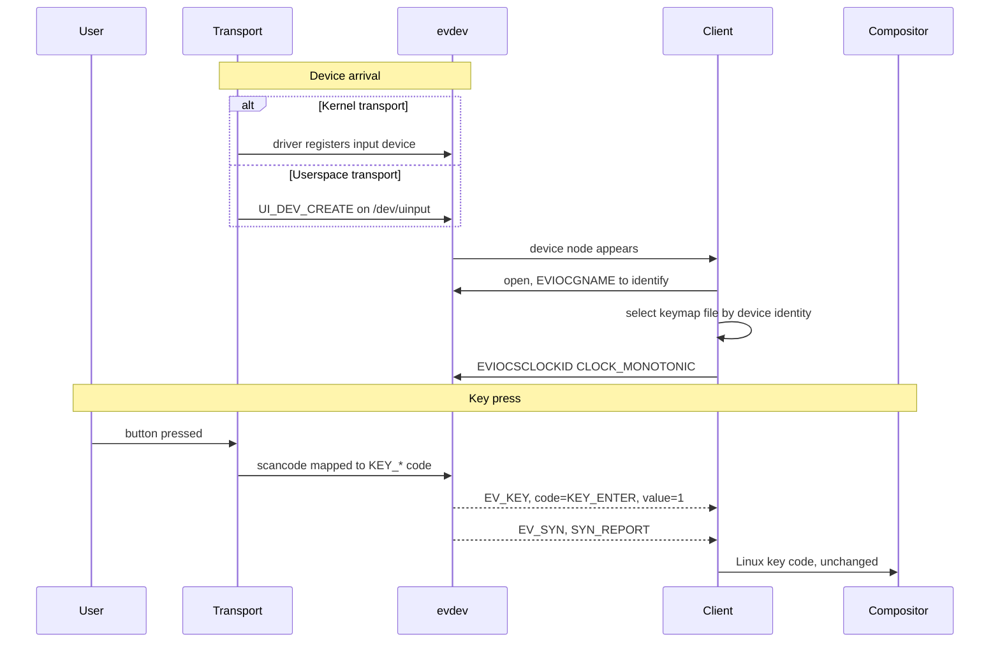

# Linux Input

## Document History

|Date|Author|Comments|
|----|------|--------|
|2026-09-21|G.Weatherup|Initial specification|
|2026-09-25|G.Weatherup|Common key set added; scope narrowed to the contract at the device node|

!!! warning "Draft Document"
    This document is currently in **draft form** and under active discussion. Specifications, examples, and recommendations may change based on review feedback and implementation experience.

## References

!!! info References
    |||
    |-|-|
    |**Upstream Project**| Linux kernel input subsystem, [Documentation/input](https://www.kernel.org/doc/html/latest/input/index.html) |
    |**Upstream Baseline**| See Upstream Baseline and Variance Policy |
    |**Responsibility**| OEM |
    |**Consumed By**| Any process reading evdev — see Access and Concurrency |
    |**Validation**| TBC |
    |**Reference Implementation**| TBD |

## Related Pages

!!! tip "Related Pages"
    - [Common Key Set](common_key_set.md)
    - [VSI Specification Template](../../../../docs/standards/vsi_template.md)
    - [Third-Party Build Integration](../../../../docs/standards/build_integration.md)
    - [Directory and Dynamic Linking Specification](../../../filesystem/current/docs/directory_and_dynamic_linking_specification.md)
    - [Deep Sleep](../../../../deepsleep/current/docs/deep_sleep.md)

## Purpose

This specification defines how user input reaches RDK on a platform. Whatever the transport — infrared, front panel, a radio remote, a gamepad — the vendor populates keys into the standard Linux input path, and the RDK stack and Wayland consume standard Linux key processing. There is no RDK-specific input channel.

Two things follow, and they are the substance of this document. The vendor exposes each transport as an evdev character device, created either by a kernel driver or through `uinput`. Every key it carries is a standard code from `linux/input-event-codes.h`, drawn from a common key set that is the same on every platform, with any platform-specific additions declared rather than assumed.

The vendor's obligation ends at the device node. What reads it, and how events are routed to applications, is middleware and out of scope. Voice capture, pairing state machines and application key routing are not covered here.

## Access and Concurrency

More than one process reads input at the same time. Which processes those are is middleware's business and changes; the access pattern the device must support does not, and that is what the vendor implements against.

|Property|Obligation on the device|
|--------|------------------------|
|Multiple readers|A node is opened by more than one process concurrently, and every reader receives every event. A device must not assume a single reader.|
|Exclusive grab|A client may take `EVIOCGRAB`, after which it alone receives events until it releases the grab or closes the descriptor. The kernel enforces this; a device must not work around it.|
|Descriptor hand-off|An open descriptor may be passed to another process, which then reads directly. Access travels with the descriptor, so no additional permission is needed by the receiving process.|
|Start ordering|Readers start both before and after devices appear. A device is not guaranteed a reader when it is created and must not depend on one.|
|Departure|A reader may close or crash at any time. That is not a device error, and any grab it held is released.|

## Upstream Baseline and Variance Policy

|Item|Value|
|----|-----|
|Upstream project|Linux kernel input subsystem (`evdev`, `uinput`, `rc-core`, `gpio-keys`)|
|Baseline version|**Decision required** — the platform kernel baseline is not stated in this repository. See Open Issues.|
|Source|Kernel tree supplied by the SOC vendor|
|Licence|GPL-2.0-only (kernel); userspace links only against the UAPI headers|

**Variance policy**

|Change|Policy|
|------|------|
|Presenting input through anything other than an evdev character device|**Prohibited.** A transport implemented in userspace injects through `uinput`; it does not invent a private channel.|
|Emitting key codes outside `linux/input-event-codes.h`|**Prohibited.** Every transport normalises to standard `KEY_*` codes before the event reaches evdev.|
|Modifying the SoC vendor's IR driver source to change the device name|**Discouraged.** Normalise with a udev rule instead, per `VSI.LINUXINPUT.6`. Patching the vendor driver creates a Vendor Layer maintenance burden or requires SoC vendor agreement.|
|Out-of-tree input drivers|**Permitted with declaration**, with source availability per the kernel's GPL obligations.|
|Downstream patches to `evdev`, `uinput` or `rc-core` that change observable behaviour|**Prohibited.**|
|Additional input devices beyond those declared|**Permitted.** Devices are enumerated by capability, not from a fixed list.|

## System Context



Everything converges on `/dev/input/event*`. Transports decoded in the kernel reach it directly; transports decoded in user space reach it by writing to `/dev/uinput`, which presents them as ordinary input devices.

This is what makes the contract tractable: a reader opens evdev and does not know or care which transport produced an event, or how many readers there are. It also means `uinput` is part of the vendor-facing contract, not an implementation detail.

## Injection Methods

A transport reaches evdev one of two ways. Which one a platform uses is an implementation choice; the obligations that follow from it are not.

|Method|Used when|Obligations|
|------|---------|-----------|
|Kernel driver|The transport is decoded in the kernel — `rc-core` for IR, `gpio-keys` for front panel, HID for USB and Bluetooth HID|The device registers during boot. Autorepeat is generated by the kernel. Key mapping comes from the device tree or the driver's keymap.|
|`uinput`|The transport is decoded in user space, by a daemon or a library|The injector declares device name, identity and capability bits at `UI_DEV_CREATE`, generates its own autorepeat, and terminates every report with `SYN_REPORT`. The node exists only while the injecting process lives, and is recreated with the same identity on restart.|

A device created through `uinput` must be indistinguishable from a kernel device to a reader. Making that true is the vendor's job, and it is why `VSI.LINUXINPUT.5`, `.9` and `.16` exist.

## Usage on the RDK Stack



A reader treats `EV_SYN`/`SYN_REPORT` as the event boundary and does not act on individual `EV_KEY` records in isolation, because a single remote action can produce several codes in one report.

## How Keys Move Through the System


The scancode-to-key-code mapping happens once per transport, and where it lives depends on the transport:

|Transport|Mapping source|
|---------|--------------|
|IR, kernel driver|Device tree blob|
|Front panel|Device tree, from the external input's key mapping|
|Any transport decoded in user space|The injector's own key mapping|
|HID|HID usage tables|

### The common key set

Keys are the same on every platform. A reader written against the common key set works on any RDK product, and that is the point of normalising at the device node rather than above it. The set itself is defined in [Common Key Set](common_key_set.md), which fixes the code for each button and is referenced by version from `hfp-linuxinput.yaml`.

Some remotes carry buttons that only exist on certain products. These are managed explicitly rather than allowed to vary silently: a platform declares what it adds, and what it cannot produce, in `hfp-linuxinput.yaml` alongside this document.

|Category|Rule|
|--------|----|
|Common key set|Identical on every platform. Referenced by version, never enumerated per platform, so it cannot drift.|
|Special keys|Buttons present only on this platform's remotes. Declared in the HFP, and still standard codes.|
|Omitted keys|A key in the common set this platform cannot produce. Declared with a reason.|

A special key is still a standard code. Where a button carries a recognised meaning, it uses the code for that meaning. Where it genuinely has no standard equivalent, it is allocated from `KEY_MACRO1`..`KEY_MACRO30` and named in the HFP. Vendor-private codes remain prohibited under any circumstances: a code outside the header cannot be carried by Wayland or interpreted by an application, so it is not a key, it is a dead button.

### Keymap override files

A second, optional mapping can be applied above evdev by a reader, using keymap files selected by device identity. These exist to correct devices that cannot be fixed at source. They are a workaround, not the intended path — the mapping belongs in the device tree or the injector — and a platform declares whether it depends on them in the HFP. The arrangement is not settled; see Open Issues.

```text
/etc/vendor/input/keymaps/<PMI>/Vendor_XXXX_Product_XXXX_Version_XXXX.keymap
/etc/vendor/input/keymaps/<PMI>/Vendor_XXXX_Product_XXXX.keymap
/etc/vendor/input/keymaps/<PMI>/INPUT_DEVICE_NAME.keymap
/etc/vendor/input/keymaps/Vendor_XXXX_Product_XXXX_Version_XXXX.keymap
/etc/vendor/input/keymaps/Vendor_XXXX_Product_XXXX.keymap
/etc/vendor/input/keymaps/INPUT_DEVICE_NAME.keymap
```

Files are tried most specific first. `Vendor` and `Product` are the device's identifiers from `EVIOCGID`; `PMI` selects a product variant; `INPUT_DEVICE_NAME` is the device's evdev name.

Above the reader, Wayland carries Linux input event codes unchanged, and each application maps them to its own key system. A key that is wrong at the evdev node is therefore wrong everywhere above it, which is why `VSI.LINUXINPUT.2` is a prohibition rather than a preference.

## Protocol and API Surface

|Protocol|Version|Transport|
|--------|-------|---------|
|evdev character device ABI|`EV_VERSION` 0x010001|`/dev/input/event*`, `/dev/input/rdk_ir`|
|`uinput` device creation ABI|`UINPUT_VERSION` 5|`/dev/uinput`|
|Input event codes|`linux/input-event-codes.h`, kernel baseline|Compile-time UAPI header|
|`rc-core` keymap and protocol control|sysfs|`/sys/class/rc/rc*`|

**Operations relied upon**

|Operation|Direction|Parameters|Returns|Errors|
|---------|---------|----------|-------|------|
|`read(2)`|Kernel → Client|Buffer of `struct input_event`|Count of bytes; whole events only|`EAGAIN` when non-blocking and no event pending; `ENODEV` once the device is removed|
|`EVIOCGID`|Client → Kernel|—|`struct input_id` — bustype, vendor, product, version|`ENOTTY` if not an evdev node|
|`EVIOCGNAME`|Client → Kernel|Buffer length|Device name string|Truncated silently if the buffer is short|
|`EVIOCGBIT`|Client → Kernel|Event type, buffer length|Bitmask of supported codes|—|
|`EVIOCGRAB`|Client → Kernel|1 to grab, 0 to release|Exclusive delivery to this client|`EBUSY` if another client already holds the grab|
|`EVIOCSCLOCKID`|Client → Kernel|`CLOCK_MONOTONIC`|Timestamp domain for subsequent events|`EINVAL` for an unsupported clock|
|`UI_DEV_SETUP`, `UI_DEV_CREATE`|Injector → Kernel|Device name, `input_id`, capability bits|A new evdev node|`EINVAL` for inconsistent capabilities|
|`EV_KEY`|Kernel → Client|`code` from `KEY_*`, `value` 0 release / 1 press / 2 autorepeat|—|—|
|`EV_SYN` / `SYN_REPORT`|Kernel → Client|—|Marks the end of one input report|—|
|`EV_SYN` / `SYN_DROPPED`|Kernel → Client|—|Client's buffer overran; client must resynchronise|—|

**Semantics not carried by the table**

- Events are delivered in order per device. Ordering between devices is not defined, and a reader must not infer one.
- `SYN_DROPPED` means events were lost. A reader must discard everything up to the next `SYN_REPORT` and re-read device state; ignoring it leaves stuck keys.
- `EVIOCGRAB` is held by one client at a time and is released when that file descriptor closes, including on client crash.
- Timestamps default to `CLOCK_REALTIME`, which steps when time is set. Readers set `CLOCK_MONOTONIC` before reading.
- Autorepeat (`value` 2) is generated by the kernel for `rc-core` and `gpio-keys`. A userspace injector generates its own, so repeat rate is not uniform across transports.
- A `uinput` device disappears when its creating process exits, and reappears as a new node when it restarts.

**Protocol assumptions**

- The IR RCU device is reachable at the fixed path `/dev/input/rdk_ir`, created by a Vendor Layer udev rule from the SoC-specific device name. Node numbering under `/dev/input/event*` is not stable across boots and is not relied upon.
- A reader identifies non-IR devices by reading the device name and identity from the file descriptor. This is explicitly not done for IR, which uses the fixed path.
- Devices may arrive and depart at any time. A radio remote's node exists only while it is connected.
- Node ownership and permissions are set by udev before any reader starts.

## Performance and Resource Budget

|Metric|Budget|Measured at|Source|
|------|------|-----------|-------|
|IR frame time, NEC protocol|67.5 ms for the first frame|Air|Protocol-imposed, cannot be reduced|
|IR repeat interval, NEC protocol|110 ms|Air|Protocol-imposed|
|Kernel decode to evdev availability|≤ 5 ms|`read()` on the input node|RDK requirement|
|Userspace injection to evdev availability|≤ 10 ms|`read()` on the input node|RDK requirement, applies to every `uinput` transport|
|Device node present after remote connects|≤ 1 s|udev settle|RDK requirement, `VSI.LINUXINPUT.12`|
|Key mapping in place|Before any reader starts|Unit ordering|RDK requirement, `VSI.LINUXINPUT.14`|

The end-to-end key-to-screen budget is not set here: it spans components this document does not own. What this document bounds is the path up to the device node.

Every process inserted into the key path adds a relay hop and its latency. Where that cost is unacceptable — a gamepad carried over IP, for instance — the platform passes the descriptor to the reader instead of relaying events, which is why descriptor hand-off is in Access and Concurrency rather than being an optional nicety.

When a budget is exceeded the visible failure is dropped or coalesced key presses: a reader that cannot keep up overruns its buffer, receives `SYN_DROPPED`, and any keys in flight are lost.

## Security and Threat Surface

**Assets.** Every key the user presses, including PIN entry for parental control and purchase confirmation. A process that can read an input device node has a keylogger; one that can write `/dev/uinput` can synthesise input indistinguishable from a real remote.

**Attack surface.**

|Entry point|Reachable by|Exposure|
|-----------|------------|--------|
|IR receiver|Anyone with line of sight|Unauthenticated, unpaired. Any IR source can inject any key in the keymap.|
|Radio transports|Anyone in radio range|Constrained by that transport's own pairing and authentication, not by the input subsystem|
|`/dev/input/*`|Any process with read permission|Full keystroke visibility|
|`/dev/uinput`|Any process with write permission|Arbitrary input injection|
|A vendor injector shipped as a library|Whatever can write the Vendor Layer|Where an injector is `dlopen`'d by another process, it runs with that process's privileges|

IR is the notable one: it is unauthenticated by design and cannot be made otherwise. Anything that must not be triggerable by an arbitrary IR transmitter — factory reset, purchase confirmation — needs a second factor above this layer, which this specification cannot provide.

`/dev/uinput` deserves equal attention precisely because this design depends on it. Every userspace transport writes to it legitimately, so it cannot simply be closed off; it must instead be restricted to those processes.

**Privilege boundaries.** A reader needs read access to the input nodes. An injector needs write access to `/dev/uinput`. Neither requires root.

**Secrets.** Input devices store none. Pairing state for a radio transport is held by that transport, not by the input subsystem.

**Isolation.** Device node permissions are the primary control, per `VSI.LINUXINPUT.7` and `.15`, with the Vendor Layer AppArmor profile confining the injecting processes.

**Upstream CVE classes.** Input drivers parse untrusted data from hardware, and HID descriptor parsing has a history of out-of-bounds reads. These are fixed in the kernel, so the update path is the platform kernel update.

## Licensing and Open-Source Obligations

- Kernel-side components are GPL-2.0-only. Userspace links only against UAPI headers carrying the `Linux-syscall-note` exception, so no copyleft obligation propagates to RDK userspace.
- Out-of-tree input drivers carry the kernel's GPL obligations, including a source offer for the binary as shipped.
- The daemons and libraries a platform chooses to decode transports in user space are the OEM's own deliverables. Their licences are declared with them and are not specified here.
- `NOTICE` credits any third-party component the platform actually ships in the input path.

## Certification and Regulatory

No certification obligation attaches to the Linux input subsystem itself. IR reception is passive and unregulated.

Obligations attach to the radio transports that feed it, held by the components owning those radios:

|Obligation|Body|Applies to|Who holds it|
|----------|----|----------|------------|
|Bluetooth qualification|Bluetooth SIG|Products shipping a Bluetooth remote|OEM, via [Bluetooth](../../../bluetooth/current/docs/bluetooth.md)|
|Radio conformance|Regional regulator|Products shipping any radio remote|OEM, via the component owning that radio|

Both gate shipping the product, not the input path.

## Responsibilities

|Item|SOC|OEM|RDK|
|----|---|---|---|
|Kernel input drivers and `CONFIG_*` symbols|✓|||
|IR receiver hardware and driver|✓|||
|Device tree key mapping for IR and front panel||✓||
|udev rule creating `/dev/input/rdk_ir`||✓||
|Userspace injectors for transports not decoded in the kernel||✓||
|`hfp-linuxinput.yaml`||✓||
|Keymap files, where required||✓||
|Reading input and delivering events to applications|||✓|
|The common key set definition|||✓|

## Implementation Requirements

|#|Requirement|Comments|
|-|-----------|--------|
|**VSI.LINUXINPUT.1**|Every input transport shall present its events through an evdev character device, whether created by a kernel driver or through `uinput`.|No transport may invent a private channel to a reader. This applies to every transport without exception, including any radio stack supplied as a vendor library.|
|**VSI.LINUXINPUT.2**|Every key event shall carry a code defined in `linux/input-event-codes.h` for the kernel baseline.|Capture every button on every supplied remote; any code outside the header fails.|
|**VSI.LINUXINPUT.3**|The vendor shall not allocate key codes in the vendor-private range for buttons that have a standard code.|Inspect the mapping at its source.|
|**VSI.LINUXINPUT.4**|Each input device shall report a stable, non-empty name and identity through `EVIOCGNAME` and `EVIOCGID`.|Identity selects the keymap file and distinguishes remotes; empty or duplicated identities fail.|
|**VSI.LINUXINPUT.5**|Each input device shall report accurate capability bits through `EVIOCGBIT`, listing every code it can emit and no code it cannot.|Applies equally to `uinput` devices, where the capabilities are declared by the injector.|
|**VSI.LINUXINPUT.6**|The Vendor Layer shall supply a udev rule creating `/dev/input/rdk_ir` as a symlink to the IR RCU input device.|The SoC-specific device name varies per vendor and node numbering is not stable. Example: `SUBSYSTEM=="input", ATTRS{name}=="aml_keypad", SYMLINK+="input/rdk_ir"`|
|**VSI.LINUXINPUT.7**|Input device nodes shall be readable by the processes that consume input and shall not be world-readable.|Input carries PINs; check node mode and ownership. More than one process reads a node — see Access and Concurrency.|
|**VSI.LINUXINPUT.8**|Every key press shall be followed by a matching release for the same code.|An unmatched press leaves a stuck key.|
|**VSI.LINUXINPUT.9**|Each input report shall be terminated by `EV_SYN`/`SYN_REPORT`.|Applies to userspace injectors, which must emit it explicitly.|
|**VSI.LINUXINPUT.10**|Devices shall support `EVIOCSCLOCKID` with `CLOCK_MONOTONIC`.|Stated so it is tested rather than assumed.|
|**VSI.LINUXINPUT.11**|A key code reported by the Deep Sleep HAL as a wake-up trigger shall equal the code the same button produces at runtime.|Cross-checks `HAL.DeepSleep.4` against the runtime mapping.|
|**VSI.LINUXINPUT.12**|A remote device node shall appear within 1 second of the remote connecting, and shall be removed on disconnect.|Bounds hotplug handling so it is testable.|
|**VSI.LINUXINPUT.14**|Key mapping shall be in place before any process reading input starts.|Keys pressed before mapping is available decode as `KEY_RESERVED` and are lost.|
|**VSI.LINUXINPUT.15**|Write access to `/dev/uinput` shall be restricted to the processes that inject input, and shall not be world-writable.|Every userspace transport depends on `uinput`, so it cannot be closed off — it must be restricted.|
|**VSI.LINUXINPUT.16**|A `uinput` device shall be recreated with the same name and identity after its creating process restarts.|Otherwise a reader cannot re-identify the device or reselect its keymap.|
|**VSI.LINUXINPUT.18**|The platform shall continue to operate with reduced function when an optional transport is absent.|An absent transport means that transport's keys are unavailable. It is not a failure to start.|
|**VSI.LINUXINPUT.19**|The vendor shall not run any input component as root.|Inspect the unit's `User=`.|
|**VSI.LINUXINPUT.20**|The platform shall produce every key in the declared common key set, except where an omission is declared in `hfp-linuxinput.yaml` with a reason.|A reader written against the common set must work unmodified on any product.|
|**VSI.LINUXINPUT.21**|Any key a remote produces that is outside the common key set shall be declared in `hfp-linuxinput.yaml` before the product ships.|An undeclared key is indistinguishable from a mapping fault.|
|**VSI.LINUXINPUT.22**|A button with no standard semantic code shall be allocated from `KEY_MACRO1`..`KEY_MACRO30` and named in `hfp-linuxinput.yaml`.|Keeps special keys inside the standard namespace so Wayland can carry them.|
|**VSI.LINUXINPUT.23**|`hfp-linuxinput.yaml` shall declare which transports the platform carries, and a declared transport shall be present.|Lets a reader know what to expect without probing.|

Numbers 13, 17 and 24 are retired and are not reused. Identifiers are stable, so the remaining requirements keep the numbers they were reviewed under.

## Configuration Surface

|Item|Type|Required value|Owner|
|----|----|--------------|-----|
|`CONFIG_INPUT_EVDEV`|Kernel config|`y`|SOC|
|`CONFIG_INPUT_UINPUT`|Kernel config|`y` or `m`|SOC|
|`CONFIG_RC_CORE`|Kernel config|`y`, where a kernel IR driver is used|SOC|
|`CONFIG_RC_DECODERS` and the per-protocol decoders|Kernel config|`y` for each protocol the remotes use|SOC|
|`CONFIG_KEYBOARD_GPIO`|Kernel config|`y`, where front-panel buttons are present|SOC|
|`CONFIG_HID_GENERIC`, `CONFIG_BT_HIDP`|Kernel config|`y`, where a HID remote is supported|SOC|
|`CONFIG_LIRC`|Kernel config|`y` on engineering images, so raw IR scancodes can be traced|SOC|
|`/etc/udev/rules.d/99-input-aliases.rules`|Config file|Rule creating `/dev/input/rdk_ir`|OEM|
|Device tree key mapping|Device tree|Standard `linux,code` per button|OEM|
|`hfp-linuxinput.yaml`|HAL Feature Profile|Transports carried, special keys, omitted keys|OEM|
|`/etc/vendor/input/keymaps/`|Config files|Keymap overrides, where required|OEM|
|`/sys/class/rc/rc*/protocols`|sysfs|The decode protocols in use|OEM|

## Interfaces to be Defined

|Interface|Status|Tracking|
|---------|------|--------|
|evdev and `uinput`|Defined, kernel ABI|—|
|`/dev/input/rdk_ir` naming convention|Defined here|`VSI.LINUXINPUT.6`|
|`hfp-linuxinput.yaml` schema|Defined here|`hfp-linuxinput.yaml`|
|Common key set|Defined|[common_key_set.md](common_key_set.md)|
|Keymap file format|**Required, undefined**|See Open Issues|
|`IDeepSleep` `KeyCode`|Defined|[deep_sleep.md](../../../../deepsleep/current/docs/deep_sleep.md)|

No AIDL interface is proposed for input. evdev is already a stable kernel ABI, and wrapping it in binder would add a relay hop without adding a contract.

## Build and Packaging

- Kernel-side components are part of the vendor kernel and are not packaged separately.
- Userspace injectors are Vendor Layer deliverables, placed and linked per the [Directory and Dynamic Linking Specification](../../../filesystem/current/docs/directory_and_dynamic_linking_specification.md). Where one is `dlopen`'d, it must be on the layer's linker path.
- Third-party components the platform ships in the input path are delivered into the `/vendor` layer under their own module directories, per [Third-Party Build Integration](../../../../docs/standards/build_integration.md).
- udev rules and keymap files are configuration, delivered through the layer's `etc` aggregation so a product can vary them without a rebuild.

## Third-Party Integration

1. Enable the kernel configuration in Configuration Surface for the transports the product carries, and confirm each presents a node under `/dev/input/`.
2. Supply the device tree key mappings for IR and front-panel buttons, using standard `linux,code` values.
3. Supply the udev rule creating `/dev/input/rdk_ir`, matching the SoC-specific device name.
4. For each transport decoded in user space, supply the injector and confirm it creates a `uinput` device with correct capabilities and a stable identity across restarts.
5. Complete `hfp-linuxinput.yaml`: transports carried, special keys, omitted keys, common key set version.
6. Verify against Validation, capturing every button on every supplied remote.
7. Declare back to RDK: kernel baseline, transports present, any out-of-tree drivers or injectors with licences and source availability, and every variance taken.

## Startup and Lifecycle

- Kernel input devices are created during boot; `uinput` devices are created when their injecting process starts, so they may appear after a reader has already enumerated.
- `systemd-udevd` must have settled its rules for `/dev/input/` before a reader starts, or it opens nodes with the wrong permissions and may not find `/dev/input/rdk_ir`.
- Key mapping must be in place before any reader starts, per `VSI.LINUXINPUT.14`.
- A `uinput` device is removed when its creating process exits and returns as a new node on restart, so readers re-open by identity rather than by path.

## Diagnostics and Debug

**Log sources.** The kernel input paths log to the kernel ring buffer, read through `journalctl -k`. `systemd-udevd` logs device creation and rule application under its own unit. Each vendor injector logs under its own identifier.

**Inspection commands.**

|Purpose|Command|
|-------|-------|
|List input devices, identities and capabilities|`cat /proc/bus/input/devices`|
|Confirm the normalised IR node exists|`ls -l /dev/input/rdk_ir`|
|Watch events from one device|`evtest /dev/input/rdk_ir`|
|Watch raw IR decode and the code each scancode maps to|`ir-keytable -t`|
|Show the loaded keymap and enabled protocols|`ir-keytable -r`|
|Watch device arrival and departure|`udevadm monitor --udev --subsystem-match=input`|
|Show the rules applied to a node|`udevadm info --attribute-walk --name=/dev/input/eventN`|
|Distinguish a `uinput` device from a kernel one|`udevadm info --name=/dev/input/eventN` and check the parent|

**Healthy baseline.** `/dev/input/rdk_ir` exists and points at the IR device. Each supplied remote appears in `/proc/bus/input/devices` with a non-empty name and a populated `KEY=` bitmask. `ir-keytable -t` shows a scancode and a resolved `KEY_*` name for every button. `evtest` shows a press, a release and a `SYN_REPORT` per button.

**Common failure modes.**

|Symptom|Distinguishing observation|Cause|
|-------|--------------------------|------|
|No events at all|Device absent from `/proc/bus/input/devices`|Driver or kernel config missing, or the injector did not start|
|Device appears after readers have enumerated|Node present but unused until a reader restarts|`uinput` injector started late|
|Device present, no events|Scancodes seen but no key names|Mapping not applied at its source|
|Some buttons dead|`KEY_RESERVED` for those buttons|Incomplete device tree or injector mapping|
|IR works on one product, not another|`/dev/input/rdk_ir` missing on the failing one|udev rule not supplied, `VSI.LINUXINPUT.6`|
|A transport's keys never arrive|No `uinput` device for that transport|Injector not delivered or failed to start|
|Only one reader receives events|Another client holds `EVIOCGRAB`|Expected — see Access and Concurrency|
|Stuck key|A press with no matching release in `evtest`|`SYN_DROPPED` mishandled, or the transport dropped the release|
|Wrong key after wake from deep sleep|Wake code differs from runtime code|Mapping mismatch, `VSI.LINUXINPUT.11`|
|Colour key triggers the wrong colour in an app|Compare the evdev code against `input-event-codes.h`|See Open Issues|

**Production constraints.** `evtest` and `ir-keytable` are engineering tools and need not ship on a production image, but a platform with neither cannot be diagnosed in the field. Raw IR scancode tracing requires `CONFIG_LIRC`; without it, mapping faults can only be diagnosed on an engineering image.

## Validation

|Requirement|Method|Test asset|
|-----------|------|----------|
|`VSI.LINUXINPUT.1`, `.4`, `.5`, `.10`|Enumerate input devices, query identity and capabilities, for kernel and `uinput` devices alike|TBC|
|`VSI.LINUXINPUT.2`, `.3`, `.8`, `.9`|Capture every button on every supplied remote and compare against the standard code set|TBC|
|`VSI.LINUXINPUT.6`|Confirm `/dev/input/rdk_ir` resolves to the IR device across two boots|TBC|
|`VSI.LINUXINPUT.7`, `.15`|Inspect node permissions on `/dev/input/*` and `/dev/uinput`|TBC|
|`VSI.LINUXINPUT.11`|Wake from deep sleep on a known button and compare the reported code against the runtime code|TBC|
|`VSI.LINUXINPUT.12`, `.16`|Connect and disconnect a remote; restart each injecting process|TBC|
|`VSI.LINUXINPUT.14`|Press a key during the boot window and confirm it decodes|TBC|
|`VSI.LINUXINPUT.18`|Remove each optional transport and confirm reduced function without failure to start|TBC|
|`VSI.LINUXINPUT.19`|Inspect the `User=` of each input component's unit|TBC|
|`VSI.LINUXINPUT.20`, `.21`, `.22`, `.23`|Compare every code produced against the common key set and the HFP declaration|TBC|

Concurrency is validated alongside these: open each node from two processes at once and confirm both receive every event, then take `EVIOCGRAB` from one and confirm exclusivity and release on close.

## Product Customization

- Transports present, and the number of remotes supported concurrently, vary by product. Devices are discovered by enumeration and capability bits, never assumed.
- Device tree mappings and keymap overrides vary by product. The key code namespace does not.
- Front-panel button count and function vary. Each is a standard code.

## Open Issues

|Issue|Owner|Tracking|
|-----|-----|--------|
|RDK Key Codes And Mappings documents all four colour keys rotated by two relative to `linux/input-event-codes.h` — `KEY_YELLOW` at `0x18e`, `KEY_BLUE` at `0x18f`, `KEY_RED` at `0x190`, `KEY_GREEN` at `0x191`, where the header has red, green, yellow, blue in that order. [Common Key Set](common_key_set.md) states the header values normatively; whether any shipped platform was built from the rotated table, and is mismapped end to end, is not established.|Architecture|To raise|
|The keymap file mechanism is described as largely a workaround and marked as needing revisit, and its file format is unspecified. A vendor cannot author one from documentation alone, and the search path has already moved once.|Architecture|To raise|
|[Common Key Set](common_key_set.md) version 1 is derived from the PRD for unified remote control key mapping, which leaves several buttons without a code. The codes allocated here for exit, page up and down, menu, options, voice, the digits, TV input select and settings are this document's proposal and are not yet ratified by the PRD owner.|Architecture|To raise|
|The common key set has no product-by-product evidence behind it: the PRD's per-product columns for Xumo, Glass, X1, SQY Q and XSB are empty, so which platforms can produce which keys is unverified and no platform has yet declared `omittedKeys`.|Architecture|To raise|
|The permitted pairing list for radio remotes was specified here and has been removed as out of scope. It needs a home in the component owning that radio, or it is lost.|Architecture|To raise|
|The third-party IR code-set database was specified here, including an agreed library name and ABI across suppliers. It controls consumer electronics by transmitting IR and does not arrive through the input subsystem, so it has been removed. It needs a home, and the cross-supplier ABI is a real interface that is now written down nowhere.|Architecture|To raise|
|Whether radio remotes should reach evdev through the kernel HID driver instead of userspace injection is an open question in the reference material.|Architecture|To raise|
|IR device naming is normalised by udev today, with an intent to align on a common device name longer term, which would make `VSI.LINUXINPUT.6` and the udev rule redundant.|Architecture|To raise|
|Platform kernel baseline version is unstated repository-wide, so the input event code set is unpinned.|Kernel_Architecture|To raise|
|Deep sleep wake behaviour is flagged as unresolved in the reference material, specifically which IR key codes are available on wake.|Architecture|To raise|
|`metadata.yaml` reviewers do not include any team that reads input.|Architecture|To raise|
